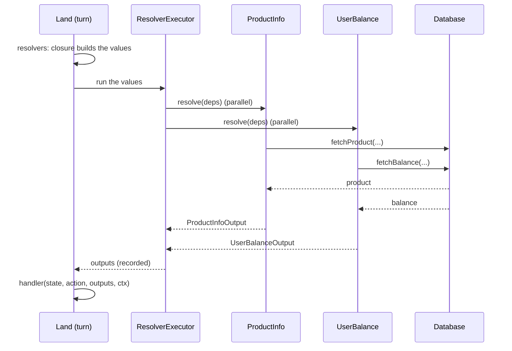

[English](resolver.md) | [中文版](resolver.zh-TW.md)

# Resolver Usage Guide

> A resolver loads data from outside the land (a database, a cache, a remote API) before a handler runs, so the handler itself stays synchronous.

## Overview

A resolver is a request for outside data, written as a small value. The land builds the value when it admits an input, runs it off the land's actor, and hands its result, the resolver's **output**, to the handler as a parameter.

Resolvers belong to actions (`HandleAction`), `CanJoin`, `OnJoin`, `OnLeave` and the lifecycle handlers `OnInitialize` and `OnFinalize`. Client events are fire-and-forget and take no resolvers: `HandleEvent` has no `resolvers:` parameter. `DestroyWhenEmpty(after:)` takes none either; its handler's executors (`onDestroyWhenEmptyResolverExecutors`) can be set only on `LandDefinition` directly.

- **Handlers stay synchronous.** A handler doesn't await; its data has arrived before it runs.
- **Parallel loading.** An entry's resolvers run in parallel.
- **One failure stops the handler.** Any resolver that throws skips the handler (see [Error Handling](#error-handling)).
- **Typed outputs.** The handler receives each output as a typed parameter, in the order the resolvers are declared.

Two forms exist today:

| Entries | Form |
|---|---|
| `HandleAction`, `OnInitialize`, `OnFinalize` | A `Resolver` value, built by the entry's `resolvers:` closure |
| `CanJoin`, `OnJoin`, `OnLeave` | A `ContextResolver` type, named by metatype (`resolvers: UserProfileResolver.self`) |

In both forms the handler gets the outputs as parameters. The join entries move to values later; until then, their resolvers read the join's context ([Join Resolvers](#join-resolvers)).

## Core Concepts

### A Resolver Is a Value

A resolver is a `@PlainData` struct that conforms to `Resolver`. Its stored fields are its parameters. `resolve` reads only those fields and the land's services, and returns the output.

```swift
protocol HasProductDatabase: Sendable {
    var productDatabase: ProductDatabase { get }
}

@PlainData
struct ProductInfo<D: HasProductDatabase>: Resolver {
    typealias Dependencies = D
    let productID: String

    func resolve(_ deps: D) async throws -> ProductInfoOutput {
        let data = try await deps.productDatabase.fetchProduct(by: productID)
        return ProductInfoOutput(id: data.id, name: data.name, price: data.price, stock: data.stock)
    }
}
```

- **`Dependencies`** is what `resolve` may use. It is the land's services type, the one given to `Land(_:using:services:)`, or `NoServices` for a land without services. A resolver generic over a capability protocol (`D: HasProductDatabase`) works in every land whose services conform to it. In a land whose services lack the capability, the declaration doesn't compile.
- **`@PlainData`** checks the fields at compile time: no class, closure, `Date`, `UUID`, `URL` or `Any` ([plain data](../turns/README.md#what-counts-as-plain-data)). A resolver can't carry a reference to the land's state.
- **No state access.** `resolve` runs off the land's actor. It can't read the State; whatever it needs from the State, the land copies into a field when it builds the value.

### Services

A land with services declares their type, and the server is given a value of it when the land type is registered:

```swift
struct ShopServices: HasProductDatabase {
    let productDatabase: ProductDatabase
}

let shop = Land("shop", using: ShopState.self, services: ShopServices.self) {
    Rules { ... }
}

try await host.register(
    landType: "shop",
    land: shop,
    services: { _, _ in ShopServices(productDatabase: database) },
    initialState: ShopState(),
    webSocketPath: "/game/shop",
    configuration: NIOLandServerConfiguration()
)
```

`Land(_:using:services:)` returns a `TypedLand<State, Services>`. Its `definition` is the plain `LandDefinition`. A land with services must be registered through the typed overload, which takes the services factory. Registering its bare `definition` is refused: `LandRegistrationError` names the services type and says none were given. A `LandKeeper` built in a test takes the value directly: `LandKeeper(land: shop, resolverServices: ShopServices(...), initialState: ShopState())`.

### ResolverOutput

A resolver's output conforms to `ResolverOutput` and carries `@PlainData`, with the same field rules as the resolver.

```swift
@PlainData
struct ProductInfoOutput: ResolverOutput {
    let id: String
    let name: String
    let price: Int
    let stock: Int
}
```

The output is recorded, so a replay hands the handler the same output without calling `resolve` again.

## Usage

### Using in an Action Handler

The entry's `resolvers:` closure builds the value from the State, the action and a read-only context. The handler gets the output after the action:

```swift
Rules {
    HandleAction(AddToCartAction.self, resolvers: { _, action, _ in
        ProductInfo(productID: action.productID)
    }) { state, action, product, ctx in
        guard let product, product.stock > 0 else {
            return AddToCartResponse(success: false, message: "Out of stock")
        }
        state.cart.items.append(CartItem(productID: product.id, name: product.name, price: product.price))
        return AddToCartResponse(success: true)
    }
}
```

The output parameter is optional. It is `nil` when the closure built no value (see below); otherwise the handler runs only after the resolver succeeded.

### When the Closure Runs

The closure runs once, in the turn that admits the input: before the resolvers start, with the State as it is at that moment. A change to the State while the resolvers run doesn't reach the value. The closure reads; it can't write the State (it gets it as a constant), and its context has no random source.

An action's closure runs before the [action caps](#actions-with-resolvers) are checked, so it also runs for an action the caps then refuse. Replay doesn't run it: replay reads the outputs the record holds. So the closure must not change anything. The compiler stops it from writing the State, but not from calling code that has effects, or from changing a State that holds a reference. Such an effect would happen for a refused action too, and replay would neither undo it nor repeat it.

The closure may return `nil`. Then nothing is fetched, and the handler gets `nil` for that output. An action whose closure returns `nil` for every resolver has nothing to wait for: it is handled like an action without resolvers, and the action caps don't count it. Use `nil` to skip a load the State already answers:

```swift
HandleAction(AddToCartAction.self, resolvers: { state, action, _ in
    state.productCache[action.productID] == nil ? ProductInfo(productID: action.productID) : nil
}) { state, action, fetched, _ in
    guard let product = fetched ?? state.productCache[action.productID] else {
        return AddToCartResponse(success: false)
    }
    ...
}
```

An action whose closure built no value is applied in order with the inputs that don't wait. So it can be applied before an earlier action of the same type that is still waiting for its resolvers.

### Multiple Resolvers

The closure returns a tuple. The resolvers run in parallel, and the handler gets a tuple of optional outputs in the same order:

```swift
HandleAction(PurchaseAction.self, resolvers: { _, action, ctx in
    (ProductInfo(productID: action.productID), UserBalance(playerID: ctx.playerID))
}) { state, action, resolved, _ in
    guard let product = resolved.0, let balance = resolved.1 else {
        return PurchaseResponse(success: false)
    }
    ...
}
```

An action takes one or two resolvers; `OnInitialize`, `OnFinalize` and the join entries take one to three. Two resolvers in one entry whose outputs have the same name are refused at registration, because the record names each output ([Output Names](#output-names)). That covers two of the same base type (`ProductInfo` twice), and also `Price` and `PriceResolver`, whose outputs are both named `price`.

### Two-Phase Handlers

With `validate` and `apply` ([Two-Phase Handlers](land-dsl.md#two-phase-handlers)), both stages get the outputs, after the action and before the plan:

```swift
HandleAction(AdminAction.self, resolvers: { _, _, ctx in UserPermission(playerID: ctx.playerID) },
    validate: { _, _, permission, _ in
        guard let permission, permission.isAdmin else { throw AdminError.adminRequired }
    },
    apply: { state, action, _, ctx in
        AdminResponse()
    })
```

### Lifecycle Handlers

`OnInitialize`'s closure gets the initial State and a read-only context (`ctx.landID`). `OnFinalize`'s gets the final State and a read-only context. Each body gets its output after the State, then a `LandContext`:

```swift
Lifetime {
    OnInitialize(resolvers: { _, ctx in RoomConfig(roomID: ctx.landID) }) { state, config, _ in
        state.maxPlayers = config?.maxPlayers ?? 4
    }
    OnFinalize(resolvers: { state, ctx in SaveResults(landID: ctx.landID, scores: state.scores) }) { _, _, _ in }
}
```

Limit: in `OnInitialize`, `ctx.metadata` is empty. The land's creation metadata doesn't reach it.

### Join Resolvers

`CanJoin`, `OnJoin` and `OnLeave` still name `ContextResolver` types. A `ContextResolver` reads the join's context: `ctx.playerID`, `ctx.landID`, `ctx.currentState` and `ctx.services`. The land's generator isn't in `ctx.services`: replay doesn't run resolvers, so a resolver's draw would move it live only (#765). A resolver that needs randomness brings its own generator; its output is recorded like any other.

```swift
struct UserProfileResolver: ContextResolver {
    typealias Output = UserProfile

    static func resolve(ctx: ResolverContext) async throws -> UserProfile {
        try await profileStore.load(ctx.playerID)
    }
}

Rules {
    OnJoin(resolvers: UserProfileResolver.self) { state, profile, ctx in
        state.players[ctx.playerID] = PlayerState(name: profile?.name ?? "Guest")
    }
}
```

The handler gets the output as a parameter, as for a value: after the State for `OnJoin` and `OnLeave`, after the session for `CanJoin` (`{ state, session, profile, ctx in … }`).

## Execution Flow

### Parallel Execution

All of an entry's resolvers run in parallel:



### Execution Order

1. **Build.** In the turn that admits the input, the `resolvers:` closure builds the values. A `nil` value is skipped.
2. **Run.** The values' `resolve(_:)` run in parallel, off the land's actor, with the land's services.
3. **Collect.** The land waits for every resolver, then records the outputs.
4. **Handle.** In a later turn, the handler runs with the outputs as parameters.

### Output Names

The record names each output after its resolver's base type, without generic arguments: `ProductInfo<ShopServices>` is recorded as `productInfo`, and `UserProfileResolver` as `userProfile` (a `Resolver` suffix is dropped, and the first letter lowercased). Errors name the base type: `ResolverExecutionError.resolverFailed(name: "ProductInfo", …)`.

## Error Handling

### Resolver Errors

When resolver execution fails:

1. **All resolvers cancelled**: If any resolver fails, other parallel resolvers are automatically cancelled
2. **Error wrapped**: Error is wrapped in `ResolverExecutionError`, including resolver name
3. **Handler not executed**: If resolver fails, handler doesn't execute. The exception is OnInitialize with `onResolverFailure: .continue`, which runs without the outputs (see [Deadline](#deadline))
4. **Error sent to client**: Error is automatically converted to `ErrorPayload` and sent to client

### Error Types

#### ResolverError

Predefined resolver errors:

```swift
public enum ResolverError: Error, Sendable {
    case missingParameter(String)      // Missing required parameter
    case dataLoadFailed(String)        // Data load failed
    case cancelled                     // Execution cancelled
    case custom(String)                // Custom error
}
```

#### ResolverExecutionError

Executor-level error:

```swift
public enum ResolverExecutionError: Error, Sendable {
    case resolverFailed(name: String, underlyingError: Error)
    case multipleResolversFailed([(name: String, error: Error)])
    case timedOut(names: [String], after: Duration)
}
```

### Deadline

One resolver group, meaning the resolvers of one action, join or leave, has a deadline. OnInitialize's resolvers have their own, longer one, `RESOLVER_INIT_TIMEOUT_MS` (Int, default 30000; 0 disables it), since every join, leave and action waits for the land's initialization. The destroy handlers' resolvers (OnFinalize, and the destroy-when-empty handler's when they are set on `LandDefinition`) have none: they run on the destroy path, outside every player's queue, and a cut-off one would skip its handler, such as a final save. The deadline is `RESOLVER_TIMEOUT_MS` (Int, default 5000; 0 disables it; a negative or non-integer value gives the default) (#104). A group still running at the deadline is cancelled, and the call throws `ResolverExecutionError.timedOut`, naming the resolvers still running. A timeout is handled like any resolver failure:

| Where | On a failure or timeout |
|---|---|
| Action | The handler doesn't run; the client gets the error |
| CanJoin, OnJoin | The join fails and no player is left; an empty land gets its destroy timer back |
| OnLeave | The player is already removed. OnLeave is **dropped**, so the player's game state stays behind; it is logged and counted (`onLeaveDropped`) |
| OnInitialize (timeout) | The initialization **fails**: OnInitialize doesn't run, every waiting and later join gets `JoinError.landShuttingDown` (a retryable `JOIN_DENIED`), leaves and actions throw `LandInitializationError`, and the land is torn down without its destroy handlers, since there is no initialized state for them to save. Counted as `initTimeouts` |
| OnInitialize (a resolver throws) | Set per definition with `OnInitialize(resolvers:onResolverFailure:)` (#238). `.failLand`, the default: the initialization fails as for a timeout. Counted as `initFailures`. `.continue`: logged, and OnInitialize runs without the group's outputs, all of them, not only the failing resolver's; the handler must check every output it reads. The place for that check is a two-stage OnInitialize's `validate`, which may refuse, failing the initialization with nothing written ([Land DSL](land-dsl.md#an-initialization-that-can-be-refused)). A `CancellationError` is exempt from `.failLand` only while the land is shutting down; a resolver's own cancellation, such as a cancelled HTTP request, follows the policy |
| OnInitialize (the land fails during its resolvers) | A land failure the transport reports while OnInitialize's resolvers run (a tickless land; a tick land applies it only in a tick, after the initialization) ends the land at once: its drain doesn't wait for the initialization (#946). Whatever the resolvers return afterwards, a value, an error or a timeout, and under either `onResolverFailure` choice: OnInitialize doesn't run, nothing is recorded, no loop starts, and the land is torn down without its destroy handlers, since its state was never set up. Every waiting and later leave and action throws `LandInitializationError` with the land's `LandFailure` as its `underlying`; a join gets `JoinError.landShuttingDown` |

**At-least-once.** Cancellation doesn't stop a resolver that ignores it, and it doesn't undo an external effect already started (a charge, a write). Such a resolver keeps running after the timeout, and its result is dropped. A retry of the join or action runs the resolver again, so its effect can happen twice. A resolver with side effects must be idempotent, for example keyed by the request.

`ResolverDeadlineMetrics.shared` counts the timeouts (`timeouts`, and `initTimeouts` for OnInitialize), the OnInitialize groups that threw and failed their land's initialization (`initFailures`), the groups their caller stopped waiting for that are still running (`abandoned`: timed out, or the caller was cancelled; a gauge that comes down when the group's task ends) and the dropped OnLeave inputs (`onLeaveDropped`). The abandoned groups are also counted per kind, each a gauge: `abandonedActions`, `abandonedCanJoin`, `abandonedOnJoin`, `abandonedOnLeave` and `abandonedOnInitialize` (#364). An abandoned group's resolver keeps running and keeps whatever it holds: the gauges show it, and no cap ends it. The transport profiler exports them on each line ([Transport](../transport/README.md)). A cancelled caller gets `CancellationError` at once, even if a resolver ignores the cancellation.

### Actions with Resolvers

An action that declares resolvers doesn't hold up the session's other messages while its resolvers run. The server takes the action in (its closed-land and sender checks, and its sequence number), starts the resolvers, and moves on to the session's next message. When the resolvers complete, the action is queued: on a land with a `Tick`, for the next tick, and its response (an acknowledgement) is sent; on a tickless land, for the next input turn, and its response is the handler's, sent once that turn is recorded.

- **Ordering.** Actions are independent of one another. A later action, a resolver-free action, or a client event from the same session can be applied, and answered, before an earlier action whose resolvers are still running. Actions that become ready for the same tick apply in the order they were sent. On a tickless land the record keeps the order actions were applied in, so a replay applies them in the live order (record format 3.1). Client events keep their send order among themselves. Join and leave stay barriers: a leave rejects the session's actions still in their resolvers.
- **Responses.** Each response carries the action's `requestID`; clients match responses by it, never by order. The TypeScript SDK does.
- **Disconnect.** A disconnect drops the session's pending responses, and its leave rejects the actions still in their resolvers.
- **Freeze.** A debug freeze (`debugFreeze`) on a tickless land waits for its actions in their resolvers until they're answered, so it can wait up to the resolver deadline.

Three caps bound the actions in their resolvers. Over any of them, the action is rejected at once with `ACTION_HANDLER_ERROR`, and its message says which cap:

| Variable | Default | Caps |
|---|---|---|
| `ACTION_IN_FLIGHT_MAX_PER_SESSION` | 8 | One session's actions in their resolvers. An action abandoned at its deadline (or whose caller stopped waiting) counts until its resolvers end. Message: `action rejected: in-flight limit reached (…)` |
| `RESOLVER_ABANDONED_ACTIONS_MAX_PER_LAND` | 32 | One land's abandoned actions still in their resolvers (#364). Only actions count: a land's abandoned CanJoin, OnJoin, OnLeave and OnInitialize groups are reported, not capped, so an outage behind the join resolvers doesn't stop the actions of players already in. Other lands' actions still run. Message: `action rejected: abandoned-resolver limit reached (… in this land)` |
| `RESOLVER_ABANDONED_ACTIONS_MAX` | 256 | The process's abandoned actions still in their resolvers. Joins, leaves and OnInitialize don't count. Message: `action rejected: abandoned-resolver limit reached (…)` |

0 removes a cap; a negative or non-integer value gives the default. Resolver-free actions, actions whose closure built no value, and client events are never capped. `ResolverDeadlineMetrics` reports the caps: `abandonedActions` (a gauge), `inFlightLimitRejections`, `landAbandonedLimitRejections` and `abandonedLimitRejections`.

### Error Handling Example

```swift
@PlainData
struct ProductInfo<D: HasProductDatabase>: Resolver {
    typealias Dependencies = D
    let productID: String

    func resolve(_ deps: D) async throws -> ProductInfoOutput {
        do {
            let data = try await deps.productDatabase.fetchProduct(by: productID)
            return ProductInfoOutput(from: data)
        } catch DatabaseError.notFound {
            throw ResolverError.dataLoadFailed("Product not found: \(productID)")
        } catch {
            throw ResolverError.dataLoadFailed("Failed to load: \(error.localizedDescription)")
        }
    }
}
```

## Best Practices

### 1. Check the State in the Closure

The closure sees the State; `resolve` doesn't. Answer from the State there, and build no value when it already has the data:

```swift
HandleAction(AddToCartAction.self, resolvers: { state, action, _ in
    state.productCache[action.productID] == nil ? ProductInfo(productID: action.productID) : nil
}) { state, action, fetched, _ in
    if let fetched { state.productCache[action.productID] = fetched }
    ...
}
```

The handler writes the cache. Neither the closure nor `resolve` can.

### 2. Provide Clear Error Messages

```swift
guard product.stock > 0 else {
    throw ResolverError.dataLoadFailed("Product \(productID) is out of stock")
}
```

### 3. Use Parallelism Appropriately

Split independent loads into separate resolvers, so they run in parallel:

```swift
// ✅ Two resolvers in parallel: total time = max(product, balance)
HandleAction(PurchaseAction.self, resolvers: { _, action, ctx in
    (ProductInfo(productID: action.productID), UserBalance(playerID: ctx.playerID))
}) { state, action, resolved, ctx in ... }

// ❌ One resolver that loads both in sequence: total time = product + balance
@PlainData
struct PurchaseData<D: HasProductDatabase & HasWallet>: Resolver {
    typealias Dependencies = D
    let productID: String
    let playerID: PlayerID
    func resolve(_ deps: D) async throws -> PurchaseDataOutput {
        let product = try await deps.productDatabase.fetchProduct(by: productID)
        let balance = try await deps.wallet.balance(of: playerID)
        return PurchaseDataOutput(product: product, balance: balance)
    }
}
```

### 4. Declare Only the Capabilities You Use

Make a resolver generic over the protocols it needs (`D: HasProductDatabase`), not over the land's whole services type. It then works in every land whose services have that capability, and a test can give it a stub with only that capability.

## Common Use Cases

### Use Case 1: Verify User Permissions

Handler bodies can't throw. To refuse an action on a resolver's output, read it in `validate` and throw there ([Two-Phase Handlers](land-dsl.md#two-phase-handlers)).

```swift
@PlainData
struct UserPermission<D: HasPermissionStore>: Resolver {
    typealias Dependencies = D
    let playerID: PlayerID
    func resolve(_ deps: D) async throws -> UserPermissionOutput {
        try await deps.permissionStore.permission(for: playerID)
    }
}

enum AdminError: Error {
    case adminRequired
}

HandleAction(AdminAction.self, resolvers: { _, _, ctx in UserPermission(playerID: ctx.playerID) },
    validate: { _, _, permission, _ in
        guard let permission, permission.isAdmin else {
            throw AdminError.adminRequired  // nothing is written
        }
    },
    apply: { state, action, _, ctx in
        AdminResponse()
    })
```

### Use Case 2: Load Several Related Records

```swift
HandleAction(UpgradeItemAction.self, resolvers: { _, action, ctx in
    (UserProfile(playerID: ctx.playerID), UserInventory(playerID: ctx.playerID))
}) { state, action, resolved, ctx in
    guard let profile = resolved.0, let inventory = resolved.1 else { return UpgradeItemResponse(success: false) }
    ...
}
```

## Related Documentation

- [Runtime Operation](runtime.md) - How LandKeeper executes resolvers
- [Core Concepts](README.md) - StateNode and Land DSL
- [Land DSL](land-dsl.md) - Declaring resolvers in the Land DSL
