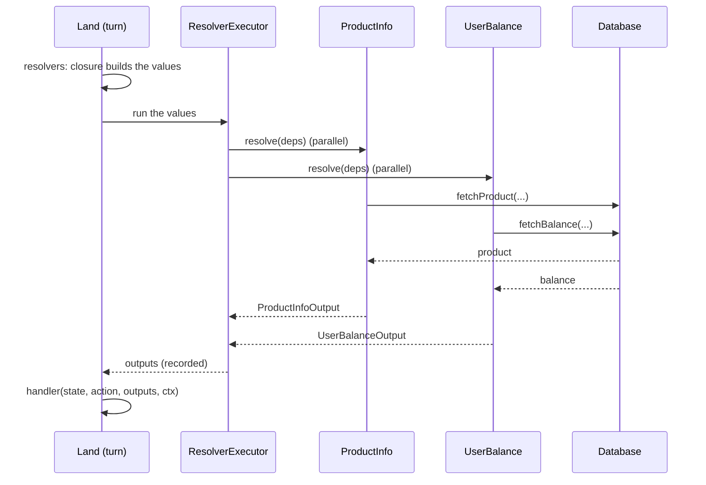

[English](resolver.md) | [中文版](resolver.zh-TW.md)

# Resolver 使用指南

> Resolver 在 handler 執行前，從 land 外部（資料庫、快取、遠端 API）載入資料，讓 handler 本身保持同步。

## 概述

Resolver 是對外部資料的一個請求，寫成一個小型的值。land 在接收 input 時建立這個值，在 land 的 actor 之外執行它，並把結果，也就是 resolver 的**輸出**，作為參數交給 handler。

Resolver 屬於 action（`HandleAction`）、`CanJoin`、`OnJoin`、`OnLeave` 與生命週期 handler `OnInitialize`、`OnFinalize`。Client event 是送出即不管（fire-and-forget），不帶 resolver：`HandleEvent` 沒有 `resolvers:` 參數。`DestroyWhenEmpty(after:)` 也不帶 resolver；它的 handler 的 executor（`onDestroyWhenEmptyResolverExecutors`）只能直接在 `LandDefinition` 上設定。

- **handler 保持同步。** handler 不需要 await；它執行前資料已經到齊。
- **並行載入。** 一個 entry 的 resolver 並行執行。
- **一個失敗就中止 handler。** 任何 resolver 丟出錯誤，handler 就會被跳過（見[錯誤處理](#錯誤處理)）。
- **型別化的輸出。** handler 以有型別的參數接收每個輸出，順序與 resolver 的宣告順序相同。

目前有兩種形式：

| Entry | 形式 |
|---|---|
| `HandleAction`、`OnInitialize`、`OnFinalize` | `Resolver` 值，由該 entry 的 `resolvers:` closure 建立 |
| `CanJoin`、`OnJoin`、`OnLeave` | `ContextResolver` 型別，以 metatype 指定（`resolvers: UserProfileResolver.self`） |

兩種形式中，handler 都以參數取得輸出。join 的 entry 之後會改用值；在那之前，它們的 resolver 讀取 join 的 context（[Join 的 Resolver](#join-的-resolver)）。

## 核心概念

### Resolver 是一個值

Resolver 是符合 `Resolver` 的 `@PlainData` struct。它儲存的欄位就是它的參數。`resolve` 只讀這些欄位與 land 的服務，並回傳輸出。

```swift
protocol HasProductDatabase: Sendable {
    var productDatabase: ProductDatabase { get }
}

@PlainData
struct ProductInfo<D: HasProductDatabase>: Resolver {
    typealias Dependencies = D
    let productID: String

    func resolve(_ deps: D) async throws -> ProductInfoOutput {
        let data = try await deps.productDatabase.fetchProduct(by: productID)
        return ProductInfoOutput(id: data.id, name: data.name, price: data.price, stock: data.stock)
    }
}
```

- **`Dependencies`** 是 `resolve` 可以使用的東西。它是 land 的服務型別，也就是傳給 `Land(_:using:services:)` 的那個型別；沒有服務的 land 則用 `NoServices`。對能力 protocol 泛型的 resolver（`D: HasProductDatabase`），在服務符合該 protocol 的每個 land 都能使用。在服務缺少該能力的 land，這個宣告無法編譯。
- **`@PlainData`** 在編譯期檢查欄位：不能是 class、closure、`Date`、`UUID`、`URL` 或 `Any`（[純資料](../turns/README.zh-TW.md#什麼算純資料)）。Resolver 不能攜帶對 land 狀態的 reference。
- **不能存取 State。** `resolve` 在 land 的 actor 之外執行，不能讀取 State；需要 State 的內容時，land 在建立值時把它複製到欄位中。

### 服務

有服務的 land 會宣告服務的型別，註冊 land type 時，伺服器會拿到該型別的一個值：

```swift
struct ShopServices: HasProductDatabase {
    let productDatabase: ProductDatabase
}

let shop = Land("shop", using: ShopState.self, services: ShopServices.self) {
    Rules { ... }
}

try await host.register(
    landType: "shop",
    land: shop,
    services: { _, _ in ShopServices(productDatabase: database) },
    initialState: ShopState(),
    webSocketPath: "/game/shop",
    configuration: NIOLandServerConfiguration()
)
```

`Land(_:using:services:)` 回傳 `TypedLand<State, Services>`。它的 `definition` 是一般的 `LandDefinition`。有服務的 land 必須透過帶有服務 factory 的 typed overload 註冊。直接註冊它的 `definition` 會被拒絕：`LandRegistrationError` 會寫出服務型別，並指出沒有提供服務。在測試中建立的 `LandKeeper` 直接接收這個值：`LandKeeper(land: shop, resolverServices: ShopServices(...), initialState: ShopState())`。

### ResolverOutput

Resolver 的輸出符合 `ResolverOutput` 並標記 `@PlainData`，欄位規則與 resolver 相同。

```swift
@PlainData
struct ProductInfoOutput: ResolverOutput {
    let id: String
    let name: String
    let price: Int
    let stock: Int
}
```

輸出會被錄製，所以 replay 時 handler 拿到同樣的輸出，不會再呼叫 `resolve`。

## 使用方式

### 在 Action Handler 中使用

entry 的 `resolvers:` closure 用 State、action 與唯讀的 context 建立值。handler 在 action 之後取得輸出：

```swift
Rules {
    HandleAction(AddToCartAction.self, resolvers: { _, action, _ in
        ProductInfo(productID: action.productID)
    }) { state, action, product, ctx in
        guard let product, product.stock > 0 else {
            return AddToCartResponse(success: false, message: "Out of stock")
        }
        state.cart.items.append(CartItem(productID: product.id, name: product.name, price: product.price))
        return AddToCartResponse(success: true)
    }
}
```

輸出參數是 optional。closure 沒有建立值時它是 `nil`（見下方）；否則 handler 只在 resolver 成功後才執行。

### closure 何時執行

closure 只執行一次，在接收該 input 的 turn 中：在 resolver 啟動之前，使用當下的 State。resolver 執行期間 State 的變動不會影響這個值。closure 只讀；它不能寫入 State（拿到的是常數），它的 context 也沒有隨機來源。

Action 的 closure 在檢查 [action 上限](#帶-resolver-的-action)之前執行，所以上限之後拒絕的 action，它的 closure 也已執行過。Replay 不執行 closure：replay 讀取 record 保存的輸出。因此 closure 不可改變任何東西。編譯器會阻止它寫入 State，但不會阻止它呼叫有副作用的程式碼，也不會阻止它改變持有參考的 State。這樣的副作用對被拒絕的 action 也會發生，而 replay 既不會撤銷它，也不會重現它。

closure 可以回傳 `nil`。這時不會載入任何東西，handler 在該輸出得到 `nil`。若 action 的 closure 對每個 resolver 都回傳 `nil`，就沒有東西要等：它的處理方式與不帶 resolver 的 action 相同，action 上限也不計入它。State 已能回答時，用 `nil` 來略過一次載入：

```swift
HandleAction(AddToCartAction.self, resolvers: { state, action, _ in
    state.productCache[action.productID] == nil ? ProductInfo(productID: action.productID) : nil
}) { state, action, fetched, _ in
    guard let product = fetched ?? state.productCache[action.productID] else {
        return AddToCartResponse(success: false)
    }
    ...
}
```

closure 沒有建立任何值的 action，與不需等待的輸入依序套用。因此它可能比同類型、較早送出、仍在等待 resolver 的 action 先套用。

### 多個 Resolver

closure 回傳一個 tuple。resolver 並行執行，handler 依相同順序得到由 optional 輸出組成的 tuple：

```swift
HandleAction(PurchaseAction.self, resolvers: { _, action, ctx in
    (ProductInfo(productID: action.productID), UserBalance(playerID: ctx.playerID))
}) { state, action, resolved, _ in
    guard let product = resolved.0, let balance = resolved.1 else {
        return PurchaseResponse(success: false)
    }
    ...
}
```

一個 action 帶一到兩個 resolver；`OnInitialize`、`OnFinalize` 與 join 的 entry 帶一到三個。同一個 entry 中有兩個輸出名稱相同的 resolver，在註冊時會被拒絕，因為錄製以名稱區分每個輸出（[輸出名稱](#輸出名稱)）。這包括兩個基礎型別相同的 resolver（兩個 `ProductInfo`），也包括 `Price` 與 `PriceResolver`，兩者的輸出都叫 `price`。

### 兩段式 Handler

使用 `validate` 與 `apply`（[兩段式 Handler](land-dsl.zh-TW.md#兩段式-handler)）時，兩個階段都會拿到輸出，位置在 action 之後、plan 之前：

```swift
HandleAction(AdminAction.self, resolvers: { _, _, ctx in UserPermission(playerID: ctx.playerID) },
    validate: { _, _, permission, _ in
        guard let permission, permission.isAdmin else { throw AdminError.adminRequired }
    },
    apply: { state, action, _, ctx in
        AdminResponse()
    })
```

### 生命週期 Handler

`OnInitialize` 的 closure 拿到初始 State 與唯讀的 context（`ctx.landID`）。`OnFinalize` 的 closure 拿到最終 State 與唯讀的 context。每個 body 在 State 之後拿到輸出，接著是 `LandContext`：

```swift
Lifetime {
    OnInitialize(resolvers: { _, ctx in RoomConfig(roomID: ctx.landID) }) { state, config, _ in
        state.maxPlayers = config?.maxPlayers ?? 4
    }
    OnFinalize(resolvers: { state, ctx in SaveResults(landID: ctx.landID, scores: state.scores) }) { _, _, _ in }
}
```

限制：在 `OnInitialize` 中，`ctx.metadata` 是空的。Land 的建立 metadata 不會傳到這裡。

### Join 的 Resolver

`CanJoin`、`OnJoin` 與 `OnLeave` 仍以名稱指定 `ContextResolver` 型別。`ContextResolver` 讀取 join 的 context：`ctx.playerID`、`ctx.landID`、`ctx.currentState` 與 `ctx.services`。land 的產生器不在 `ctx.services` 中：replay 不會執行 resolver，所以 resolver 的抽取只會在 live 時推進它（#765）。需要亂數的 resolver 請自備產生器；它的輸出會像其他輸出一樣被錄製。

```swift
struct UserProfileResolver: ContextResolver {
    typealias Output = UserProfile

    static func resolve(ctx: ResolverContext) async throws -> UserProfile {
        try await profileStore.load(ctx.playerID)
    }
}

Rules {
    OnJoin(resolvers: UserProfileResolver.self) { state, profile, ctx in
        state.players[ctx.playerID] = PlayerState(name: profile?.name ?? "Guest")
    }
}
```

handler 與值的情況一樣，以參數取得輸出：`OnJoin` 與 `OnLeave` 在 State 之後，`CanJoin` 在 session 之後（`{ state, session, profile, ctx in … }`）。

## 執行流程

### 並行執行

一個 entry 的所有 resolver 並行執行：



### 執行順序

1. **建立。** 在接收 input 的 turn 中，`resolvers:` closure 建立值。`nil` 的值會被略過。
2. **執行。** 這些值的 `resolve(_:)` 在 land 的 actor 之外，帶著 land 的服務並行執行。
3. **收集。** land 等待每個 resolver 完成，然後錄製輸出。
4. **處理。** 在之後的 turn 中，handler 以輸出作為參數執行。

### 輸出名稱

錄製以 resolver 的基礎型別（不含泛型參數）為每個輸出命名：`ProductInfo<ShopServices>` 錄製為 `productInfo`，`UserProfileResolver` 錄製為 `userProfile`（去掉 `Resolver` 後綴，首字母轉小寫）。錯誤訊息也使用基礎型別名稱：`ResolverExecutionError.resolverFailed(name: "ProductInfo", …)`。

## 錯誤處理

### Resolver 錯誤

當 resolver 執行失敗時：

1. **所有 resolver 被取消**：如果任何 resolver 失敗，其他並行的 resolver 會被自動取消
2. **錯誤被包裝**：錯誤會被包裝在 `ResolverExecutionError` 中，包含 resolver 名稱
3. **Handler 不執行**：如果 resolver 失敗，handler 不會執行。例外是設定 `onResolverFailure: .continue` 的 OnInitialize，它會在沒有輸出的情況下執行（見[期限](#期限)）
4. **錯誤傳送到客戶端**：錯誤會自動轉換為 `ErrorPayload` 並發送到客戶端

### 錯誤類型

#### ResolverError

預定義的 resolver 錯誤：

```swift
public enum ResolverError: Error, Sendable {
    case missingParameter(String)      // 缺少必要參數
    case dataLoadFailed(String)        // 資料載入失敗
    case cancelled                     // 執行被取消
    case custom(String)                // 自定義錯誤
}
```

#### ResolverExecutionError

執行器層級的錯誤：

```swift
public enum ResolverExecutionError: Error, Sendable {
    case resolverFailed(name: String, underlyingError: Error)
    case multipleResolversFailed([(name: String, error: Error)])
    case timedOut(names: [String], after: Duration)
}
```

### 期限

一組 resolver，也就是同一個 action、join 或 leave 的所有 resolver，有一個期限。OnInitialize 的 resolver 有自己較長的期限 `RESOLVER_INIT_TIMEOUT_MS`（Int，預設 30000；0 停用），因為每個 join、leave 與 action 都要等 land 初始化完成。銷毀 handler 的 resolver（OnFinalize，以及直接在 `LandDefinition` 上設定時的 destroy-when-empty handler）沒有期限：它們在銷毀流程上執行，不在任何玩家的佇列中，被中斷時會跳過 handler（例如最後一次存檔）。期限為 `RESOLVER_TIMEOUT_MS`（Int，預設 5000；0 停用；負數或非整數使用預設值）（#104）。到期仍在執行的 resolver 組會被取消，呼叫丟出 `ResolverExecutionError.timedOut`，列出仍在執行的 resolver。逾時的處理方式與任何 resolver 失敗相同：

| 位置 | 失敗或逾時時 |
|---|---|
| Action | handler 不執行，客戶端收到錯誤 |
| CanJoin、OnJoin | join 失敗，不會留下玩家；變空的 land 會重新排定銷毀計時 |
| OnLeave | 玩家已被移除。OnLeave 會被**丟棄**，該玩家的遊戲狀態因此留下；會記錄日誌並計數（`onLeaveDropped`） |
| OnInitialize（逾時） | 初始化**失敗**：OnInitialize 不執行，等待中與之後的 join 都收到 `JoinError.landShuttingDown`（可重試的 `JOIN_DENIED`），leave 與 action 丟出 `LandInitializationError`，land 會被拆除且不執行銷毀 handler，因為沒有已初始化的狀態可存。計數為 `initTimeouts` |
| OnInitialize（resolver 丟錯） | 由各 definition 以 `OnInitialize(resolvers:onResolverFailure:)` 設定（#238）。`.failLand`（預設）：初始化如同逾時一樣失敗，計數為 `initFailures`。`.continue`：記錄日誌，OnInitialize 在沒有該組輸出的情況下執行，是整組的輸出都沒有，不只是丟錯那個 resolver 的；handler 必須檢查它讀取的每個輸出。這個檢查應放在兩段式 OnInitialize 的 `validate`，它可以拒絕，讓初始化失敗且什麼都不寫入（[Land DSL](land-dsl.zh-TW.md#可被拒絕的初始化)）。只有在 land 正在關閉時，`CancellationError` 才不適用 `.failLand`；resolver 自己的取消（例如被取消的 HTTP 請求）依設定處理 |
| OnInitialize（land 在 resolver 執行期間失敗） | OnInitialize 的 resolver 執行期間，transport 回報的 land 失敗（tickless land；tick land 只在 tick 中套用，而那發生在初始化之後）會立刻結束 land：它的 drain 不等初始化（#946）。之後 resolver 不論回傳什麼，值、錯誤或逾時，`onResolverFailure` 不論選哪一種：OnInitialize 都不執行、不記錄、不啟動任何 loop，land 拆除時也不執行銷毀 handler，因為它的狀態從未建立。每個等待中與之後的 leave 和 action 都丟出 `LandInitializationError`，其 `underlying` 是 land 的 `LandFailure`；join 收到 `JoinError.landShuttingDown` |

**至少一次（at-least-once）。** 取消無法停止忽略取消的 resolver，也無法撤銷已開始的外部動作（扣款、寫入）。這樣的 resolver 在逾時後會繼續執行，其結果會被丟棄。重試 join 或 action 會再執行一次 resolver，所以外部動作可能發生兩次。有副作用的 resolver 必須是冪等的，例如以請求作為 key。

`ResolverDeadlineMetrics.shared` 計數逾時次數（`timeouts`，OnInitialize 另計為 `initTimeouts`）、丟錯而使 land 初始化失敗的 OnInitialize resolver 組（`initFailures`）、呼叫端已不再等待但仍在執行的 resolver 組（`abandoned`：逾時，或呼叫端被取消；gauge，該組的 task 結束時減少），以及被丟棄的 OnLeave（`onLeaveDropped`）。被放棄的 resolver 組也依種類分別計數，各為一個 gauge：`abandonedActions`、`abandonedCanJoin`、`abandonedOnJoin`、`abandonedOnLeave` 與 `abandonedOnInitialize`（#364）。被放棄的 resolver 仍會繼續執行，也仍持有它占用的資源：gauge 會顯示它，但沒有任何上限能結束它。Transport profiler 會在每一行輸出這些計數（[Transport](../transport/README.zh-TW.md)）。被取消的呼叫端會立即收到 `CancellationError`，即使 resolver 忽略取消。

### 帶 resolver 的 action

宣告了 resolver 的 action 在 resolver 執行期間，不會擋住同一個 session 的其他訊息。伺服器收下 action（檢查 land 是否關閉、發送者是否有效，並配發序號）、啟動 resolver，然後就處理該 session 的下一則訊息。resolver 完成後，action 排入佇列：有 `Tick` 的 land 排入下一個 tick，並送出回應（確認）；沒有 tick 的 land 排入下一個 input turn，回應是 handler 的回應，在該 turn 錄製後送出。

- **順序。** action 彼此獨立。同一個 session 稍後的 action、不帶 resolver 的 action 或 client event，可能比 resolver 仍在執行的較早 action 先套用、先回應。為同一個 tick 備妥的 action 依送出順序套用。在沒有 tick 的 land 上，錄製會保留 action 的套用順序，因此 replay 依 live 的順序套用（錄製格式 3.1）。client event 之間維持送出順序。join 與 leave 仍是屏障：leave 會拒絕該 session 仍在 resolver 中的 action。
- **回應。** 每個回應都帶有 action 的 `requestID`；客戶端以它比對回應，而不是依順序。TypeScript SDK 即是如此。
- **斷線。** 斷線會丟棄該 session 尚未送出的回應，它的 leave 也會拒絕仍在 resolver 中的 action。
- **凍結。** 在沒有 tick 的 land 上，debug 凍結（`debugFreeze`）會等仍在 resolver 中的 action 被回應，因此最多可能等到 resolver 的期限。

三個上限約束仍在 resolver 中的 action。超過任一個時，action 會立即被拒絕，收到 `ACTION_HANDLER_ERROR`，訊息會指出是哪一個上限：

| 變數 | 預設 | 限制對象 |
|---|---|---|
| `ACTION_IN_FLIGHT_MAX_PER_SESSION` | 8 | 單一 session 仍在 resolver 中的 action。到期被放棄（或呼叫端不再等待）的 action 在 resolver 結束前仍計入。訊息：`action rejected: in-flight limit reached (…)` |
| `RESOLVER_ABANDONED_ACTIONS_MAX_PER_LAND` | 32 | 單一 land 中被放棄但 resolver 仍在執行的 action（#364）。只計 action：land 被放棄的 CanJoin、OnJoin、OnLeave 與 OnInitialize resolver 組只回報、不受上限，因此 join resolver 背後的服務中斷時，已在 land 中的玩家仍能送 action。其他 land 的 action 不受影響。訊息：`action rejected: abandoned-resolver limit reached (… in this land)` |
| `RESOLVER_ABANDONED_ACTIONS_MAX` | 256 | 整個 process 中被放棄但 resolver 仍在執行的 action。join、leave 與 OnInitialize 不計入。訊息：`action rejected: abandoned-resolver limit reached (…)` |

0 表示不設上限；負數或非整數使用預設值。不帶 resolver 的 action、closure 沒有建立任何值的 action，以及 client event，都不受上限限制。`ResolverDeadlineMetrics` 回報三個上限的狀況：`abandonedActions`（gauge）、`inFlightLimitRejections`、`landAbandonedLimitRejections` 與 `abandonedLimitRejections`。

### 錯誤處理範例

```swift
@PlainData
struct ProductInfo<D: HasProductDatabase>: Resolver {
    typealias Dependencies = D
    let productID: String

    func resolve(_ deps: D) async throws -> ProductInfoOutput {
        do {
            let data = try await deps.productDatabase.fetchProduct(by: productID)
            return ProductInfoOutput(from: data)
        } catch DatabaseError.notFound {
            throw ResolverError.dataLoadFailed("Product not found: \(productID)")
        } catch {
            throw ResolverError.dataLoadFailed("Failed to load: \(error.localizedDescription)")
        }
    }
}
```

## 最佳實踐

### 1. 在 closure 中檢查 State

closure 看得到 State；`resolve` 看不到。在 closure 中依 State 回答，State 已有資料時就不建立值：

```swift
HandleAction(AddToCartAction.self, resolvers: { state, action, _ in
    state.productCache[action.productID] == nil ? ProductInfo(productID: action.productID) : nil
}) { state, action, fetched, _ in
    if let fetched { state.productCache[action.productID] = fetched }
    ...
}
```

由 handler 寫入快取。closure 與 `resolve` 都不能寫。

### 2. 提供清晰的錯誤訊息

```swift
guard product.stock > 0 else {
    throw ResolverError.dataLoadFailed("Product \(productID) is out of stock")
}
```

### 3. 合理使用並行

把彼此獨立的載入分到不同的 resolver，它們就會並行執行：

```swift
// ✅ Two resolvers in parallel: total time = max(product, balance)
HandleAction(PurchaseAction.self, resolvers: { _, action, ctx in
    (ProductInfo(productID: action.productID), UserBalance(playerID: ctx.playerID))
}) { state, action, resolved, ctx in ... }

// ❌ One resolver that loads both in sequence: total time = product + balance
@PlainData
struct PurchaseData<D: HasProductDatabase & HasWallet>: Resolver {
    typealias Dependencies = D
    let productID: String
    let playerID: PlayerID
    func resolve(_ deps: D) async throws -> PurchaseDataOutput {
        let product = try await deps.productDatabase.fetchProduct(by: productID)
        let balance = try await deps.wallet.balance(of: playerID)
        return PurchaseDataOutput(product: product, balance: balance)
    }
}
```

### 4. 只宣告你用到的能力

讓 resolver 對它需要的 protocol 泛型（`D: HasProductDatabase`），不要對 land 完整的服務型別泛型。這樣它在服務具備該能力的每個 land 都能使用，測試也只需給它一個只有該能力的 stub。

## 常見使用場景

### 場景 1：驗證使用者權限

Handler body 不能拋出錯誤；要依 resolver 輸出拒絕 action，就在 `validate` 中讀取並拋出錯誤（[兩段式 Handler](land-dsl.zh-TW.md#兩段式-handler)）。

```swift
@PlainData
struct UserPermission<D: HasPermissionStore>: Resolver {
    typealias Dependencies = D
    let playerID: PlayerID
    func resolve(_ deps: D) async throws -> UserPermissionOutput {
        try await deps.permissionStore.permission(for: playerID)
    }
}

enum AdminError: Error {
    case adminRequired
}

HandleAction(AdminAction.self, resolvers: { _, _, ctx in UserPermission(playerID: ctx.playerID) },
    validate: { _, _, permission, _ in
        guard let permission, permission.isAdmin else {
            throw AdminError.adminRequired  // nothing is written
        }
    },
    apply: { state, action, _, ctx in
        AdminResponse()
    })
```

### 場景 2：載入多個相關資料

```swift
HandleAction(UpgradeItemAction.self, resolvers: { _, action, ctx in
    (UserProfile(playerID: ctx.playerID), UserInventory(playerID: ctx.playerID))
}) { state, action, resolved, ctx in
    guard let profile = resolved.0, let inventory = resolved.1 else { return UpgradeItemResponse(success: false) }
    ...
}
```

## 相關文檔

- [Runtime 運作機制](runtime.zh-TW.md) - 了解 LandKeeper 如何執行 resolver
- [核心概念](README.zh-TW.md) - 了解 StateNode 和 Land DSL
- [Land DSL](land-dsl.zh-TW.md) - 了解如何在 Land DSL 中宣告 resolver
