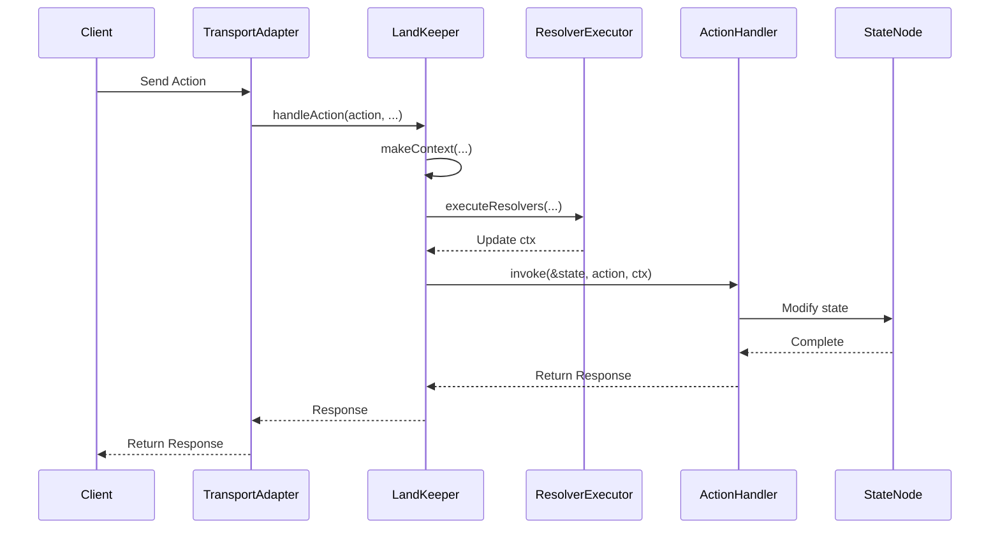
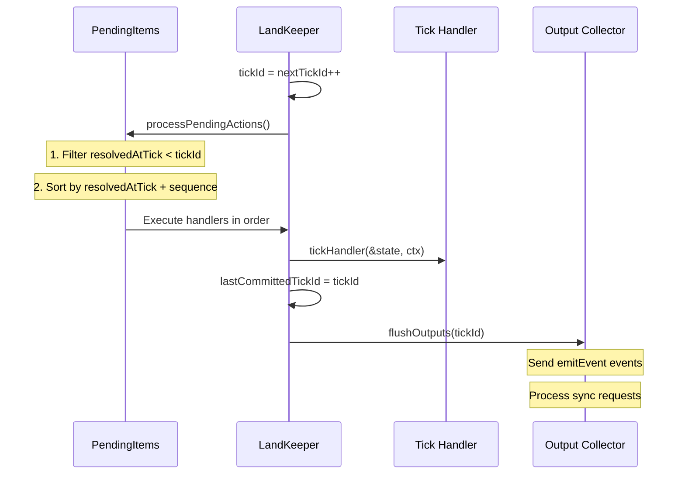

[English](runtime.md) | [中文版](runtime.zh-TW.md)

# Runtime Operation Mechanism

> LandKeeper is SwiftStateTree's runtime executor, responsible for managing state, executing handlers, and coordinating synchronization.

## Overview

`LandKeeper` is SwiftStateTree's core runtime component, managing the complete lifecycle of a single Land instance as an `actor`. It is responsible for:

- Managing authoritative state (StateNode)
- Executing Land-defined handlers (Action, Event, Tick)
- Handling player join/leave lifecycle
- Coordinating state synchronization mechanism
- Managing scheduled tasks (Tick) and auto-destruction

## Core Design

### Actor Serialization

`LandKeeper` is an `actor`, which means:

1. **Serialization within single room**: All operations within the same `LandKeeper` instance are serialized, ensuring state consistency
2. **Parallel execution across different rooms**: Each room has an independent `LandKeeper` instance and can execute in parallel

```swift
// Operations within the same room are serialized
await keeper.handleAction(action, playerID: playerID, ...)
await keeper.handleEvent(event, playerID: playerID, ...)

// Operations across different rooms can execute in parallel
await withTaskGroup(of: Void.self) { group in
    for room in rooms {
        group.addTask {
            await room.keeper.tick() // Parallel execution
        }
    }
}
```

### Sync in Turns

The keeper sends state to clients from inside its own turns. A turn applies its inputs, then hands its events and, when a sync is due, the sync phase to the transport, all in one actor turn. So a state change and a sync never interleave: a change made after a turn's sync phase is sent by the next one. [In-Turn Sync](#in-turn-sync-default) describes the turns.

## State Management

### State Changes

All state changes must go through `LandKeeper` methods:

```swift
// Change state in handler
HandleAction(SomeAction.self) { state, action, ctx in
    // state is inout parameter, can modify directly
    state.someField = action.value
    return SomeResponse()
}
```

`LandKeeper` runs a handler that changes the state through `withHandlerStep`. It mutates the actor's state in place and binds `ctx.random` for that call. The handlers that replay repeats (OnInitialize, OnJoin, OnLeave, actions, client events, server inputs and the tick) get a service that continues the land's generator, and the keeper writes the generator back when the handler returns. OnDestroyWhenEmpty and OnFinalize also run through `withHandlerStep`, but with a copy of the generator that is never written back. AfterFinalize, which gets a snapshot of the state, draws from that same copy, so the drain's three handlers continue one sequence. CanJoin and the sync handler don't run through `withHandlerStep`: each gets its own copy, also never written back.

```swift
// Internal implementation (simplified)
func withHandlerStep<T>(_ ctx: LandContext, _ operation: (inout State, LandContext) throws -> T) rethrows -> T {
    // A service that continues the land's generator, for this call only
    let random = DeterministicRngService(continuing: landRandom, seed: landRandomSeed)
    defer { landRandom = random.generator }   // the draws move the land's generator
    var bound = ctx
    bound.stepRandom = random
    // Actor serialization ensures thread safety
    return try operation(&state, bound)
}
```

The land's generator is keeper state. A handler that replay repeats from the record draws from it, and the keeper writes it back when the handler returns. CanJoin, the sync handler and the destroy-phase handlers aren't repeated from the record, so they draw from a copy that is never written back ([`ctx.random`](#landcontext-functions)).

### State Reading

`currentState()` returns a copy of the current state. Reading it changes nothing, not even the dirty flags.

```swift
// Read current state (read-only)
let current = await keeper.currentState()
```

## Request-Scoped LandContext

Each Action/Event request creates a new `LandContext`, which is released after processing. This is similar to NestJS's Request Context design pattern.

### LandContext Features

- **Request-level**: Each request creates a new `LandContext`
- **Not persistent**: Released after processing, doesn't retain state
- **Isolated Transport**: Through closure delegation, doesn't expose Transport details

```swift
// LandKeeper, simplified: an action with resolvers
func handleAction<A: ActionPayload>(_ action: A, ...) async throws -> AnyCodable {
    let ctx = makeContext(
        playerID: playerID,
        clientID: clientID,
        sessionID: sessionID
    )

    // In the turn that admits the action: build the resolver values
    // from the State and the action
    let resolvers = handler.resolvers?.build((state, action), ValidateContext(ctx)) ?? []

    // Off the actor: run them in parallel with the land's services
    let outputs = try await run(resolvers)

    // In a later turn: the handler gets the outputs as a typed parameter
    return try withHandlerStep(ctx) { state, ctx in
        try handler.invoke(&state, action: action, outputs: outputs, ctx: ctx)
    }
}
```

### LandContext Functions

`LandContext` provides the following functions:

- **Identification**: `playerID`, `clientID`, `sessionID`, `landID`
- **Service access**: `services` - External service abstraction (database, logging, etc.). The land's generator isn't in it.
- **Deterministic randomness**: `random` - The land's generator. Draw synchronously inside the handler: a `random` kept past the handler, or used from a `Task`, doesn't move the land, or moves it where replay can't repeat it
- **Deterministic events**: `emitEvent(_:to:)` - Enqueue an event to be flushed deterministically at end of tick
- **Deterministic sync**: `requestSyncNow()` / `requestSyncBroadcastOnly()` - Request sync to be flushed deterministically at end of tick
- **Resolver output**: The handler gets each resolver's output as a typed parameter, after the input ([Resolver](resolver.md))

## Handler Execution Flow

### Action Handler Flow



### Inputs and Turns

Handlers (actions, client events, server inputs, lifecycle, `Tick`) are synchronous: `(inout State, …, LandContext)`. State changes only inside them, one input at a time, in the order the keeper applied them, and that order is what the reevaluation record keeps. A handler cannot await. Async work (a database read, a call to another service) goes in a resolver: resolvers run before the handler, outside the turn, and their outputs reach the handler as a typed parameter and are recorded, so replay reuses them instead of calling the service again. See [Resolver Mechanism](resolver.md).

A handler can't throw after it writes (#586). The bodies of `HandleAction`, `HandleEvent`, `HandleServerInput`, `OnJoin` and `OnLeave` don't throw. An input that can be refused declares `validate` and `apply` ([Land DSL: Two-Phase Handlers](land-dsl.md#two-phase-handlers)): `validate` reads the state and may throw, `apply` writes and can't, and the two run back to back in the same turn. An input whose `validate` throws fails alone, with nothing written:

- the inputs after it are applied in the same pass;
- on a tickless land the action's caller gets the error (`ACTION_HANDLER_ERROR`). On a tick land the caller already got its acknowledgement when the action was queued (the handler runs in a later tick), so the failure is logged (`Input refused: its validate threw`) and doesn't reach the caller. A client event's error goes to the client as an error payload; a server input's is logged. Errors at intake (an unknown action, a decode failure, a resolver's error, a rejected delivery) reach the caller on both;
- it emits nothing: `validate` can't emit, and `apply` doesn't run;
- it is recorded like any other input and listed as rejected, so replay runs its `validate` again and checks that it refuses the same inputs ([Reevaluation: Rejected Inputs](reevaluation.md#rejected-inputs-35)).

`OnJoin` and `OnLeave` can't fail: whether a player may join is `CanJoin`'s decision ([Land DSL: Join Checks](land-dsl.md#join-checks)), and a leave always happens. `OnInitialize` and the destroy-phase handlers (`OnFinalize`, `OnDestroyWhenEmpty`) may still throw, and keep what they wrote before the throw.

### Event Handler Flow

Event handler flow is similar, but has no return value, and a client event takes no resolvers:

```swift
// Event handler execution: a client event takes no resolvers
func handleEvent<E: EventPayload>(_ event: E, ...) {
    let ctx = makeContext(...)

    // Execute handler (no return value)
    withHandlerStep(ctx) { state, ctx in
        handler.invoke(&state, event: event, ctx: ctx)
    }
}
```

## Player Lifecycle

### Join Flow

Player joining has two phases:

1. **CanJoin**: Validation before joining (optional)
2. **OnJoin**: Processing after joining

```swift
// Join flow
public func join(session: PlayerSession, ...) async throws -> JoinDecision {
    // 1. Execute CanJoin handler (if defined)
    if let canJoinHandler = definition.lifetimeHandlers.canJoin {
        decision = try canJoinHandler(state, session, ctx)
    }

    // 2. If denied, return directly
    guard case .allow(let playerID) = decision else {
        return decision
    }

    // 3. Check player limit
    if let maxPlayers = definition.config.maxPlayers {
        guard players.count < maxPlayers else {
            throw JoinError.roomIsFull
        }
    }

    // 4. Execute OnJoin handler (if defined)
    if let onJoinHandler = definition.lifetimeHandlers.onJoin {
        // Execute Resolver (if any)
        // Execute handler
        withHandlerStep(ctx) { state, ctx in
            onJoinHandler(&state, ctx)
        }
    }

    return decision
}
```

### Leave Flow

When a player leaves, `OnLeave` handler is executed:

```swift
public func leave(playerID: PlayerID, ...) async throws {
    // Execute OnLeave handler (if defined)
    if let onLeaveHandler = definition.lifetimeHandlers.onLeave {
        withHandlerStep(ctx) { state, ctx in
            onLeaveHandler(&state, ctx)
        }
    }

    // Clean up player data
    players.removeValue(forKey: playerID)

    // Check if auto-destruction is needed
    checkAutoDestroy()
}
```

## Tick Mechanism

### Tick Configuration

Define Tick in Land DSL:

```swift
Lifetime {
    Tick(every: .milliseconds(100)) { state, ctx in
        // Execute every 100ms
        state.stepSimulation()
    }
}
```

### Tick Scheduling

The tick loop and the sync loop are fixed-rate. Each next deadline is the previous deadline plus the interval, not "now plus the interval", so the rate holds while a tick takes part of its interval. A tick that overruns does not cause a burst of catch-up ticks: missed deadlines are skipped, and the loop continues at the next deadline still in the future.

Each land delays the first iteration of its loops by a per-land phase offset, so lands created together (a join ramp, a server start) do not run their ticks and syncs in the same few milliseconds of each interval. The offset is FNV-1a 64 of the land ID modulo `min(interval, 100 ms)` (`LandLoopPhase`), the same in every process. It only shifts wall-clock timing; tick IDs, ordering and replay are unaffected. `LAND_LOOP_PHASE_OFFSET=false` turns it off.

### Event Queue Mechanism (PendingItems)

`LandKeeper` uses a unified `pendingItems` queue to manage all inputs:

- **Action**: Actions sent by clients
- **ClientEvent**: Events sent by clients
- **Lifecycle Event**: `OnJoin`, `OnLeave`, `OnInitialize`

```swift
// Unified PendingItem type
public enum PendingItem: Sendable {
    case action(PendingActionItem)
    case clientEvent(PendingClientEventItem)
    case lifecycle(PendingLifecycleItem)
}
```

Each PendingItem records:

- `sequence`: Globally incrementing sequence number (shared across Action/Event/Lifecycle)
- `resolvedAtTick`: Tick ID when Resolver completed
- `resolverOutputs`: Resolver outputs (Action and Lifecycle have, ClientEvent is empty)

### Tick Execution Model

Execution order for each Tick:



Sorting rules ensure **Deterministic Replay**:

1. **Primary**: `resolvedAtTick` (tick when Resolver completed)
2. **Secondary**: `sequence` (receive order)

### Deterministic Output Mechanism

Event sends and sync requests from handlers are collected in `OutputCollector`, flushed uniformly at end of tick:

```swift
// ✅ Correct: Use emitEvent (sync API, deterministic)
HandleAction(AttackAction.self) { state, action, ctx in
    state.applyDamage(action.damage)

    // Event is queued, sent at end of tick
    ctx.emitEvent(DamageEvent(damage: action.damage), to: .all)

    return AttackResponse(success: true)
}

// ❌ Avoid: Using spawn + sendEvent (async, non-deterministic)
// ctx.spawn { await ctx.sendEvent(...) }
```

Deterministic methods provided by `LandContext`:

| Method                       | Description                                     |
| ---------------------------- | ----------------------------------------------- |
| `emitEvent(_:to:)`           | Enqueue event, sent at end of tick              |
| `requestSyncNow()`           | Request immediate sync, executed at end of tick |
| `requestSyncBroadcastOnly()` | Request broadcast sync, executed at end of tick |
| `random`                     | The land's generator, replayed with the record  |

### Tick Execution

`LandKeeper` automatically manages Tick tasks:

```swift
// Start Tick on initialization
Task {
    // Execute OnInitialize once (if defined), resolvers first
    await ensureInitialized()

    // Start Tick loop
    if let interval = definition.lifetimeHandlers.tickInterval {
        await configureTickLoop(interval: interval)
    }
}

// Tick loop (simplified)
private func runTick() async {
    let tickId = nextTickId
    nextTickId += 1

    // 1. Process pending Action/Event/Lifecycle
    try await processPendingActions()

    // 2. Execute Tick handler
    if let tickHandler = definition.lifetimeHandlers.tickHandler {
        tickHandler(&state, makeContext(tickId: tickId))
    }

    // 3. Update committed tick ID
    lastCommittedTickId = tickId

    // 4. Flush deterministic outputs
    await flushOutputs(forTick: tickId)
}
```

## Synchronization Mechanism

### Update Modes

A land syncs in one of three ways (`LandKeeper.hasPeriodicSync` is true for the first two):

| Land | Sync | Suits |
|---|---|---|
| `Tick` (with or without `StateSync`) | the sync loop at the `StateSync` interval, or at the tick interval when `StateSync` is not set | real-time games with a simulation step (Hero Defense: tick 50 ms, `StateSync` 100 ms) |
| `StateSync` without `Tick` | the sync loop at its interval; inputs are applied as they arrive | games whose state changes only through inputs, with a steady update rate |
| neither | only when requested: `ctx.requestSyncNow()` / `ctx.requestSyncBroadcastOnly()` in a handler, or the host calling the adapter's `syncNow()` | turn-based or low-traffic lands |

A land without periodic sync has no next cycle to fall back on, so the runtime retries a cycle it had to skip (see [Writer Back-Pressure](#writer-back-pressure)).

### In-Turn Sync (default)

With in-turn sync, a land's `TransportAdapter` runs on its keeper's serial executor, and the keeper runs the sync phase synchronously inside its own turns, with no suspension point between the state changes and the frames they produce. The turn kinds are:

- tick turn: the ready inputs, the tick handler, the emitted events, and the sync phase when a handler requested one or the sync loop folded into it. A sync due within min(5 ms, tick / 4, sync / 4) of the next tick runs in that tick turn (coincident sync), so a sync coinciding with a tick sees the tick's result;
- sync-only turn: the sync loop's own interval, so the sync cadence is kept; or a requested sync. A requested sync is the adapter's `syncNow()`, the sync the lag timer asks for, the repair after a joiner's firstSync that read a state a commit had already passed, or the freeze's resume. It runs as one sync-only turn before the request returns. On a land without periodic sync, a commit that leaves events queued gets one more sync-only turn right after its own;
- input turn (lands without a tick): at most 64 ready inputs, their events, and the sync phase when requested. Inputs that arrive during a turn go to a later one.

The sync phase plans every frame of the cycle from the state at that point of the turn, then commits: it enqueues the frames to the adapter's outbound writer and clears the dirty flags. Nothing runs between the plan and the commit, so no change is cleared unsent. A plan that fails commits nothing, and its dirty flags stay for the next cycle.

A join completes in the sync phase of the turn it flips in (#69, #194). The joiner's whole view is planned from that turn's end state, in the same plan as the other recipients' diffs, and its frames follow theirs: its JoinResponse, its firstSync, then the targeted events its `OnJoin` addressed to it, held until then.

Stated limits:

- The debug freeze's settle is a sync-only turn of its own. It first checks, in this order, that the land is live and has neither failed nor started closing, that the settle's deadline hasn't passed, that the same freeze is still in effect, and that it runs through the keeper's sync adapter: the one attached to the keeper or, on a keeper that was never attached, the adapter whose sync requests the keeper accepts. Then it plans and commits a sync phase from the frozen state in the same turn, with no writer back-pressure deferral and no join flips; an ordinary phase that runs while frozen still leaves its sync to the resume. A settle that finds a check failed plans nothing: a released freeze answers `released`, a failed land its failure, a closing one `LandInputRejection.landClosed`. Its plan's first throw ends the land in that turn, as any sync phase's does. It doesn't take the pending sync work of other turns: the resume delivers that. The resume then makes two requests. First, the sync deferred while frozen runs as a sync-only turn. Second, joins that are ready but haven't flipped get a sync-only turn of their own. The second request is skipped when the first was deferred by writer back-pressure (the retry, or the next periodic phase, flips them), when the land failed, or when the land was frozen again in between (that freeze's resume makes it).
- An input whose `validate` throws fails alone: its caller gets the error on a tickless land (on a tick land it was acknowledged at intake, and the failure is logged), it is removed and recorded as rejected, and the other inputs of the turn are applied. It wrote nothing, so the next sync has nothing of it to send ([Inputs and Turns](#inputs-and-turns)).
- A live keeper with no transport runs the same turns. A benchmark worker pool or a test that drives a keeper directly is such a keeper. Its turns take and record their events and sync requests, but deliver them nowhere.
- A live keeper refuses a transport that can't run the sync phase in its turns, and stops the process ([Attaching a transport](../transport/README.md#attaching-a-transport)).
- A re-evaluation keeper replays recorded inputs and doesn't run these turns. A live join or leave on a tickless re-evaluation keeper stops the process; its actions and client events are ignored, and its server inputs refused (`notLive`).

In-turn sync can't be turned off. The `IN_TURN_SYNC` environment variable was its switch and has been removed: a server that still sets it ignores it, and the first adapter in the process logs a warning naming it.

### Writer Back-Pressure

Each adapter sends through one ordered outbound writer. While the writer still holds a sync cycle's frames from an earlier cycle, a new cycle is skipped before it takes its copy: nothing is planned, the dirty flags and queued events stay, and the next cycle diffs against the last state sent, so it carries every change. On a land with periodic sync that is its next periodic cycle; a land without one gets one retry once the writer has drained. Overload thus turns into skipped cycles instead of a growing queue. Event and action-response frames are not held back. A skipped phase is counted as a skip and as a deferred turn; the transport profiler reports both (see [Transport](../transport/README.md#profiling)).

### Dirty Tracking

State changes automatically mark dirty:

```swift
// In StateNode
@Sync(.broadcast)
var players: [PlayerID: PlayerState] = [:] {
    didSet {
        markDirty()  // Automatically mark dirty
    }
}
```

A committed sync phase clears the dirty flags in its turn when its plan diffed every synced field (see [In-Turn Sync](#in-turn-sync-default)). To clear them manually:

```swift
// Clear all dirty flags
state.clearDirty()
```

## Auto-Destruction

### Destruction Conditions

Define destruction conditions in Land DSL:

```swift
Lifetime {
    DestroyWhenEmpty(after: .seconds(60)) { state, ctx in
        // Destroy empty room after 60 seconds, can execute cleanup logic here
        ctx.logger.info("Land is empty, destroying...")
    }
}
```

### Destruction Check

`LandKeeper` checks destruction conditions at appropriate times:

```swift
// Check when player leaves
private func checkAutoDestroy() {
    if players.isEmpty {
        // Start destruction timer
        destroyTask = Task {
            try? await safeTaskSleep(for: destroyDelay)
            // Execute destruction logic
        }
    } else {
        // Player joined, cancel destruction
        destroyTask?.cancel()
        destroyTask = nil
    }
}
```

## Best Practices

1. **Avoid long-running handlers**: Handlers should execute quickly. Do async I/O out-of-band (e.g., via Resolver + cached outputs, or external pipelines).
2. **Use Resolver appropriately**: Put data loading logic in Resolver, keep handlers synchronous
3. **Pay attention to state change scope**: Only change state in handlers, don't change in Resolver
4. **Leverage Actor serialization**: No need for additional locking mechanisms, actor automatically ensures thread safety

## Related Documentation

- [Core Concepts](README.md) - Understand StateNode and Land DSL
- [Sync Rules](sync.md) - Deep dive into sync mechanism
- [Resolver Mechanism](resolver.md) - Resolver usage guide
- [Transport Layer](../transport/README.md) - Understand how TransportAdapter interacts with LandKeeper
