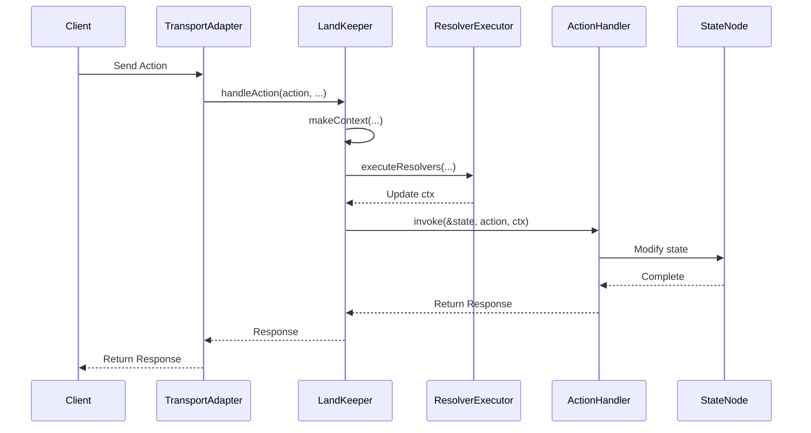
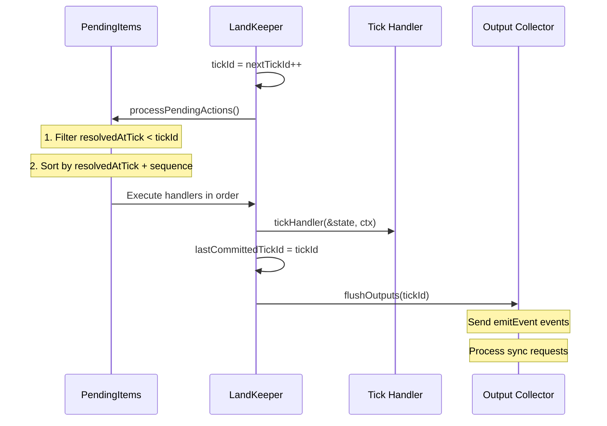

[English](runtime.md) | [中文版](runtime.zh-TW.md)

# Runtime Operation Mechanism

> LandKeeper is SwiftStateTree's runtime executor, responsible for managing state, executing handlers, and coordinating synchronization.

## Overview

`LandKeeper` is SwiftStateTree's core runtime component, managing the complete lifecycle of a single Land instance as an `actor`. It is responsible for:

- Managing authoritative state (StateNode)
- Executing Land-defined handlers (Action, Event, Tick)
- Handling player join/leave lifecycle
- Coordinating state synchronization mechanism
- Managing scheduled tasks (Tick) and auto-destruction

## Core Design

### Actor Serialization

`LandKeeper` is an `actor`, which means:

1. **Serialization within single room**: All operations within the same `LandKeeper` instance are serialized, ensuring state consistency
2. **Parallel execution across different rooms**: Each room has an independent `LandKeeper` instance and can execute in parallel

```swift
// Operations within the same room are serialized
await keeper.handleAction(action, playerID: playerID, ...)
await keeper.handleEvent(event, playerID: playerID, ...)

// Operations across different rooms can execute in parallel
await withTaskGroup(of: Void.self) { group in
    for room in rooms {
        group.addTask {
            await room.keeper.tick() // Parallel execution
        }
    }
}
```

### Snapshot Sync Mode

> This section and [Sync Flow](#sync-flow) describe the legacy path (`IN_TURN_SYNC=false`). By default the sync phase runs inside the keeper's own turns; see [In-Turn Sync](#in-turn-sync-default).

`LandKeeper` uses snapshot mode for synchronization, which is a non-blocking design:

- **Get snapshot when syncing**: Sync operations get a state snapshot at the start
- **Don't block changes**: State changes can proceed in parallel with synchronization
- **Consistency guarantee**: Actor serialization ensures each sync gets a consistent snapshot
- **Deduplication mechanism**: Concurrent sync requests are deduplicated to avoid duplicate work

```swift
// Sync flow
guard let state = await keeper.beginSync(clearDirtyFlags: true) else {
    // Another sync is in progress, skip (deduplication)
    return
}
defer { await keeper.endSync() }

// Use state snapshot for sync operations
// State changes can proceed in parallel at this time, won't block
```

## State Management

### State Changes

All state changes must go through `LandKeeper` methods:

```swift
// Change state in handler
HandleAction(SomeAction.self) { state, action, ctx in
    // state is inout parameter, can modify directly
    state.someField = action.value
    return SomeResponse()
}
```

`LandKeeper` runs every handler through `withMutableStateSync`, which mutates the actor's state in place:

```swift
// Internal implementation (simplified; debug builds also check a throwing handler's writes,
// see Inputs and Turns)
func withMutableStateSync<T>(_ operation: (inout State) throws -> T) rethrows -> T {
    // Actor serialization ensures thread safety
    return try operation(&state)
}
```

### State Reading

There are two ways to read state:

1. **Current state**: `currentState()` - Get snapshot of current state (read-only)
2. **Sync snapshot**: `beginSync(clearDirtyFlags:)` - Snapshot obtained when starting sync operation. For the sync pipeline only; use `currentState()` to read the state. With `clearDirtyFlags: true` it clears the live dirty flags, so a reader that only wants a copy would make the next sync skip those changes.

```swift
// Read current state (read-only)
let current = await keeper.currentState()

// Start sync (get snapshot)
guard let snapshot = await keeper.beginSync(clearDirtyFlags: true) else { return }
defer { await keeper.endSync() }
// Use snapshot for sync operations
```

## Request-Scoped LandContext

Each Action/Event request creates a new `LandContext`, which is released after processing. This is similar to NestJS's Request Context design pattern.

### LandContext Features

- **Request-level**: Each request creates a new `LandContext`
- **Not persistent**: Released after processing, doesn't retain state
- **Isolated Transport**: Through closure delegation, doesn't expose Transport details

```swift
// LandKeeper internally creates LandContext
func handleAction<A: ActionPayload>(_ action: A, ...) async throws -> AnyCodable {
    var ctx = makeContext(
        playerID: playerID,
        clientID: clientID,
        sessionID: sessionID
    )

    // Execute Resolver (if any)
    if !handler.resolverExecutors.isEmpty {
        ctx = try await ResolverExecutor.executeResolvers(...)
    }

    // Execute handler
    return try withMutableStateSync { state in
        try handler.invoke(&state, action: action, ctx: ctx)
    }
}
```

### LandContext Functions

`LandContext` provides the following functions:

- **Identification**: `playerID`, `clientID`, `sessionID`, `landID`
- **Service access**: `services` - External service abstraction (database, logging, etc.)
- **Deterministic events**: `emitEvent(_:to:)` - Enqueue an event to be flushed deterministically at end of tick
- **Deterministic sync**: `requestSyncNow()` / `requestSyncBroadcastOnly()` - Request sync to be flushed deterministically at end of tick
- **Resolver output**: Access resolver results through `@dynamicMemberLookup`

## Handler Execution Flow

### Action Handler Flow



### Inputs and Turns

Handlers (actions, client events, lifecycle, `Tick`) are synchronous: `(inout State, …, LandContext) throws`. State changes only inside them, one input at a time, in the order the keeper applied them, and that order is what the reevaluation record keeps. A handler cannot await. Async work (a database read, a call to another service) goes in a resolver: resolvers run before the handler, outside the turn, and their outputs reach the handler through `ctx` and are recorded, so replay reuses them instead of calling the service again. See [Resolver Mechanism](resolver.md).

An input whose handler throws fails alone:

- its caller gets the error, and the inputs after it are applied in the same pass;
- the server events it emitted are dropped;
- a join whose `OnJoin` throws is discarded;
- what the handler wrote to the state before the throw stays, and the next sync sends it (there is no per-input rollback, #87);
- it is recorded like any other input, so replay runs it again and it fails the same way.

**Validate before you mutate.** Check every condition that can throw before the handler's first write to the state, so that a failed input changes nothing. In debug builds the keeper checks this: when a handler throws, it compares the synced state with a copy taken before the handler, and if the handler wrote, it logs a warning naming the input (`action <type>`, `event <type>`, `serverInput <type>`, `OnJoin`, `OnLeave`, `OnInitialize`), once per input type and land. A destroy handler (`OnDestroyWhenEmpty`, `OnFinalize`) is checked only when a later destroy-phase handler reads the state (`OnFinalize`, `AfterFinalize`, `OnShutdown`). Re-evaluation doesn't check. `@Internal` fields are not compared, so writes to them aren't reported. The copy costs a large debug game the first write to each container per input; set `DEBUG_WARN_THROWING_INPUT_WRITES=false` to turn the check off. Release builds don't check and don't copy.

### Event Handler Flow

Event handler flow is similar, but has no return value:

```swift
// Event handler execution
func handleEvent<E: EventPayload>(_ event: E, ...) async {
    var ctx = makeContext(...)

    // Execute Resolver (if any)
    if !handler.resolverExecutors.isEmpty {
        ctx = try await ResolverExecutor.executeResolvers(...)
    }

    // Execute handler (no return value)
    try withMutableStateSync { state in
        try handler.invoke(&state, event: event, ctx: ctx)
    }
}
```

## Player Lifecycle

### Join Flow

Player joining has two phases:

1. **CanJoin**: Validation before joining (optional)
2. **OnJoin**: Processing after joining

```swift
// Join flow
public func join(session: PlayerSession, ...) async throws -> JoinDecision {
    // 1. Execute CanJoin handler (if defined)
    if let canJoinHandler = definition.lifetimeHandlers.canJoin {
        decision = try canJoinHandler(state, session, ctx)
    }

    // 2. If denied, return directly
    guard case .allow(let playerID) = decision else {
        return decision
    }

    // 3. Check player limit
    if let maxPlayers = definition.config.maxPlayers {
        guard players.count < maxPlayers else {
            throw JoinError.roomIsFull
        }
    }

    // 4. Execute OnJoin handler (if defined)
    if let onJoinHandler = definition.lifetimeHandlers.onJoin {
        // Execute Resolver (if any)
        // Execute handler
        try withMutableStateSync { state in
            try onJoinHandler(&state, ctx)
        }
    }

    return decision
}
```

### Leave Flow

When a player leaves, `OnLeave` handler is executed:

```swift
public func leave(playerID: PlayerID, ...) async throws {
    // Execute OnLeave handler (if defined)
    if let onLeaveHandler = definition.lifetimeHandlers.onLeave {
        try withMutableStateSync { state in
            try onLeaveHandler(&state, ctx)
        }
    }

    // Clean up player data
    players.removeValue(forKey: playerID)

    // Check if auto-destruction is needed
    checkAutoDestroy()
}
```

## Tick Mechanism

### Tick Configuration

Define Tick in Land DSL:

```swift
Lifetime {
    Tick(every: .milliseconds(100)) { (state: inout GameState, ctx: LandContext) in
        // Execute every 100ms
        state.stepSimulation()
    }
}
```

### Tick Scheduling

The tick loop and the sync loop are fixed-rate. Each next deadline is the previous deadline plus the interval, not "now plus the interval", so the rate holds while a tick takes part of its interval. A tick that overruns does not cause a burst of catch-up ticks: missed deadlines are skipped, and the loop continues at the next deadline still in the future.

Each land delays the first iteration of its loops by a per-land phase offset, so lands created together (a join ramp, a server start) do not run their ticks and syncs in the same few milliseconds of each interval. The offset is FNV-1a 64 of the land ID modulo `min(interval, 100 ms)` (`LandLoopPhase`), the same in every process. It only shifts wall-clock timing; tick IDs, ordering and replay are unaffected. `LAND_LOOP_PHASE_OFFSET=false` turns it off.

### Event Queue Mechanism (PendingItems)

`LandKeeper` uses a unified `pendingItems` queue to manage all inputs:

- **Action**: Actions sent by clients
- **ClientEvent**: Events sent by clients
- **Lifecycle Event**: `OnJoin`, `OnLeave`, `OnInitialize`

```swift
// Unified PendingItem type
public enum PendingItem: Sendable {
    case action(PendingActionItem)
    case clientEvent(PendingClientEventItem)
    case lifecycle(PendingLifecycleItem)
}
```

Each PendingItem records:

- `sequence`: Globally incrementing sequence number (shared across Action/Event/Lifecycle)
- `resolvedAtTick`: Tick ID when Resolver completed
- `resolverOutputs`: Resolver outputs (Action and Lifecycle have, ClientEvent is empty)

### Tick Execution Model

Execution order for each Tick:



Sorting rules ensure **Deterministic Replay**:

1. **Primary**: `resolvedAtTick` (tick when Resolver completed)
2. **Secondary**: `sequence` (receive order)

### Deterministic Output Mechanism

Event sends and sync requests from handlers are collected in `OutputCollector`, flushed uniformly at end of tick:

```swift
// ✅ Correct: Use emitEvent (sync API, deterministic)
HandleAction(AttackAction.self) { state, action, ctx in
    state.applyDamage(action.damage)

    // Event is queued, sent at end of tick
    ctx.emitEvent(DamageEvent(damage: action.damage), to: .all)

    return AttackResponse(success: true)
}

// ❌ Avoid: Using spawn + sendEvent (async, non-deterministic)
// ctx.spawn { await ctx.sendEvent(...) }
```

Deterministic methods provided by `LandContext`:

| Method                       | Description                                     |
| ---------------------------- | ----------------------------------------------- |
| `emitEvent(_:to:)`           | Enqueue event, sent at end of tick              |
| `requestSyncNow()`           | Request immediate sync, executed at end of tick |
| `requestSyncBroadcastOnly()` | Request broadcast sync, executed at end of tick |

### Tick Execution

`LandKeeper` automatically manages Tick tasks:

```swift
// Start Tick on initialization
Task {
    // Execute OnInitialize once (if defined), resolvers first
    await ensureInitialized()

    // Start Tick loop
    if let interval = definition.lifetimeHandlers.tickInterval {
        await configureTickLoop(interval: interval)
    }
}

// Tick loop (simplified)
private func runTick() async {
    let tickId = nextTickId
    nextTickId += 1

    // 1. Process pending Action/Event/Lifecycle
    try await processPendingActions()

    // 2. Execute Tick handler
    if let tickHandler = definition.lifetimeHandlers.tickHandler {
        tickHandler(&state, makeContext(tickId: tickId))
    }

    // 3. Update committed tick ID
    lastCommittedTickId = tickId

    // 4. Flush deterministic outputs
    await flushOutputs(forTick: tickId)
}
```

## Synchronization Mechanism

### Update Modes

A land syncs in one of three ways (`LandKeeper.hasPeriodicSync` is true for the first two):

| Land | Sync | Suits |
|---|---|---|
| `Tick` (with or without `StateSync`) | the sync loop at the `StateSync` interval, or at the tick interval when `StateSync` is not set | real-time games with a simulation step (Hero Defense: tick 50 ms, `StateSync` 100 ms) |
| `StateSync` without `Tick` | the sync loop at its interval; inputs are applied as they arrive | games whose state changes only through inputs, with a steady update rate |
| neither | only when requested: `ctx.requestSyncNow()` / `ctx.requestSyncBroadcastOnly()` in a handler, or the host calling the adapter's `syncNow()` | turn-based or low-traffic lands |

A land without periodic sync has no next cycle to fall back on, so the runtime retries a cycle it had to skip (see [Writer Back-Pressure](#writer-back-pressure)).

### In-Turn Sync (default)

With in-turn sync, a land's `TransportAdapter` runs on its keeper's serial executor, and the keeper runs the sync phase synchronously inside its own turns, with no suspension point between the state changes and the frames they produce (`InTurnSync`). The turn kinds are:

- tick turn: the ready inputs, the tick handler, the emitted events, and the sync phase when a handler requested one or the sync loop folded into it. A sync due within min(5 ms, tick / 4, sync / 4) of the next tick runs in that tick turn (coincident sync), so a sync coinciding with a tick sees the tick's result;
- sync-only turn: the sync loop's own interval, so the sync cadence is kept;
- input turn (lands without a tick): at most 64 ready inputs, their events, and the sync phase when requested. Inputs that arrive during a turn go to a later one.

The sync phase plans every frame of the cycle from the state at that point of the turn, then commits: it enqueues the frames to the adapter's outbound writer and clears the dirty flags. Nothing runs between the plan and the commit, so no change is cleared unsent. A plan that fails commits nothing, and its dirty flags stay for the next cycle.

Stated limits:

- A joiner's first sync and the delivery of its `OnJoin` effects to the joiner still run outside the turn. <!-- TODO(#194): describe in-turn joins once #194 is merged. -->
- The debug freeze settle still runs a `beginSync` / `endSync` cycle.
- An input whose handler throws fails alone, as on the legacy path: its caller gets the error, it is removed and recorded, and the other inputs of the turn are applied. The state keeps what the throwing handler wrote before the throw, and the next sync sends it ([validate before you mutate](#inputs-and-turns)).
- Re-evaluation keepers always use the legacy path.

`IN_TURN_SYNC=false` is the kill switch: the adapter keeps its own executor and syncs through `beginSync` / `endSync` ([Sync Flow](#sync-flow)). The adapter decides once, at init, and the keeper follows it.

### Writer Back-Pressure

Each adapter sends through one ordered outbound writer. While the writer still holds a sync cycle's frames from an earlier cycle, a new cycle is skipped before it takes its copy: nothing is planned, the dirty flags and queued events stay, and the next cycle diffs against the last state sent, so it carries every change. On a land with periodic sync that is its next periodic cycle; a land without one gets one retry once the writer has drained. Overload thus turns into skipped cycles instead of a growing queue. Event and action-response frames are not held back. With in-turn sync a skipped phase is counted as a deferred turn; the transport profiler reports both (see [Transport](../transport/README.md#profiling)).

### Sync Flow

> The legacy path (`IN_TURN_SYNC=false`).

Synchronization uses snapshot mode, doesn't block state changes:

```swift
// Start sync
public func beginSync(clearDirtyFlags: Bool) -> State? {
    guard !isSyncing else {
        return nil  // Deduplication: skip concurrent sync requests
    }
    isSyncing = true
    let snapshot = state  // Get snapshot directly, non-blocking
    if clearDirtyFlags {
        state.clearDirty()  // Clear live dirty flags; the snapshot keeps its own
    }
    return snapshot
}

// End sync
public func endSync() {
    isSyncing = false
}
```

Dirty flags are cleared in `beginSync`, in the same actor turn that takes the snapshot. The snapshot keeps its dirty flags, so the sync cycle sees every change since the previous clearing cycle, and a mutation that runs while the cycle is in flight stays dirty for the next one. `TransportAdapter` passes `clearDirtyFlags: false` for broadcast-only cycles (they do not diff per-player fields) and when dirty tracking is disabled. `clearDirtyFlags` has no default, so every caller decides. `endSync(clearDirtyFlags:)` is deprecated and ignores its argument; pass the choice to `beginSync(clearDirtyFlags:)` instead.

### Sync Deduplication

`isSyncing` flag is used for deduplication, not for blocking:

- When sync is in progress, concurrent sync requests are skipped
- State changes (Action/Event) are not blocked, can proceed in parallel
- Each sync gets a consistent snapshot (guaranteed by actor serialization)

### Dirty Tracking

State changes automatically mark dirty:

```swift
// In StateNode
@Sync(.broadcast)
var players: [PlayerID: PlayerState] = [:] {
    didSet {
        markDirty()  // Automatically mark dirty
    }
}
```

Dirty flags are cleared when a full sync cycle takes its snapshot (see Sync Flow). To clear them manually:

```swift
// Clear all dirty flags
state.clearDirty()
```

## Auto-Destruction

### Destruction Conditions

Define destruction conditions in Land DSL:

```swift
Lifetime {
    DestroyWhenEmpty(after: .seconds(60)) { state, ctx in
        // Destroy empty room after 60 seconds, can execute cleanup logic here
        ctx.logger.info("Land is empty, destroying...")
    }
}
```

### Destruction Check

`LandKeeper` checks destruction conditions at appropriate times:

```swift
// Check when player leaves
private func checkAutoDestroy() {
    if players.isEmpty {
        // Start destruction timer
        destroyTask = Task {
            try? await safeTaskSleep(for: destroyDelay)
            // Execute destruction logic
        }
    } else {
        // Player joined, cancel destruction
        destroyTask?.cancel()
        destroyTask = nil
    }
}
```

## Best Practices

1. **Avoid long-running handlers**: Handlers should execute quickly. Do async I/O out-of-band (e.g., via Resolver + cached outputs, or external pipelines).
2. **Use Resolver appropriately**: Put data loading logic in Resolver, keep handlers synchronous
3. **Pay attention to state change scope**: Only change state in handlers, don't change in Resolver
4. **Leverage Actor serialization**: No need for additional locking mechanisms, actor automatically ensures thread safety

## Related Documentation

- [Core Concepts](README.md) - Understand StateNode and Land DSL
- [Sync Rules](sync.md) - Deep dive into sync mechanism
- [Resolver Mechanism](resolver.md) - Resolver usage guide
- [Transport Layer](../transport/README.md) - Understand how TransportAdapter interacts with LandKeeper
