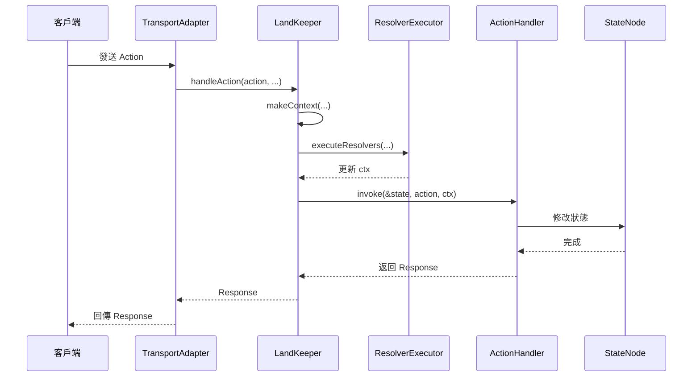
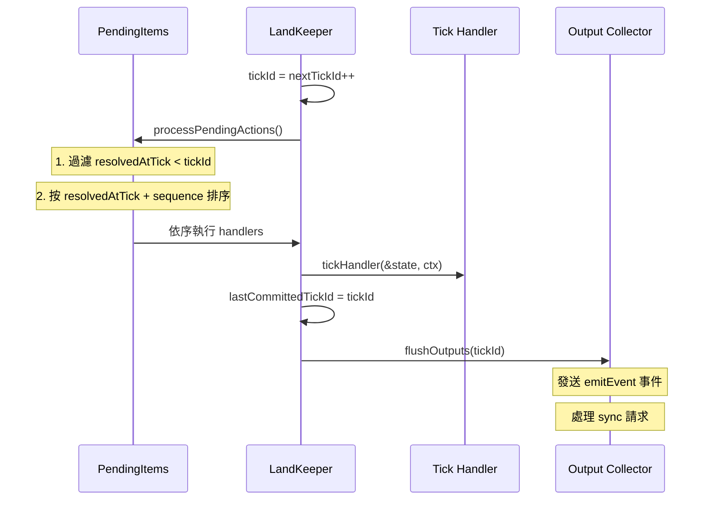

[English](runtime.md) | [中文版](runtime.zh-TW.md)

# Runtime 運作機制

> LandKeeper 是 SwiftStateTree 的運行時執行器，負責管理狀態、執行 handlers 和協調同步。

## 概述

`LandKeeper` 是 SwiftStateTree 的核心運行時組件，作為一個 `actor` 管理單一 Land 實例的完整生命週期。它負責：

- 管理權威狀態（StateNode）
- 執行 Land 定義的 handlers（Action、Event、Tick）
- 處理玩家加入/離開生命週期
- 協調狀態同步機制
- 管理定時任務（Tick）和自動銷毀

## 核心設計

### Actor 序列化

`LandKeeper` 是一個 `actor`，這意味著：

1. **單一房間內的序列化**：同一個 `LandKeeper` 實例內的所有操作會序列化執行，確保狀態一致性
2. **不同房間的並行執行**：每個房間有獨立的 `LandKeeper` 實例，可以並行執行

```swift
// 同一個房間內的操作會序列化
await keeper.handleAction(action, playerID: playerID, ...)
await keeper.handleEvent(event, playerID: playerID, ...)

// 不同房間的操作可以並行
await withTaskGroup(of: Void.self) { group in
    for room in rooms {
        group.addTask {
            await room.keeper.tick() // 並行執行
        }
    }
}
```

### Snapshot 同步模式

> 本節與[同步流程](#同步流程)描述的是 legacy 路徑（`IN_TURN_SYNC=false`）。預設情況下 sync phase 在 keeper 自己的 turn 內執行，見 [In-Turn Sync](#in-turn-sync預設)。

`LandKeeper` 使用 snapshot 模式進行同步，這是一個非阻塞的設計：

- **同步時取得快照**：同步操作在開始時取得狀態快照
- **不阻塞變更**：狀態變更可以與同步並行進行
- **一致性保證**：Actor 序列化確保每個同步都取得一致的快照
- **去重機制**：並發的同步請求會被去重，避免重複工作

```swift
// Sync 流程
guard let state = await keeper.beginSync(clearDirtyFlags: true) else {
    // 另一個同步正在進行，跳過（去重）
    return
}
defer { await keeper.endSync() }

// 使用 state 快照進行同步操作
// 此時狀態變更可以並行進行，不會阻塞
```

## 狀態管理

### 狀態變更

所有狀態變更都必須通過 `LandKeeper` 的方法進行：

```swift
// 在 handler 中變更狀態
HandleAction(SomeAction.self) { state, action, ctx in
    // state 是 inout 參數，可以直接修改
    state.someField = action.value
    return SomeResponse()
}
```

`LandKeeper` 透過 `withMutableStateSync` 執行每個 handler，直接修改 actor 的狀態：

```swift
// 內部實作（簡化版；debug build 另外檢查拋出錯誤的 handler 是否寫入，見 Input 與 Turn）
func withMutableStateSync<T>(_ operation: (inout State) throws -> T) rethrows -> T {
    // Actor 序列化確保線程安全
    return try operation(&state)
}
```

### 狀態讀取

讀取狀態有兩種方式：

1. **當前狀態**：`currentState()` - 取得當前狀態的快照（只讀）
2. **同步快照**：`beginSync(clearDirtyFlags:)` - 開始同步操作時取得的快照。僅供同步流程使用；讀取狀態請用 `currentState()`。傳入 `clearDirtyFlags: true` 會清除即時狀態的 dirty 標記，只想取得副本的讀取者若這樣呼叫，下一次同步就會漏掉這些變更。

```swift
// 讀取當前狀態（只讀）
let current = await keeper.currentState()

// 開始同步（取得快照）
guard let snapshot = await keeper.beginSync(clearDirtyFlags: true) else { return }
defer { await keeper.endSync() }
// 使用 snapshot 進行同步操作
```

## Request-Scoped LandContext

每次 Action/Event 請求都會建立一個新的 `LandContext`，處理完成後釋放。這類似於 NestJS 的 Request Context 設計模式。

### LandContext 特性

- **請求級別**：每個請求建立一個新的 `LandContext`
- **不持久化**：處理完成後釋放，不保留狀態
- **隔離 Transport**：透過閉包委派，不暴露 Transport 細節

```swift
// LandKeeper 內部建立 LandContext
func handleAction<A: ActionPayload>(_ action: A, ...) async throws -> AnyCodable {
    var ctx = makeContext(
        playerID: playerID,
        clientID: clientID,
        sessionID: sessionID
    )

    // 執行 Resolver（如果有的話）
    if !handler.resolverExecutors.isEmpty {
        ctx = try await ResolverExecutor.executeResolvers(...)
    }

    // 執行 handler
    return try withMutableStateSync { state in
        try handler.invoke(&state, action: action, ctx: ctx)
    }
}
```

### LandContext 功能

`LandContext` 提供以下功能：

- **識別資訊**：`playerID`、`clientID`、`sessionID`、`landID`
- **服務存取**：`services` - 外部服務抽象（資料庫、日誌等）
- **Deterministic 事件**：`emitEvent(_:to:)` - 將事件排入佇列，於 tick 結尾以 deterministic 順序 flush
- **Deterministic 同步**：`requestSyncNow()` / `requestSyncBroadcastOnly()` - 請求同步，於 tick 結尾以 deterministic 順序 flush
- **Resolver 輸出**：透過 `@dynamicMemberLookup` 存取 resolver 結果

## Handler 執行流程

### Action Handler 流程



### Input 與 Turn

Handler（action、client event、lifecycle、`Tick`）都是同步的：`(inout State, …, LandContext) throws`。狀態只在 handler 內改變，一次一個 input，依 keeper 套用的順序，而 reevaluation 錄製保留的正是這個順序。Handler 不能 await。非同步工作（讀資料庫、呼叫其他服務）請放在 resolver：resolver 在 handler 之前、turn 之外執行，其輸出透過 `ctx` 交給 handler 並被錄製，因此 replay 會重用輸出，而不是再呼叫一次服務。見 [Resolver 機制](resolver.zh-TW.md)。

Handler 拋出錯誤的 input 單獨失敗：

- 呼叫者收到錯誤，其後的 input 在同一輪照常套用；
- 它發出的 server event 會被丟棄；
- `OnJoin` 拋出錯誤的 join 會被捨棄；
- handler 在拋出前寫入狀態的內容會保留，下一次同步會送出（沒有逐 input 的 rollback，#87）；
- 它和其他 input 一樣被錄製，因此 replay 會再執行它，並以相同方式失敗。

**先驗證再修改。** 在 handler 第一次寫入狀態之前，先檢查所有可能拋出錯誤的條件，失敗的 input 就不會改變任何東西。Debug build 的 keeper 會檢查這件事：handler 拋出錯誤時，keeper 拿 handler 執行前的狀態副本比對同步狀態；若 handler 有寫入，就記錄一則警告，標明是哪個 input（`action <type>`、`event <type>`、`serverInput <type>`、`OnJoin`、`OnLeave`、`OnInitialize`），每個 land 的每種 input 只記一次。Destroy handler（`OnDestroyWhenEmpty`、`OnFinalize`）只在之後還有 destroy 階段的 handler 會讀取狀態時（`OnFinalize`、`AfterFinalize`、`OnShutdown`）才檢查。Re-evaluation 不檢查。`@Internal` 欄位不在比對範圍內，寫入它們不會被回報。另有兩個盲點：透過同步狀態裡的 class 實例寫入不會被發現，因為副本與原狀態共用同一個實例（同步狀態應為 value type，#464）；`Float` 或 `Double` 的 NaN 與自身比較不相等，所以沒有寫入就拋出錯誤的 handler 也可能發出警告，並用掉該 input 類型唯一的一次警告。這份副本讓大型 debug 遊戲每個 input 多付一次「第一次寫入各容器時的複製」；設 `DEBUG_WARN_THROWING_INPUT_WRITES=false` 可關閉檢查。Release build 不檢查，也不複製。

### Event Handler 流程

Event handler 的流程類似，但沒有返回值：

```swift
// Event handler 執行
func handleEvent<E: EventPayload>(_ event: E, ...) async {
    var ctx = makeContext(...)

    // 執行 Resolver（如果有的話）
    if !handler.resolverExecutors.isEmpty {
        ctx = try await ResolverExecutor.executeResolvers(...)
    }

    // 執行 handler（無返回值）
    try withMutableStateSync { state in
        try handler.invoke(&state, event: event, ctx: ctx)
    }
}
```

## 玩家生命週期

### Join 流程

玩家加入有兩個階段：

1. **CanJoin**：加入前的驗證（可選）
2. **OnJoin**：加入後的處理

```swift
// Join 流程
public func join(session: PlayerSession, ...) async throws -> JoinDecision {
    // 1. 執行 CanJoin handler（如果定義）
    if let canJoinHandler = definition.lifetimeHandlers.canJoin {
        decision = try canJoinHandler(state, session, ctx)
    }

    // 2. 如果被拒絕，直接返回
    guard case .allow(let playerID) = decision else {
        return decision
    }

    // 3. 檢查人數上限
    if let maxPlayers = definition.config.maxPlayers {
        guard players.count < maxPlayers else {
            throw JoinError.roomIsFull
        }
    }

    // 4. 執行 OnJoin handler（如果定義）
    if let onJoinHandler = definition.lifetimeHandlers.onJoin {
        // 執行 Resolver（如果有的話）
        // 執行 handler
        try withMutableStateSync { state in
            try onJoinHandler(&state, ctx)
        }
    }

    return decision
}
```

### Leave 流程

玩家離開時會執行 `OnLeave` handler：

```swift
public func leave(playerID: PlayerID, ...) async throws {
    // 執行 OnLeave handler（如果定義）
    if let onLeaveHandler = definition.lifetimeHandlers.onLeave {
        try withMutableStateSync { state in
            try onLeaveHandler(&state, ctx)
        }
    }

    // 清理玩家資料
    players.removeValue(forKey: playerID)

    // 檢查是否需要自動銷毀
    checkAutoDestroy()
}
```

## Tick 機制

### Tick 設定

在 Land DSL 中定義 Tick：

```swift
Lifetime {
    Tick(every: .milliseconds(100)) { (state: inout GameState, ctx: LandContext) in
        // 每 100ms 執行一次
        state.stepSimulation()
    }
}
```

### Tick 排程

Tick loop 與 sync loop 都是固定速率（fixed-rate）。下一個 deadline 是上一個 deadline 加上間隔，而不是「現在加上間隔」，所以 tick 佔掉部分間隔時速率仍維持不變。超時的 tick 不會引發一連串補跑的 tick：錯過的 deadline 會被略過，loop 從下一個仍在未來的 deadline 繼續。

每個 land 會以各自的 phase offset 延後其 loop 的第一次迭代，避免同時建立的 land（join ramp、server 啟動）在每個間隔的同一幾毫秒內跑 tick 與 sync。Offset 是 land ID 的 FNV-1a 64 對 `min(interval, 100 ms)` 取餘數（`LandLoopPhase`），在每個 process 都相同。它只移動 wall-clock 時間；tick ID、順序與 replay 不受影響。設定 `LAND_LOOP_PHASE_OFFSET=false` 可關閉。

### Event Queue 機制 (PendingItems)

`LandKeeper` 使用統一的 `pendingItems` 佇列來管理所有輸入：

- **Action**：客戶端發送的 Action
- **ClientEvent**：客戶端發送的 Event
- **Lifecycle Event**：`OnJoin`、`OnLeave`、`OnInitialize`

```swift
// 統一的 PendingItem 類型
public enum PendingItem: Sendable {
    case action(PendingActionItem)
    case clientEvent(PendingClientEventItem)
    case lifecycle(PendingLifecycleItem)
}
```

每個 PendingItem 都會記錄：

- `sequence`：全域遞增的序號（跨 Action/Event/Lifecycle 共用）
- `resolvedAtTick`：Resolver 完成時的 tick ID
- `resolverOutputs`：Resolver 輸出（Action 和 Lifecycle 有，ClientEvent 為空）

### Tick 執行模型

每個 Tick 的執行順序：



排序規則確保 **Deterministic Replay**：

1. **Primary**: `resolvedAtTick`（Resolver 完成的 tick）
2. **Secondary**: `sequence`（接收順序）

### Deterministic Output 機制

Handler 中的事件發送和同步請求會被收集到 `OutputCollector`，在 tick 結尾統一 flush：

```swift
// ✅ 正確：使用 emitEvent（同步 API，deterministic）
HandleAction(AttackAction.self) { state, action, ctx in
    state.applyDamage(action.damage)

    // 事件會排入佇列，在 tick 結尾發送
    ctx.emitEvent(DamageEvent(damage: action.damage), to: .all)

    return AttackResponse(success: true)
}

// ❌ 避免：使用 spawn + sendEvent（async，non-deterministic）
// ctx.spawn { await ctx.sendEvent(...) }
```

`LandContext` 提供的 deterministic 方法：

| 方法                         | 說明                        |
| ---------------------------- | --------------------------- |
| `emitEvent(_:to:)`           | 排入事件佇列，tick 結尾發送 |
| `requestSyncNow()`           | 請求立即同步，tick 結尾執行 |
| `requestSyncBroadcastOnly()` | 請求廣播同步，tick 結尾執行 |

### Tick 執行

`LandKeeper` 會自動管理 Tick 任務：

```swift
// 初始化時啟動 Tick
Task {
    // 執行一次 OnInitialize（如果定義），先跑 resolver
    await ensureInitialized()

    // 啟動 Tick loop
    if let interval = definition.lifetimeHandlers.tickInterval {
        await configureTickLoop(interval: interval)
    }
}

// Tick loop（簡化版）
private func runTick() async {
    let tickId = nextTickId
    nextTickId += 1

    // 1. 處理待執行的 Action/Event/Lifecycle
    try await processPendingActions()

    // 2. 執行 Tick handler
    if let tickHandler = definition.lifetimeHandlers.tickHandler {
        tickHandler(&state, makeContext(tickId: tickId))
    }

    // 3. 更新已提交的 tick ID
    lastCommittedTickId = tickId

    // 4. Flush deterministic outputs
    await flushOutputs(forTick: tickId)
}
```

## 同步機制

### 更新模式

Land 以三種方式之一同步（前兩種的 `LandKeeper.hasPeriodicSync` 為 true）：

| Land | 同步 | 適用 |
|---|---|---|
| `Tick`（有無 `StateSync` 皆可） | sync loop 以 `StateSync` 間隔執行；未設定 `StateSync` 時以 tick 間隔執行 | 有模擬步進的即時遊戲（Hero Defense：tick 50 ms、`StateSync` 100 ms） |
| 只有 `StateSync`、沒有 `Tick` | sync loop 以其間隔執行；input 一到就套用 | 狀態只因 input 改變、需要穩定更新頻率的遊戲 |
| 兩者皆無 | 只在請求時同步：handler 內的 `ctx.requestSyncNow()` / `ctx.requestSyncBroadcastOnly()`，或 host 呼叫 adapter 的 `syncNow()` | 回合制或低流量的 land |

沒有週期同步的 land 沒有下一個 cycle 可以依靠，因此 runtime 會重試它不得不略過的 cycle（見 [Writer Back-Pressure](#writer-back-pressure)）。

### In-Turn Sync（預設）

開啟 in-turn sync 時，land 的 `TransportAdapter` 在其 keeper 的 serial executor 上執行，keeper 在自己的 turn 內同步執行 sync phase，狀態變更與其產生的 frame 之間沒有任何 suspension point（`InTurnSync`）。Turn 的種類：

- tick turn：就緒的 input、tick handler、送出的 event，以及 handler 請求或 sync loop 併入（fold）時的 sync phase。距下一個 tick 不到 min(5 ms, tick / 4, sync / 4) 的 sync 會在該 tick turn 執行（coincident sync），因此與 tick 重合的 sync 會看到該 tick 的結果；
- sync-only turn：sync loop 自己的間隔，維持同步節奏；
- input turn（沒有 tick 的 land）：最多 64 個就緒的 input、它們的 event，以及有請求時的 sync phase。Turn 進行中到達的 input 會留到之後的 turn。

Sync phase 以 turn 中該時點的狀態規劃（plan）本次 cycle 的所有 frame，然後 commit：把 frame 放進 adapter 的 outbound writer，並清除 dirty flag。Plan 與 commit 之間沒有任何其他工作執行，因此不會有尚未送出的變更被清除。Plan 失敗時什麼都不 commit，dirty flag 保留到下一個 cycle。

已知限制：

- Joiner 的第一次同步，以及其 `OnJoin` 效果送給該 joiner 的部分，仍在 turn 之外執行。<!-- TODO(#194): #194 合併後描述 in-turn join。 -->
- Debug freeze 的 settle 仍執行一次 `beginSync` / `endSync` cycle。
- Handler 拋出錯誤的 input 單獨失敗，與 legacy 路徑相同：呼叫者收到錯誤，該 input 被移除並記錄，同一 turn 的其他 input 照常套用。狀態保留 handler 在拋出前寫入的內容，下一次同步會送出（[先驗證再修改](#input-與-turn)）。
- Re-evaluation 的 keeper 一律走 legacy 路徑。

`IN_TURN_SYNC=false` 是 kill switch：adapter 保留自己的 executor，透過 `beginSync` / `endSync` 同步（[同步流程](#同步流程)）。Adapter 在 init 時決定一次，keeper 跟隨它。

### Writer Back-Pressure

每個 adapter 都透過一個有序的 outbound writer 送出。當 writer 仍持有先前 cycle 的 sync frame 時，新的 cycle 會在取得 copy 之前被略過：不做任何 plan，dirty flag 與排隊中的 event 保留，下一個 cycle 會與最後送出的狀態做 diff，因此包含所有變更。有週期同步的 land 靠它的下一個週期 cycle；沒有的 land 會在 writer 清空後重試一次。過載因此變成略過的 cycle，而不是不斷增長的佇列。Event 與 action response 的 frame 不會被擋下。開啟 in-turn sync 時，被略過的 phase 記為 deferred turn；transport profiler 會回報兩者（見 [Transport](../transport/README.zh-TW.md#profiling)）。

### 同步流程

> Legacy 路徑（`IN_TURN_SYNC=false`）。

同步使用 snapshot 模式，不阻塞狀態變更：

```swift
// 開始同步
public func beginSync(clearDirtyFlags: Bool) -> State? {
    guard !isSyncing else {
        return nil  // 去重：跳過並發的同步請求
    }
    isSyncing = true
    let snapshot = state  // 直接取得快照，不阻塞
    if clearDirtyFlags {
        state.clearDirty()  // 清除即時狀態的 dirty 標記；快照保留自己的標記
    }
    return snapshot
}

// 結束同步
public func endSync() {
    isSyncing = false
}
```

Dirty 標記在 `beginSync` 中清除，與取得快照位於同一個 actor 回合。快照保留自己的 dirty 標記，因此同步週期能看到上一個會清除標記的週期以來的所有變更；同步進行中發生的狀態變更則維持 dirty，留給下一個週期。`TransportAdapter` 在 broadcast-only 週期（不比對 per-player 欄位）以及停用 dirty tracking 時傳入 `clearDirtyFlags: false`。`clearDirtyFlags` 沒有預設值，每個呼叫端都必須明確決定。`endSync(clearDirtyFlags:)` 已標記為 deprecated，並忽略其參數；請改把這個選擇傳給 `beginSync(clearDirtyFlags:)`。

### 同步去重

`isSyncing` 標記用於去重，不是用於阻塞：

- 當同步進行中時，並發的同步請求會被跳過
- 狀態變更（Action/Event）不會被阻塞，可以並行進行
- 每個同步都取得一致的快照（actor 序列化保證）

### Dirty Tracking

狀態變更時會自動標記 dirty：

```swift
// 在 StateNode 中
@Sync(.broadcast)
var players: [PlayerID: PlayerState] = [:] {
    didSet {
        markDirty()  // 自動標記 dirty
    }
}
```

完整的同步週期在取得快照時會清除 dirty 標記（見同步流程）。若要手動清除：

```swift
// 清除所有 dirty 標記
state.clearDirty()
```

## 自動銷毀

### 銷毀條件

在 Land DSL 中定義銷毀條件：

```swift
Lifetime {
    DestroyWhenEmpty(after: .seconds(60)) { state, ctx in
        // 空房間 60 秒後銷毀，可在這裡執行清理邏輯
        ctx.logger.info("Land is empty, destroying...")
    }
}
```

### 銷毀檢查

`LandKeeper` 會在適當的時機檢查銷毀條件：

```swift
// 玩家離開時檢查
private func checkAutoDestroy() {
    if players.isEmpty {
        // 啟動銷毀計時器
        destroyTask = Task {
            try? await safeTaskSleep(for: destroyDelay)
            // 執行銷毀邏輯
        }
    } else {
        // 有玩家加入，取消銷毀
        destroyTask?.cancel()
        destroyTask = nil
    }
}
```

## 最佳實踐

1. **避免長時間運行的 handler**：handler 應該快速執行。非同步 I/O 請在 handler 之外處理（例如 Resolver + 快取輸出，或外部 pipeline）。
2. **合理使用 Resolver**：將資料載入邏輯放在 Resolver 中，handler 保持同步
3. **注意狀態變更範圍**：只在 handler 中變更狀態，不要在 Resolver 中變更
4. **利用 Actor 序列化**：不需要額外的鎖機制，actor 自動保證線程安全

## 相關文檔

- [核心概念](README.zh-TW.md) - 了解 StateNode 和 Land DSL
- [同步規則](sync.zh-TW.md) - 深入了解同步機制
- [Resolver 機制](resolver.zh-TW.md) - Resolver 使用指南
- [Transport 層](../transport/README.zh-TW.md) - 了解 TransportAdapter 如何與 LandKeeper 互動
