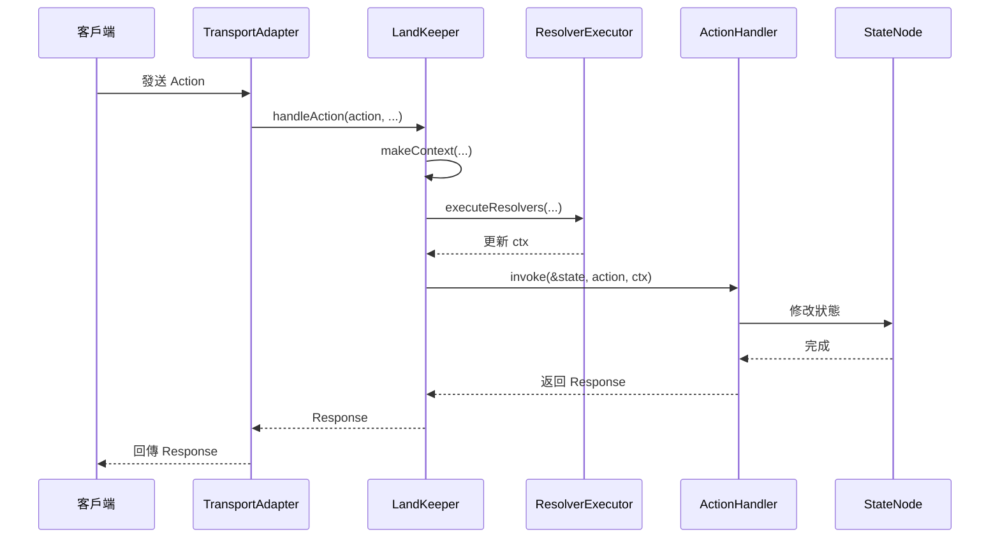
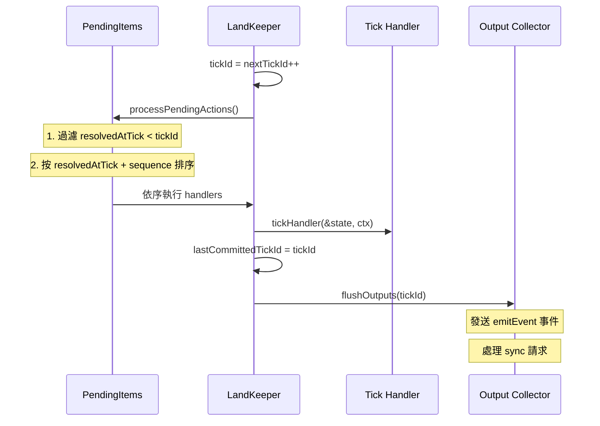

[English](runtime.md) | [中文版](runtime.zh-TW.md)

# Runtime 運作機制

> LandKeeper 是 SwiftStateTree 的運行時執行器，負責管理狀態、執行 handlers 和協調同步。

## 概述

`LandKeeper` 是 SwiftStateTree 的核心運行時組件，作為一個 `actor` 管理單一 Land 實例的完整生命週期。它負責：

- 管理權威狀態（StateNode）
- 執行 Land 定義的 handlers（Action、Event、Tick）
- 處理玩家加入/離開生命週期
- 協調狀態同步機制
- 管理定時任務（Tick）和自動銷毀

## 核心設計

### Actor 序列化

`LandKeeper` 是一個 `actor`，這意味著：

1. **單一房間內的序列化**：同一個 `LandKeeper` 實例內的所有操作會序列化執行，確保狀態一致性
2. **不同房間的並行執行**：每個房間有獨立的 `LandKeeper` 實例，可以並行執行

```swift
// 同一個房間內的操作會序列化
await keeper.handleAction(action, playerID: playerID, ...)
await keeper.handleEvent(event, playerID: playerID, ...)

// 不同房間的操作可以並行
await withTaskGroup(of: Void.self) { group in
    for room in rooms {
        group.addTask {
            await room.keeper.tick() // 並行執行
        }
    }
}
```

### Snapshot 同步模式

> 本節與[同步流程](#同步流程)描述的是 keeper 的 legacy 路徑，也就是 `beginSync` / `endSync` cycle。`TransportAdapter` 已不再走這條路徑：在 live land 上，sync phase 在 keeper 自己的 turn 內執行，見 [In-Turn Sync](#in-turn-sync預設)。在 #546 L2d 移除它之前，只有測試與直接呼叫公開 `beginSync` 的程式碼仍會用到這個 cycle。

`LandKeeper` 使用 snapshot 模式進行同步，這是一個非阻塞的設計：

- **同步時取得快照**：同步操作在開始時取得狀態快照
- **不阻塞變更**：狀態變更可以與同步並行進行
- **一致性保證**：Actor 序列化確保每個同步都取得一致的快照
- **去重機制**：並發的同步請求會被去重，避免重複工作

```swift
// Sync 流程
guard let state = await keeper.beginSync(clearDirtyFlags: true) else {
    // 另一個同步正在進行，跳過（去重）
    return
}
defer { await keeper.endSync() }

// 使用 state 快照進行同步操作
// 此時狀態變更可以並行進行，不會阻塞
```

## 狀態管理

### 狀態變更

所有狀態變更都必須通過 `LandKeeper` 的方法進行：

```swift
// 在 handler 中變更狀態
HandleAction(SomeAction.self) { state, action, ctx in
    // state 是 inout 參數，可以直接修改
    state.someField = action.value
    return SomeResponse()
}
```

`LandKeeper` 透過 `withMutableStateSync` 執行每個 handler，直接修改 actor 的狀態：

```swift
// 內部實作（簡化版）
func withMutableStateSync<T>(_ operation: (inout State) throws -> T) rethrows -> T {
    // Actor 序列化確保線程安全
    return try operation(&state)
}
```

### 狀態讀取

讀取狀態有兩種方式：

1. **當前狀態**：`currentState()` - 取得當前狀態的快照（只讀）
2. **同步快照**：`beginSync(clearDirtyFlags:)` - 開始同步操作時取得的快照。僅供同步流程使用；讀取狀態請用 `currentState()`。傳入 `clearDirtyFlags: true` 會清除即時狀態的 dirty 標記，只想取得副本的讀取者若這樣呼叫，下一次同步就會漏掉這些變更。

```swift
// 讀取當前狀態（只讀）
let current = await keeper.currentState()

// 開始同步（取得快照）
guard let snapshot = await keeper.beginSync(clearDirtyFlags: true) else { return }
defer { await keeper.endSync() }
// 使用 snapshot 進行同步操作
```

## Request-Scoped LandContext

每次 Action/Event 請求都會建立一個新的 `LandContext`，處理完成後釋放。這類似於 NestJS 的 Request Context 設計模式。

### LandContext 特性

- **請求級別**：每個請求建立一個新的 `LandContext`
- **不持久化**：處理完成後釋放，不保留狀態
- **隔離 Transport**：透過閉包委派，不暴露 Transport 細節

```swift
// LandKeeper 內部建立 LandContext
func handleAction<A: ActionPayload>(_ action: A, ...) async throws -> AnyCodable {
    var ctx = makeContext(
        playerID: playerID,
        clientID: clientID,
        sessionID: sessionID
    )

    // 執行 Resolver（如果有的話）
    if !handler.resolverExecutors.isEmpty {
        ctx = try await ResolverExecutor.executeResolvers(...)
    }

    // 執行 handler
    return try withMutableStateSync { state in
        try handler.invoke(&state, action: action, ctx: ctx)
    }
}
```

### LandContext 功能

`LandContext` 提供以下功能：

- **識別資訊**：`playerID`、`clientID`、`sessionID`、`landID`
- **服務存取**：`services` - 外部服務抽象（資料庫、日誌等）
- **Deterministic 事件**：`emitEvent(_:to:)` - 將事件排入佇列，於 tick 結尾以 deterministic 順序 flush
- **Deterministic 同步**：`requestSyncNow()` / `requestSyncBroadcastOnly()` - 請求同步，於 tick 結尾以 deterministic 順序 flush
- **Resolver 輸出**：透過 `@dynamicMemberLookup` 存取 resolver 結果

## Handler 執行流程

### Action Handler 流程



### Input 與 Turn

Handler（action、client event、server input、lifecycle、`Tick`）都是同步的：`(inout State, …, LandContext)`。狀態只在 handler 內改變，一次一個 input，依 keeper 套用的順序，而 reevaluation 錄製保留的正是這個順序。Handler 不能 await。非同步工作（讀資料庫、呼叫其他服務）請放在 resolver：resolver 在 handler 之前、turn 之外執行，其輸出透過 `ctx` 交給 handler 並被錄製，因此 replay 會重用輸出，而不是再呼叫一次服務。見 [Resolver 機制](resolver.zh-TW.md)。

Handler 寫入後不能再拋出錯誤（#586）。`HandleAction`、`HandleEvent`、`HandleServerInput`、`OnJoin` 與 `OnLeave` 的 body 都不會拋出錯誤。可被拒絕的 input 宣告 `validate` 與 `apply`（[Land DSL：兩段式 Handler](land-dsl.zh-TW.md#兩段式-handler)）：`validate` 讀取狀態且可拋出錯誤，`apply` 寫入且不能拋出，兩者在同一個 turn 內接連執行。`validate` 拋出錯誤的 input 單獨失敗，什麼都不寫入：

- 其後的 input 在同一輪照常套用；
- 在 tickless land 上，action 的呼叫者收到錯誤（`ACTION_HANDLER_ERROR`）。在 tick land 上，呼叫者在 action 排入佇列時就已收到確認（handler 在之後的 tick 執行），所以失敗只會記錄在 log（`Input refused: its validate threw`），不會傳回呼叫者。Client event 的錯誤以 error payload 送給 client；server input 的錯誤記錄在 log。在收件階段發生的錯誤（未註冊的 action、解碼失敗、resolver 的錯誤、遞送被拒）在兩種 land 上都會傳回呼叫者；
- 它不發出任何東西：`validate` 不能發出 event，`apply` 也不會執行；
- 它和其他 input 一樣被錄製，並列為 rejected，因此 replay 會再執行它的 `validate`，並檢查拒絕的是相同的 input（[Reevaluation：被拒絕的 input](reevaluation.zh-TW.md#被拒絕的-input35)）。

`OnJoin` 與 `OnLeave` 不會失敗：玩家能否加入由 `CanJoin` 決定（[Land DSL：Join 檢查](land-dsl.zh-TW.md#join-檢查)），離開則一定會發生。`OnInitialize` 與 destroy 階段的 handler（`OnFinalize`、`OnDestroyWhenEmpty`）仍可拋出錯誤，並保留拋出前寫入的內容。

### Event Handler 流程

Event handler 的流程類似，但沒有返回值：

```swift
// Event handler 執行
func handleEvent<E: EventPayload>(_ event: E, ...) async {
    var ctx = makeContext(...)

    // 執行 Resolver（如果有的話）
    if !handler.resolverExecutors.isEmpty {
        ctx = try await ResolverExecutor.executeResolvers(...)
    }

    // 執行 handler（無返回值）
    try withMutableStateSync { state in
        try handler.invoke(&state, event: event, ctx: ctx)
    }
}
```

## 玩家生命週期

### Join 流程

玩家加入有兩個階段：

1. **CanJoin**：加入前的驗證（可選）
2. **OnJoin**：加入後的處理

```swift
// Join 流程
public func join(session: PlayerSession, ...) async throws -> JoinDecision {
    // 1. 執行 CanJoin handler（如果定義）
    if let canJoinHandler = definition.lifetimeHandlers.canJoin {
        decision = try canJoinHandler(state, session, ctx)
    }

    // 2. 如果被拒絕，直接返回
    guard case .allow(let playerID) = decision else {
        return decision
    }

    // 3. 檢查人數上限
    if let maxPlayers = definition.config.maxPlayers {
        guard players.count < maxPlayers else {
            throw JoinError.roomIsFull
        }
    }

    // 4. 執行 OnJoin handler（如果定義）
    if let onJoinHandler = definition.lifetimeHandlers.onJoin {
        // 執行 Resolver（如果有的話）
        // 執行 handler
        withMutableStateSync { state in
            onJoinHandler(&state, ctx)
        }
    }

    return decision
}
```

### Leave 流程

玩家離開時會執行 `OnLeave` handler：

```swift
public func leave(playerID: PlayerID, ...) async throws {
    // 執行 OnLeave handler（如果定義）
    if let onLeaveHandler = definition.lifetimeHandlers.onLeave {
        withMutableStateSync { state in
            onLeaveHandler(&state, ctx)
        }
    }

    // 清理玩家資料
    players.removeValue(forKey: playerID)

    // 檢查是否需要自動銷毀
    checkAutoDestroy()
}
```

## Tick 機制

### Tick 設定

在 Land DSL 中定義 Tick：

```swift
Lifetime {
    Tick(every: .milliseconds(100)) { (state: inout GameState, ctx: LandContext) in
        // 每 100ms 執行一次
        state.stepSimulation()
    }
}
```

### Tick 排程

Tick loop 與 sync loop 都是固定速率（fixed-rate）。下一個 deadline 是上一個 deadline 加上間隔，而不是「現在加上間隔」，所以 tick 佔掉部分間隔時速率仍維持不變。超時的 tick 不會引發一連串補跑的 tick：錯過的 deadline 會被略過，loop 從下一個仍在未來的 deadline 繼續。

每個 land 會以各自的 phase offset 延後其 loop 的第一次迭代，避免同時建立的 land（join ramp、server 啟動）在每個間隔的同一幾毫秒內跑 tick 與 sync。Offset 是 land ID 的 FNV-1a 64 對 `min(interval, 100 ms)` 取餘數（`LandLoopPhase`），在每個 process 都相同。它只移動 wall-clock 時間；tick ID、順序與 replay 不受影響。設定 `LAND_LOOP_PHASE_OFFSET=false` 可關閉。

### Event Queue 機制 (PendingItems)

`LandKeeper` 使用統一的 `pendingItems` 佇列來管理所有輸入：

- **Action**：客戶端發送的 Action
- **ClientEvent**：客戶端發送的 Event
- **Lifecycle Event**：`OnJoin`、`OnLeave`、`OnInitialize`

```swift
// 統一的 PendingItem 類型
public enum PendingItem: Sendable {
    case action(PendingActionItem)
    case clientEvent(PendingClientEventItem)
    case lifecycle(PendingLifecycleItem)
}
```

每個 PendingItem 都會記錄：

- `sequence`：全域遞增的序號（跨 Action/Event/Lifecycle 共用）
- `resolvedAtTick`：Resolver 完成時的 tick ID
- `resolverOutputs`：Resolver 輸出（Action 和 Lifecycle 有，ClientEvent 為空）

### Tick 執行模型

每個 Tick 的執行順序：



排序規則確保 **Deterministic Replay**：

1. **Primary**: `resolvedAtTick`（Resolver 完成的 tick）
2. **Secondary**: `sequence`（接收順序）

### Deterministic Output 機制

Handler 中的事件發送和同步請求會被收集到 `OutputCollector`，在 tick 結尾統一 flush：

```swift
// ✅ 正確：使用 emitEvent（同步 API，deterministic）
HandleAction(AttackAction.self) { state, action, ctx in
    state.applyDamage(action.damage)

    // 事件會排入佇列，在 tick 結尾發送
    ctx.emitEvent(DamageEvent(damage: action.damage), to: .all)

    return AttackResponse(success: true)
}

// ❌ 避免：使用 spawn + sendEvent（async，non-deterministic）
// ctx.spawn { await ctx.sendEvent(...) }
```

`LandContext` 提供的 deterministic 方法：

| 方法                         | 說明                        |
| ---------------------------- | --------------------------- |
| `emitEvent(_:to:)`           | 排入事件佇列，tick 結尾發送 |
| `requestSyncNow()`           | 請求立即同步，tick 結尾執行 |
| `requestSyncBroadcastOnly()` | 請求廣播同步，tick 結尾執行 |

### Tick 執行

`LandKeeper` 會自動管理 Tick 任務：

```swift
// 初始化時啟動 Tick
Task {
    // 執行一次 OnInitialize（如果定義），先跑 resolver
    await ensureInitialized()

    // 啟動 Tick loop
    if let interval = definition.lifetimeHandlers.tickInterval {
        await configureTickLoop(interval: interval)
    }
}

// Tick loop（簡化版）
private func runTick() async {
    let tickId = nextTickId
    nextTickId += 1

    // 1. 處理待執行的 Action/Event/Lifecycle
    try await processPendingActions()

    // 2. 執行 Tick handler
    if let tickHandler = definition.lifetimeHandlers.tickHandler {
        tickHandler(&state, makeContext(tickId: tickId))
    }

    // 3. 更新已提交的 tick ID
    lastCommittedTickId = tickId

    // 4. Flush deterministic outputs
    await flushOutputs(forTick: tickId)
}
```

## 同步機制

### 更新模式

Land 以三種方式之一同步（前兩種的 `LandKeeper.hasPeriodicSync` 為 true）：

| Land | 同步 | 適用 |
|---|---|---|
| `Tick`（有無 `StateSync` 皆可） | sync loop 以 `StateSync` 間隔執行；未設定 `StateSync` 時以 tick 間隔執行 | 有模擬步進的即時遊戲（Hero Defense：tick 50 ms、`StateSync` 100 ms） |
| 只有 `StateSync`、沒有 `Tick` | sync loop 以其間隔執行；input 一到就套用 | 狀態只因 input 改變、需要穩定更新頻率的遊戲 |
| 兩者皆無 | 只在請求時同步：handler 內的 `ctx.requestSyncNow()` / `ctx.requestSyncBroadcastOnly()`，或 host 呼叫 adapter 的 `syncNow()` | 回合制或低流量的 land |

沒有週期同步的 land 沒有下一個 cycle 可以依靠，因此 runtime 會重試它不得不略過的 cycle（見 [Writer Back-Pressure](#writer-back-pressure)）。

### In-Turn Sync（預設）

開啟 in-turn sync 時，land 的 `TransportAdapter` 在其 keeper 的 serial executor 上執行，keeper 在自己的 turn 內同步執行 sync phase，狀態變更與其產生的 frame 之間沒有任何 suspension point。Turn 的種類：

- tick turn：就緒的 input、tick handler、送出的 event，以及 handler 請求或 sync loop 併入（fold）時的 sync phase。距下一個 tick 不到 min(5 ms, tick / 4, sync / 4) 的 sync 會在該 tick turn 執行（coincident sync），因此與 tick 重合的 sync 會看到該 tick 的結果；
- sync-only turn：sync loop 自己的間隔，維持同步節奏；或一次被請求的同步。被請求的同步包括 adapter 的 `syncNow()`、lag timer 要求的同步、joiner 的 firstSync 讀到已被 commit 超前的 state 後的補發，以及 freeze 的 resume。它在請求返回前以一個 sync-only turn 執行。沒有週期同步的 land 上，一次 commit 後若仍有事件留在佇列，緊接著會再跑一個 sync-only turn；
- input turn（沒有 tick 的 land）：最多 64 個就緒的 input、它們的 event，以及有請求時的 sync phase。Turn 進行中到達的 input 會留到之後的 turn。

Sync phase 以 turn 中該時點的狀態規劃（plan）本次 cycle 的所有 frame，然後 commit：把 frame 放進 adapter 的 outbound writer，並清除 dirty flag。Plan 與 commit 之間沒有任何其他工作執行，因此不會有尚未送出的變更被清除。Plan 失敗時什麼都不 commit，dirty flag 保留到下一個 cycle。

Join 在它 flip 的那個 turn 的 sync phase 中完成（#69、#194）。Joiner 的完整 view 以該 turn 結束時的狀態規劃，與其他接收者的 diff 在同一個 plan 中，它的 frame 排在其他人之後：先是 JoinResponse，再是 firstSync，然後是它的 `OnJoin` 發給它、一直保留到此時的 targeted event。

已知限制：

- Debug freeze 的 settle 是它自己的一個 sync-only turn。它依序確認：land 是 live、沒有失敗也還沒開始關閉，settle 的期限還沒過，仍是同一次 freeze，且經由 keeper 的同步 adapter 執行：也就是掛載到 keeper 的 adapter；若 keeper 從未掛載，則是 keeper 接受其同步請求的那個 adapter。接著在同一個 turn 內從凍結的 state 規劃並 commit 一次 sync phase，不因 writer back-pressure 延後，也不 flip join；凍結期間執行的一般 phase 仍把同步留給 resume。檢查未通過的 settle 什麼都不規劃：freeze 已釋放時回 `released`，land 已失敗時回該失敗，正在關閉時回 `LandInputRejection.landClosed`。它的 plan 第一次拋出錯誤就在該 turn 結束 land，與任何 sync phase 相同。它不會接手其他 turn 待辦的同步工作，那些由 resume 送出。之後的 resume 會提出兩個請求。第一，凍結期間被延後的同步以一個 sync-only turn 執行。第二，已就緒但尚未 flip 的 join 另外得到一個 sync-only turn。以下情況會跳過第二個請求：第一個請求因 writer back-pressure 被延後（由重試或下一次週期 phase flip 它們）、land 已失敗，或兩者之間 land 又被凍結（由那次凍結的 resume 提出）。
- `validate` 拋出錯誤的 input 單獨失敗，與 legacy 路徑相同：在 tickless land 上呼叫者收到錯誤（在 tick land 上，它在收件時已被確認，失敗只記錄在 log），該 input 被移除並記錄為 rejected，同一 turn 的其他 input 照常套用。它什麼都沒寫入，因此下一次同步沒有它的內容要送（[Input 與 Turn](#input-與-turn)）。
- 沒有 transport 的 live keeper 也執行同樣的 turn。Benchmark 的 worker pool，或直接驅動 keeper 的測試，就是這種 keeper。它的 turn 會取出並記錄 event 與同步請求，但不送往任何地方。
- Live keeper 會拒絕無法在 turn 內執行 sync phase 的 transport，並停止 process（[掛載 transport](../transport/README.zh-TW.md#掛載-transport)）。
- Re-evaluation 的 keeper 一律走 legacy 路徑。

In-turn sync 無法關閉。`IN_TURN_SYNC` 環境變數原本是它的開關，現已移除：仍設定它的 server 會忽略它，process 中第一個 adapter 會記錄一筆 warning 指出它。

### Writer Back-Pressure

每個 adapter 都透過一個有序的 outbound writer 送出。當 writer 仍持有先前 cycle 的 sync frame 時，新的 cycle 會在取得 copy 之前被略過：不做任何 plan，dirty flag 與排隊中的 event 保留，下一個 cycle 會與最後送出的狀態做 diff，因此包含所有變更。有週期同步的 land 靠它的下一個週期 cycle；沒有的 land 會在 writer 清空後重試一次。過載因此變成略過的 cycle，而不是不斷增長的佇列。Event 與 action response 的 frame 不會被擋下。被略過的 phase 同時記為一次略過與一個 deferred turn；transport profiler 會回報兩者（見 [Transport](../transport/README.zh-TW.md#profiling)）。

### 同步流程

> Keeper 的 legacy 路徑，也就是 `beginSync` / `endSync` cycle。`TransportAdapter` 已不再走這條路徑。

同步使用 snapshot 模式，不阻塞狀態變更：

```swift
// 開始同步
public func beginSync(clearDirtyFlags: Bool) -> State? {
    guard !isSyncing else {
        return nil  // 去重：跳過並發的同步請求
    }
    isSyncing = true
    let snapshot = state  // 直接取得快照，不阻塞
    if clearDirtyFlags {
        state.clearDirty()  // 清除即時狀態的 dirty 標記；快照保留自己的標記
    }
    return snapshot
}

// 結束同步
public func endSync() {
    isSyncing = false
}
```

Dirty 標記在 `beginSync` 中清除，與取得快照位於同一個 actor 回合。快照保留自己的 dirty 標記，因此同步週期能看到上一個會清除標記的週期以來的所有變更；同步進行中發生的狀態變更則維持 dirty，留給下一個週期。`clearDirtyFlags` 沒有預設值，每個呼叫端都必須明確決定。`endSync(clearDirtyFlags:)` 已標記為 deprecated，並忽略其參數；請改把這個選擇傳給 `beginSync(clearDirtyFlags:)`。

### 同步去重

> 這是 legacy 路徑。In-turn sync 下，同步請求是一個 turn，不會被跳過（[In-Turn Sync](#in-turn-sync預設)）。

`isSyncing` 標記用於去重，不是用於阻塞：

- 當同步進行中時，並發的同步請求會被跳過
- 狀態變更（Action/Event）不會被阻塞，可以並行進行
- 每個同步都取得一致的快照（actor 序列化保證）

### Dirty Tracking

狀態變更時會自動標記 dirty：

```swift
// 在 StateNode 中
@Sync(.broadcast)
var players: [PlayerID: PlayerState] = [:] {
    didSet {
        markDirty()  // 自動標記 dirty
    }
}
```

完整的同步週期在取得快照時會清除 dirty 標記（見同步流程）。若要手動清除：

```swift
// 清除所有 dirty 標記
state.clearDirty()
```

## 自動銷毀

### 銷毀條件

在 Land DSL 中定義銷毀條件：

```swift
Lifetime {
    DestroyWhenEmpty(after: .seconds(60)) { state, ctx in
        // 空房間 60 秒後銷毀，可在這裡執行清理邏輯
        ctx.logger.info("Land is empty, destroying...")
    }
}
```

### 銷毀檢查

`LandKeeper` 會在適當的時機檢查銷毀條件：

```swift
// 玩家離開時檢查
private func checkAutoDestroy() {
    if players.isEmpty {
        // 啟動銷毀計時器
        destroyTask = Task {
            try? await safeTaskSleep(for: destroyDelay)
            // 執行銷毀邏輯
        }
    } else {
        // 有玩家加入，取消銷毀
        destroyTask?.cancel()
        destroyTask = nil
    }
}
```

## 最佳實踐

1. **避免長時間運行的 handler**：handler 應該快速執行。非同步 I/O 請在 handler 之外處理（例如 Resolver + 快取輸出，或外部 pipeline）。
2. **合理使用 Resolver**：將資料載入邏輯放在 Resolver 中，handler 保持同步
3. **注意狀態變更範圍**：只在 handler 中變更狀態，不要在 Resolver 中變更
4. **利用 Actor 序列化**：不需要額外的鎖機制，actor 自動保證線程安全

## 相關文檔

- [核心概念](README.zh-TW.md) - 了解 StateNode 和 Land DSL
- [同步規則](sync.zh-TW.md) - 深入了解同步機制
- [Resolver 機制](resolver.zh-TW.md) - Resolver 使用指南
- [Transport 層](../transport/README.zh-TW.md) - 了解 TransportAdapter 如何與 LandKeeper 互動
