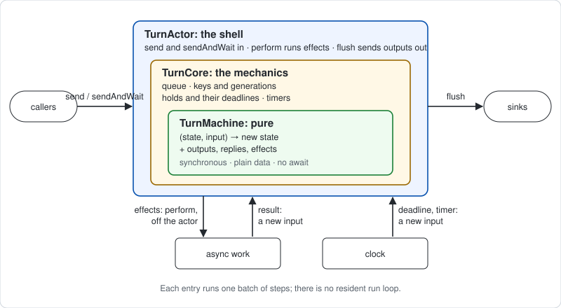

[English](README.md) | [中文版](README.zh-TW.md)

# The turn core (SwiftStateTurns)

`SwiftStateTurns` is a small library target in this package. It is a way to write an actor whose state changes only in synchronous steps. Land authors don't use it directly. It is the base that the transport layer's own actors move onto, one at a time. Its API reference and articles are the DocC catalog in `Sources/SwiftStateTurns/SwiftStateTurns.docc`; this page summarizes them.

## What a turn is

An actor's methods run one at a time. But every `await` inside a method lets other calls run first. State that a method checked before an `await` may be stale after it. A method that changes state after an `await` acts on a world that has moved on.

A *turn* is the actor's unit of work: one job, run to completion, with no suspension in it. This is the actor-model sense of the word, not a turn in a game. The turn core makes every change to an actor's state happen inside one turn, as a synchronous *step* of a value-type machine. A step is one call of the machine's handler with one input.

## How the pieces fit



- **`TurnMachine`**: The pure state machine. A step takes the state and one input. It returns the new state, plus outputs, replies and effects. A step is synchronous, stores only plain data, and can't `await`.
- **`TurnCore`**: The mechanics. It keeps the *queue* (inputs waiting behind work in flight), *keys* and their *generations* (which work is still wanted), *holds* and their deadlines (what makes later inputs wait), and timers.
- **`TurnActor`**: The shell. `send` and `sendAndWait` bring inputs in. `perform` runs effects off the actor. `flush` sends outputs out.

An effect's result, a deadline or a timer comes back as a new input. Each entry into the actor (a `send`, a `sendAndWait`, a result coming back) runs one *batch*: the steps that entry causes. `maxReleasesPerBatch` caps how many queued inputs a hold's release lets step in one batch. There is no run loop waiting between entries. The pattern is known as "functional core, imperative shell". Elm's `Cmd`/`Msg` and Erlang's `gen_server` have the same shape.

## The rule

- **State changes only in steps.** A machine's handlers aren't `async`, so a step can't await. Only a step's `Turn` reaches the core.
- **Effects come back as inputs.** When a step needs work done, it makes a request. `perform` does the work off the actor. Its result is a new input to a later step, and that step decides what the result means on the state as it is then. A result whose request has closed goes to `handleLateResult`, not to `handle`. A request closes when its key ends or is superseded, its deadline passes, or it is cancelled.
- **What a step can't own, the core owns:** keys and generations, holds with their deadlines, and withdraw tokens. A handler holds no tickets.
- **A supersede ends the old generation's queued inputs too.** Calling `start` on a key that is still live *supersedes* it. That closes the old generation's requests, drops its timer, and withdraws the inputs queued under that key's scope, as `end` does. A queued input carries no generation, so without this, an input sent under the old binding would step under the new one. Its caller gets `withdrawn` and can retry. That includes an input sent while a batch runs and admitted after the supersede. Limit: an input that arrives while the key isn't live (before its first `start`, or after an `end`) steps under the next generation; use a fresh key per binding, such as a connection or session id, when that matters.
- **Only plain data.** `@PlainData` checks at compile time that a machine stores only plain values. Only a `PlainData` machine can be run. See [Plain data and tools](#plain-data-and-tools).

## Plain data and tools

### What counts as plain data

`PlainData` (`Sources/SwiftStateTurns/PlainData.swift`) marks a value that can't call through to anything or change behind its holder: no class, closure, actor, existential, lock or token, at any depth. A field of a `@PlainData` type may be `any P`, where the protocol `P` refines `PlainData` (also as the element of an optional, an array or a dictionary's value): everything that conforms to `P` is checked plain data, and the macro checks each such field. `any P` itself doesn't conform, so `Internal<any P>`, `PlainPair<any P, Int>` and a `where T: PlainData` generic refuse it.

- **Built-ins that conform:** `Bool`, the integer types, `Double`, `Float`, `String`, `Character`, `Duration`, Foundation's `Data` (one made with `Data(bytesNoCopy:count:deallocator:)` and a custom deallocator holds a closure, so it isn't plain in spirit; the type check can't see that, so don't store one), and the turn core's own values (`InputID`, `RequestID`, `Generation`, `TurnInstant`, `Abandonment`, `TurnError`).
- **Containers conform when their contents do:** `Optional`, `Array`, `ContiguousArray`, `Set`, `Dictionary` (key and value), and `Result` (success and failure).
- **A tuple can't conform.** Store `PlainPair` instead.

| Stored type | Plain data? |
|---|---|
| `[PlayerID: Seat]`, where both are `@PlainData` | yes |
| `Set<Int>`, `String?`, `Result<Int, TurnError>` | yes |
| `any Payload`, `[any Payload]`, `(any Payload)?`, where `protocol Payload: PlainData` | yes, as a field of a `@PlainData` type |
| `[String: Any]`, `Result<Int, any Error>` | no: an existential |
| `Date`, `UUID`, `URL`, `Decimal` | no: store an `Int64` of milliseconds (or read the turn's `now`), a `String` or a project ID type, a `String`, and an integer in the smallest unit or a `String` |
| `[() -> Void]` | no: a function type |
| `[PlayerID: Connection]`, where `Connection` is a class | no: a class |

The refusals are compile errors, pinned by the must-not-compile cases in `scripts/must-not-compile/turns/` (`plaindata-class-in-dictionary.swift`, `plaindata-closure.swift`, `plaindata-any-error.swift` and their siblings).

### Your own types

Mark a struct or an enum with `@PlainData` where it is defined. The macro writes the conformance and adds one check per stored property or associated value, which reads the stored value and fails to compile unless its type is plain data. Reading the value, not the spelled type, means a field's type resolves as it does in the declaration, a sibling nested in the same outer type included.
- Every stored property needs a type annotation, so that the macro can check it.
- A generic type's conformance is conditional on each generic parameter that a stored value names: `struct Box<T> { var value: T }` is `PlainData` where `T` is. A parameter that no stored property or associated value names gets no condition, because the value holds nothing of that type. So a type generic over a services type it doesn't store, `struct ProductInfo<D> { let productID: Int }`, is `PlainData` even when `D` holds a class.
  - A parameter counts as named wherever its name appears in a field's type: `D`, `[D]`, `Box<D>` and `D.Element` all name `D`.
  - A same-type requirement in the declaration's `where` clause carries the name across: in `struct First<C: Collection, T> where C.Element == T { let first: C.Element? }` the field names `C`, so `T` is a condition too, and `T: PlainData` proves `C.Element` plain data.
  - A field whose type is a type or typealias declared inside the body makes each of the type's own parameters a condition, because the macro can't see which parameters that type uses.
  - **Limit.** A typealias declared in an extension (`extension Box { typealias Item = T }` with `let value: Item`) is outside the body, so the macro doesn't see that `Item` stands for `T`, and `T` gets no condition. The field's check then fails to compile, naming the field. Spell the parameter in the field (`let value: T`), or declare the typealias in the body.
  - A member type of a parameter needs its own requirement: for `let first: C.Element?`, write `where C.Element: PlainData` on the declaration. The macro writes `C: PlainData`, which doesn't give it, so without it the declaration fails to compile.
- `@PlainData` on a class or an actor is refused, and so is a field whose type is a class, an actor, a closure or an existential of a protocol that doesn't refine `PlainData`.
- An `any P` field is checked on its own, or as the element of `Optional`, `Array`, `ContiguousArray` or a `Dictionary`'s value. Inside any other generic type (`Set<any P>`, `Result<Int, any P>`) the macro can't see what the type does with it, so it is refused.
- A protocol may refine `PlainData`. A type that conforms to it still needs `@PlainData`: `PlainData` requires the checks the macro writes, so a class or a struct without the macro doesn't compile, unless it writes `_plainDataCheck` by hand, which the lint refuses.
- A hand-written `: PlainData` or `_plainDataCheck` outside `SwiftStateTurns`, `@retroactive` included, is refused by the plain-data lint (`Tests/SwiftStateTurnsMacrosTests/PlainDataLintTests.swift`, run with `swift test`): it would conform without checking anything. So is any use of `PlainDataCheck` in code (an alias or extension of it could add an overload), and a declaration named `SwiftStateTurns`, `Swift`, `Optional`, `Array`, `ContiguousArray` or `Dictionary`, which could change what the macro's checks resolve to.
- A `@PlainData` type takes no other attached macro, on the type or on a member that could add declarations (a method, an initializer, a subscript, a computed or `static` property, an enum case, a typealias or a nested type), because such a macro could add a stored member the checks don't see. Built-in attributes that add no members, such as `@available` and `@inlinable`, are fine, and a nested type may carry `@PlainData`.
- A type from the standard library or Foundation can't take the macro. Store the turn core's value type in its place, for example `TurnInstant` instead of `ContinuousClock.Instant`.
- A type from another module of this repository takes `@PlainData` at its definition, in its own module, never through an extension elsewhere. The IDs and values a land's state and its transport keep are marked this way: `SessionID`, `PlayerID`, `ClientID`, `EventTarget`, `StateSnapshot`, `SnapshotValue` and `MessagePackValue`. A machine can store them as they are.
- **Limit.** The macro and the lint catch mistakes; they aren't a security boundary. Swift has no sealed protocols, so code written on purpose to get around them (a hand-written witness, an alias or extension trick, a symlinked source directory the lint reads as core) can make a type conform that isn't plain data, at the cost of replay fidelity. Such a bypass is a known limitation, not a hole the checks promise to close. Two honest shapes are refused rather than checked: a field whose type uses a generic parameter that only an enclosing extension declares (`extension Outer { @PlainData struct Inner { var value: T } }`, where the macro can't read `Outer`'s parameters; declare `Inner` inside `struct Outer<T>`, or constrain `T: PlainData` there), and enum cases that share a base name (`case item(count: Int)` beside `case item(label: String)`; give each its own name, except in mutually exclusive `#if` clauses). A field of an enclosing type's own parameter makes the conformance conditional on that parameter being `PlainData` (#782); the field must spell the parameter itself, so a field typed with the parent's alias for it is still refused. A parameter that only a method or a computed property names adds no condition.
- Spell `any P` inside `Optional`, `Array`, `ContiguousArray` or a `Dictionary`'s value where the field is declared, not through an alias: the macro finds an existential by the `any` it reads, so `typealias PayloadValue = any Payload` works for a field of type `PayloadValue` but not for `PayloadValue?` or `[PayloadValue]`, which fail to compile.

In the example below, marking the first `Room` with `@PlainData` is refused: the macro names its fields that aren't plain data. The second one compiles.

Before, the state holds a class and a clock instant:

```swift
struct Room {
    var players: [PlayerID: Connection]       // Connection is a class
    var lastChat: ContinuousClock.Instant
}
```

After, it holds plain values; the connections stay on the actor, keyed by `PlayerID`:

```swift
@PlainData
struct Room {
    var players: Set<PlayerID>                // PlayerID is @PlainData
    var lastChat: TurnInstant
}
```

### Why: it keeps the phases honest

- **The state is a value.** Code outside a turn can hold a copy of it, but can't change the machine's state through that copy.
- **A step is the only way the state changes.** No other task can reach into it, and since the state holds no closure, it carries no code that could run outside a turn.
- **A value can be compared, copied and recorded.** A test can feed a machine a sequence of inputs and compare its state and outputs with what it expects, and none of this needs a lock.

### Where reference types go: tools

Some things a machine works with are objects by nature: a connection, an encoder, a layout table. They stay on the actor that runs the machine, never in the machine's state.
- **The state stores IDs.** The actor keeps a map from each ID to its object.
- **A step that needs one asks for work.** It returns an output or an effect naming the ID, and the actor, or `perform` off the actor, uses the object. What comes back reaches the state as plain data, in a later input.

### Fixed functions and settings: the behavior

A machine's *behavior* is what it does, as distinct from what it holds: functions and fixed settings that every step reads, such as a land's action handlers, its resolver lists and its player limit. They can't live in the state, because a function isn't plain data, and they don't need to, because they never change.

- **Fixed at the start.** A machine declares its type as `Behavior` (default `Void`, none). The adopter passes the value once, to `TurnCore(machine:behavior:…)`. A machine with a behavior can't be made without one.
- **Read in every step.** `turn.behavior` reads it in `handle`, `handleAbandoned`, `handleLateResult` and `answer`, and so do follow-up and timer steps, which go through `handle`. In `handleMail`, `MailTurn` has the same `behavior`.
- **Never written.** A behavior is fixed for the machine's lifetime; every change goes to the model (there is no `become`). Assigning to `turn.behavior` doesn't compile, though a reference it holds can still change (Limit, below).
- **What its functions may do.** They run inside a step, so they are synchronous, touch nothing outside the model, and are deterministic: no clock read of their own, no random numbers without a seed, no I/O. Anything that waits or does I/O goes out as an effect, and its result comes back as an input.
- **Not recorded.** A replay builds the same behavior from the same definition and config; a different behavior replays a different machine, and nothing in the record shows it.

Limit: the compiler checks only that the functions are synchronous. The other two rules are the adopter's. Nor does it stop a behavior from holding a reference with mutable state (a `Sendable` class, such as one that owns a `Mutex`, or a closure that captures one): `turn.behavior.limit = 3` is refused, but `turn.behavior.box.bump()` compiles. So a behavior holds values and functions over them only; anything a step changes goes to the model.

API: `TurnMachine.Behavior`, `Turn.behavior`, `MailTurn.behavior`, `TurnCore.init(machine:behavior:queueLimit:maxReleasesPerBatch:clock:mailboxCapacity:)`.

## A worked example

A lobby that loads each player's profile before seating them, one load at a time. The full code is in `Tests/SwiftStateTurnsTests/WorkedExampleTests.swift`. That test compiles and runs it, and checks that every excerpt on this page and in the DocC matches it. The load's result comes back as an input, and reaches `handle` only while its request is open:

```swift
case .loaded(let player, let name):
    // The load's result, back as an input. It reaches `handle` only while its request
    // is open, so the player is still joining: the state changes here, in a step.
    loading = loading.filter { $0.value != player }
    seats[player] = name
```

The effect runs off the actor:

```swift
@concurrent nonisolated func perform(_ effect: Lobby.Effect) async -> Lobby.Input? {
    switch effect {
    case .loadProfile(let player):
        return .loaded(player: player, name: await profiles.load(player))
```

### Why `perform` is both `nonisolated` and `@concurrent`

`nonisolated` keeps `perform` away from the actor's state. It can't read `core`, so an effect can't look at or change the machine behind a step's back. A must-not-compile check holds this.

`nonisolated` alone doesn't say where `perform` runs. With the `NonisolatedNonsendingByDefault` feature on, a `nonisolated async` function runs on its caller's actor (Swift 6.2's approachable-concurrency settings turn the feature on). The core calls `perform` from the actor, so a slow load would occupy the actor, and every input would wait behind it. `@concurrent` makes `perform` always run off the actor, whatever the module's settings.

Limit: `@concurrent` can't be used alone here. Without `nonisolated`, the method would be isolated to the actor, which `@concurrent` doesn't allow, and the compiler refuses the pair.

## Without the framework

The same lobby written three ways, tested with one scenario. A player joins. While the profile load is in flight, the player leaves. Then the load returns. `Tests/SwiftStateTurnsTests/ComparisonTests.swift` forces this order with a hold inside the profile store's `load`, never with timing.

**A plain actor** checks the state, awaits the load, and writes the result:

```swift
guard seats[player] == nil else { return seats.count }
let name = await profiles.load(player)
// Other calls ran during the await: the player may have left. This write doesn't know.
seats[player] = name
```

The `await` lets `leave` run in the middle of `join`, so `join` seats a player who has already left: a ghost seat. The test asserts that the ghost seat appears; it documents the hazard instead of failing on it. There is no data race here, so neither the compiler nor a thread sanitizer flags it.

**Fixed by hand**, as the repository does today: a `GenerationTable` ticket, captured before the `await` and checked with `ifCurrent` after it.

```swift
let ticket = joins.issue(player)
let name = await profiles.load(player)
// Still this join's generation? `ifCurrent`'s closure can't await, so the check and the
// write are one synchronous segment.
guard joins.ifCurrent(ticket, { _ in seats[player] = name }) != nil else {
    throw LobbyError.left
```

Limit: every method with an `await` has to remember this fix. Each one needs its own ticket, its own check, and a test that forces the interleaving.

**On the turn core**, `leave` ends the player's key:

```swift
case .leave(let player):
    // Ends the binding: a load in flight is abandoned, and its late result is stale.
    turn.end(.player(player))
    seats[player] = nil
```

The load's request belongs to that key, so the request closes, and the joiner is answered in the same batch. The returning result goes to `handleLateResult` and seats nobody. The same scenario passes, and the hazard can't be written. A handler can't `await`, and it can't start a task that reaches the machine. The `await-in-handle` and `task-in-handle` snippets under `scripts/must-not-compile/turns/` don't compile.

## Core concepts

The core uses a dozen ideas. Each one below builds on the ones before it, and each answers a question a game server runs into. The examples come from the lobby of the worked example above and from a room that adds the rest of the tools; both are compiled and run as tests.

### Input and step

An *input* is a message to the machine, such as "player 7 wants to join". A *step* is the machine handling one input. Steps run one at a time and can't `await`, so nothing changes the state while a step reads it.

A step gets two things: the machine's state (`self`) and a `Turn`. The turn is the step's only way to act on the outside: for example, to make a request, run work, arm a timer, emit an output, reply, or start and end a key. Some of that takes effect at once: `start`, `end` and `request` update the core's bookkeeping, and the same step sees the change (`isLive`, a request's ID). Publishing and launching wait for the step to end. Then the actor flushes the outputs, publishes the replies and launches the effects, and each effect's result arrives in a later step. A step can lend its turn to a synchronous helper as an `inout` parameter. It can't make, copy, store or move away a turn, and a `Task` or an escaping closure can't capture one, so a turn exists only for the step that received it. `Turn<M>` is generic over the machine so that its methods take the machine's own types: `request` takes an `M.Effect`, `emit` an `M.Output`, `reply` an `M.Reply`, and `start` an `M.Key`. The word comes from the actor model. In E, a turn is one message handled to completion; in Orleans, a turn runs until the handler's next `await`. A step has no `await`, so each step is one whole turn.

The machine acts only when an input arrives. It has no run loop and no task of its own. Inputs come from three places:
- The I/O side, such as a connection's reader, calls `send`, `sendAndWait` or `query`.
- The core delivers the results of effects and the fires of timers, and steps `handleAbandoned` when a request's deadline passes.
- A step schedules the machine's own later inputs: with `timer`, with `request` (its result), with `queue(_:behind:)`, and with a request's deadline.

An input arrives in one of three ways. `send` delivers an input and returns without waiting for a reply; it returns once the input has stepped, been queued or deferred, or been refused (see What a send waits for). `sendAndWait` delivers it and waits for the machine's reply, which the step gives with `reply`. `query` puts a synchronous question to the machine, answered in a step, and returns the answer.

```swift
let connection = WithdrawToken()
let seated = try await room.sendAndWait(.join(player: 7, connection: connection), cancellation: .cancelsCall)
let count = await room.query(.seatCount)
```

API: `send`, `sendAndWait`, `reply`, `query`, `answer`.

### Effect and perform

An *effect* is work the machine needs done outside a step, written as data: "load player 7's profile". A step can't wait for the database, so it asks for the work, and the actor's `perform` does it off the actor. Its result comes back as a new input.

There are two ways to ask. A *request* is work that a key owns and that the core tracks (the next sections explain both). `run` is untracked work: no key owns it, and nothing waits for it, such as a log line.

```swift
// Untracked work: no key owns it, and nothing waits for it.
turn.run(.log("joined \(player)"))
```

`perform` and `flush` are the actor's two ways out, and they differ. `perform` is a command: it runs async, off the actor, and its result comes back as an input. `flush` is an event: the actor calls it synchronously between steps, it returns nothing, and it gets the outputs in the order the steps emitted them. A database load is an effect; a server's sends to its clients go in `flush`.

Effects are data so that a step's work can be checked and replaced. A test's fake `perform` can record each effect a step asked for and return made-up results, with no database; `effectsByInput` counts the effects per input case, in debug builds only. The machine stays the same whether `perform` does the real work, a fake, a simulation or a replay of recorded results.

API: `perform`, `flush`, `request`, `run`, `effectsByInput`.

### Key

A *key* names something whose work can stop being wanted, such as a player's place in the lobby. `start` starts it, and `end` stops it. When a player leaves mid-join, ending their key is how the machine says "the profile load for this player is no longer wanted".

```swift
case .leave(let player):
    // Ends the binding: a load in flight is abandoned, and its late result is stale.
    turn.end(.player(player))
    seats[player] = nil
```

API: `start`, `end`, `isLive`.

### Generation

A *generation* is one lifetime of a key, from one `start` to the next. Calling `start` on a live key *supersedes* it: the old generation ends, and a new one starts. This answers the reconnect case. A player who drops and joins again gets a new generation, so a profile load started for the old connection can't seat the new one.


When the key is superseded, three things happen to the old generation. Its requests close (`handleAbandoned` runs, with `keyEnded`). A result that comes back later goes to `handleLateResult`. Inputs queued under the key's scope are withdrawn, and their callers get `withdrawn`. That includes an input sent while a batch runs and admitted after the supersede. Limit: an input that arrives while the key isn't live (before its first `start`, or after an `end`) steps under the next generation; use a fresh key per binding, such as a connection or session id, when that matters. Such an input belongs to the generation that `start` begins, so a later supersede of that generation withdraws it too. When several callers are withdrawn at once, the order in which they get their answers is unspecified.

API: `start` (true when it superseded), `generation(of:)`, `Generation`.

### Request

A *request* is an effect that a key's current generation owns. It has an ID, and it finishes in one of two ways. Its result arrives while it is open: the result steps in `handle`. Or it closes first, and it is *abandoned*: `handleAbandoned` runs with the reason (the deadline passed, the key ended, or it was cancelled). A result that arrives after that goes to `handleLateResult`, so a hung database load that finally returns changes nothing. The abandonment also cancels the request's worker, as a task group cancels its child tasks. A cancellation asks the work to stop; it doesn't stop it. `perform` checks `Task.isCancelled` (or uses cancellable awaits) only at points where stopping is safe, and work that changes something outside settles that change before it returns: an `untilWorkerReturns` hold ends when the worker returns. Work that must run to its end goes through `run`, which is untracked and never cancelled. Work that ignores the cancellation keeps the actor alive until it ends. With a mailbox, a replay gets its completions from the same `perform`, so a cancelled `perform` returns nil, the same completion whenever the cancel landed.

```swift
let hold = Hold.untilRequestCloses(Key.store, deadline: loadDeadline)
guard let id = turn.request(.loadProfile(player: player), for: .player(player), holding: hold) else { return }
loading[id] = player
```

API: `RequestID`, `cancel`, `Abandonment`, `handleAbandoned`, `handleLateResult`.

### Hold

A *hold* makes later inputs wait behind work in flight. The profile store serves one load at a time; without a hold, a second join would start a second load while the first is still running. A request takes a hold on a key, and inputs that name that key wait until the hold ends.


A hold has two kinds. `untilRequestCloses` ends when the request closes, for any reason. `untilWorkerReturns` ends only when the work returns, even if the request was abandoned first. Use it for work that changes something else while it runs, such as a database write:

```swift
// The write changes the database while it runs: the hold lasts until the worker
// returns, even if the request is abandoned first.
let hold = Hold.untilWorkerReturns(Key.database, deadline: .seconds(5))
if let id = turn.request(.writeStats(player: player), for: .player(player), holding: hold) {
    saving[id] = player
```

Every hold has a deadline, and the compiler requires it. Without one, a load that hangs would keep every later join waiting for as long as it hangs.

API: `Hold`, `request(_:for:holding:)`.

### Input policy

An *input policy* is the machine's rule for each kind of input: whether it waits behind a hold, and which key it belongs to (its *scope*). An input that has to wait is *queued*. If the player its scope names leaves while it waits, it is withdrawn and never steps.

```swift
// Waits while a save holds the database; withdrawn if the player leaves meanwhile.
case .chat(let player, _): .normal(waitsFor: .database, belongsTo: .player(player))
case .saveStats: .normal(waitsFor: .database, belongsTo: nil)
```

An input is queued only when it waits behind a hold, or when a step queues it with `queue(_:behind:)`, which parks it even when the key is free. Every other accepted input steps in the batch it arrives in; one deferred while a batch runs steps later in that batch (see What a send waits for).

The queue has a limit, set when the core is made. An input over the limit is refused with `queueFull`, so a flood of inputs can't grow memory without bound. A `control` input is never gated: a disconnect or a stop always steps. A step's own follow-up can keep its place behind a hold with `queue`. Such a *pinned* input isn't withdrawn by a scope or refused by the limit.

API: `InputPolicy`, `queue(_:behind:)`, `TurnError`.

### Withdraw token

A *withdraw token* lets the sender give up an input before it steps. A key can't do this, because the input hasn't started anything yet. A join from a connection that closed before its join stepped shouldn't seat anyone:

```swift
let late = WithdrawToken()
late.withdraw()
await #expect(throws: TurnError.withdrawn) {
    try await room.sendAndWait(.join(player: 8, connection: late), cancellation: .cancelsCall)
```

The core reads the token when the input arrives and again when it leaves the queue. A machine never stores a token.

API: `WithdrawToken`, `revoke`.

### Timers and the clock

A *timer* is an input that a key schedules for later, such as "kick this player if they say nothing for a minute". Each key has at most one timer, and a new one replaces it. Ending or superseding the key drops it.

```swift
// Kicked after a minute without a word; each chat line re-arms it.
turn.timer(at: turn.now + .seconds(60), for: .player(player), .idleKick(player: player))
```

`turn.now` reads the core's clock, once per batch. The clock is injected, with no default. A test passes a clock it moves by hand, so a one-minute timer fires when the test says so, not after a minute.

A periodic game tick is a timer that re-arms itself, not a `while` loop. The tick's input carries the instant it was scheduled for, and its step does the tick's work and arms the next tick. When the next tick falls after a late fire is the machine's choice. The core's tests re-arm at the first point of the period's grid after `turn.now`: with a 2-second period, a tick due at 2 s that fires at 7 s re-arms at 8 s, so the missed ticks are skipped, not run as a backlog. Each tick is an input like any other, a test moves the clock to fire it, and ending the key stops the ticks.

One timer in each core serves every request deadline, every follow-up's gate deadline and every timer. The core keeps one sleeping task, which sleeps until the earliest instant that is set. When it wakes, it takes the entries due by then and fires them in instant order. Entries at the same instant fire in the order the core armed them. The core arms what a step set when the step ends: its timers first, then its gate deadlines, then its request deadlines. So within one step, that order isn't the order of the calls. An entry armed while a wake is firing waits for a later wake, even when its instant is earlier than an entry the wake still has to fire. Pending mail is the exception: on a core with a mailbox, the first live entry a wake reaches takes the pending mail before the wake takes the rest of its entries, so an entry that mail arms at or before the wake's instant can fire in this wake, up to the per-wake limit. A wake whose due entries are all stale takes no mail. Limit: a mail replay places each mail by ordinal, the entry it was taken before, and doesn't record the wake. Which entries a wake fires can depend on whether mail stepped before the wake or at its first take. So when mail arms entries at or before the wake's instant in a chain, past either per-wake limit (64 entries fired, 256 stale entries popped), or across more than one take, a replay can group the wake's entries differently, and nothing reports it (#756). Each entry fires as its own input, in its own batch. One wake fires at most 64 entries; the rest fire on a later wake, and other work queued on the actor can run first. The sleeping task runs at medium priority, whichever task armed the first entry. Cancelling a request or replacing a timer wakes nothing: the old entry stays until its instant, or until the core drops it, and then does nothing.

A clock's sleep must not return before its instant, unless its task is cancelled. The core fires the entries due at the instant it slept until, without reading the clock again, so a clock that woke early would fire them early. `SystemTurnClock` is the production clock that meets this: its instants are measured from the process's origin, and its sleep reads the clock again after every wake.

A `TurnInstant` is signed nanoseconds since the process's origin. Its arithmetic saturates at the range's ends instead of wrapping: `turn.now + .seconds(.max)` is the latest instant, a timer that never fires, not one in the past, and the difference of two instants never has the wrong sign (#791).

API: `timer(at:for:_:)`, `now`, `TurnClock`, `SystemTurnClock`, `TurnInstant`.

### Follow-ups

A *follow-up* is an input a key arms for itself, to step once later: "publish the scores after this round", however many scores the round changed. It is named by its key and a *slot* (the machine's `FollowUpSlot` type), and one is pending per key and slot. An arm while one is pending *joins* it and changes nothing: the first arm's input and trigger stand. The id an arm returns names the follow-up in `handleAbandoned` only. It isn't a request id: `cancel(id)` does nothing for it, and `reply(after: id)` publishes at once.

```swift
case .round(let points):
    for (player, gained) in points.enumerated() {
        add(gained, to: player)
        // One publish per round, however many scores changed: later arms join the first.
        turn.followUp(.publish, .publish, of: .board, .afterBatch)
    }
case .publish:
    turn.emit(scores, for: .board)
```

`.afterBatch` steps it in a new batch, as the actor's own job after the current one. That job is the core's one continuation: it also releases the parked inputs a batch left past its release cap, and it steps the follow-ups that were due when it started, after the releases its loop finds first. Other entries already queued on the actor can run before it. `.afterWork(effect, deadline:)` steps it when `perform(effect)` returns, such as "sync again once the writer has drained"; a deadline that passes first closes it, and `handleAbandoned(id, .deadline)` steps. Either way it steps as a control input, and its slot is freed before it steps, so its step may arm the next one.

A follow-up belongs to its key's generation. Ending or superseding the key closes it unrun, with `handleAbandoned(id, .keyEnded)`, so one armed under an old binding never runs under the new one. A step that does the work itself retires the pending one:

```swift
// Publishing now does the pending follow-up's work: retire it, so it doesn't run too.
turn.consumeFollowUp(.publish, of: .board)
turn.emit(scores, for: .board)
```

A test waits for every follow-up to step or close, instead of sleeping:

```swift
await board.send(.round(points: [3, 1, 4]))
await board.waitForQuiescence()
```

API: `followUp`, `consumeFollowUp`, `followUpPending`, `FollowUpTrigger`, `FollowUpArming`, `FollowUpSlot`, `waitForQuiescence`, `pendingWork`, `TurnWork`.

### The mailbox

The mailbox is a side channel, like Akka's system queue next to an actor's main queue: post and go, taken at the core's checkpoints.

A collaborator on another thread sometimes has to tell the machine something before its next step, such as a transport that closed the output gate on a failure. An awaited `send` can't promise that: the actor may run a step before the hop lands. The core's *mailbox* can. A machine opts in with a `Mail` type and `handleMail`, which steps a mail as a control input (holds, `close` and the queue limit don't apply):

```swift
mutating func handleMail(_ mail: Failure, _ turn: inout MailTurn<Keeper>) {
    failed = failed ?? mail
}
```

Its actor stores the core's mailbox, so `post` reaches it without the actor's isolation:

```swift
let core: TurnCore<Keeper>
nonisolated let mailbox: TurnMailbox<Keeper.Mail>?

init() {
    let core = TurnCore(Keeper(), queueLimit: 64, maxReleasesPerBatch: 16, clock: SystemTurnClock())
    self.core = core
    // The core's own mailbox: a lint checks it's assigned from `core.mailbox`.
    self.mailbox = core.mailbox
}
```

`post` doesn't await, and works from any thread:

```swift
// From any thread, with no await: the core's next step takes the mail first.
_ = keeper.post(.transportFailed)
```

Before every step, the driver steps the mail posted before that point, in post order. What a mail's step causes (the inputs its outputs send, the parked inputs it frees) steps before the entry's own input, as if the mail had stepped in a batch of its own. One entry steps at most `mailboxCapacity` mail (`TurnCore.init`, default 8), and the rest step in a later batch, so a mail whose handler posts another can't starve other work. A full mailbox refuses a post: `post` returns false, `refusedMail` counts it, and the first pending mail wins. A step that must see a mail posted while it runs takes the mailbox itself:

```swift
// A failure posted while this step ran stops its output.
if let failure = turn.takeMail().first { failed = failed ?? failure }
if failed == nil { turn.emit(.sync, for: .land) }
```

A take is an environment read, like `now`: a replay serves the recorded take. A machine whose `Mail` is `Never` (the default) has no mailbox and pays nothing for it.

API: `Mail`, `handleMail`, `TurnMailbox`, `TurnActor.mailbox` (assigned from `TurnCore.mailbox`), `post`, `Turn.takeMail`, `TurnCore.init` (`mailboxCapacity:`), `TurnStats` (`emptyMailboxWakes`, `refusedMail`).

### Batch and `maxReleasesPerBatch`

A *batch* is the steps one entry into the actor causes: a `send`, a `sendAndWait`, or a result coming back. When a load's result releases a hold, the queued joins behind it step in the same batch. There is no run loop between entries. The `maxReleasesPerBatch` caps how many queued inputs a release lets step in one batch; the rest continue in a later one, so a long queue behind one hold can't keep other callers out. Limit: it counts only queued inputs that a hold's release lets step; abandonments and sends that arrive during the batch don't count.

```swift
queueLimit: 64,
maxReleasesPerBatch: 16,
clock: SystemTurnClock()
```

API: `TurnCore.init`.

### What a send waits for

`send` itself is synchronous. The `await` in `await room.send(...)` is Swift's actor hop: the caller waits until the actor is free, that is, until the batches ahead of it end. Once inside, the input does one of four things before `send` returns:
- It steps now, and its batch runs before `send` returns.
- It is queued behind a hold.
- It is deferred, when `send` is called while a batch runs (from `flush`, say). It is admitted later in that batch, by the same rules.
- It is refused (closed, withdrawn, or over the queue limit): dropped, and counted in `droppedSends`.

`send` waits for none of the input's results or replies. `sendAndWait` waits for the step's `reply`, and throws `TurnError` when the input is refused or withdrawn.

So there are three queues. The actor's own queue, kept by the Swift runtime, holds callers waiting to enter. The core's deferred list holds inputs sent while a batch runs; that batch drains it. The core's hold queue holds inputs waiting behind a hold. The wait happens in the caller, before it enters, so no step is ever suspended. A caller that checked its own state before the `await` re-checks it after, as any actor code does.

Swift guarantees no order between calls from different tasks: which one reaches the actor first depends on scheduling and priority. Inputs from one connection keep their order only when one task sends them one after another, so give each connection one loop that awaits each `send` in turn, not a task per message.

API: `send`, `sendAndWait`, `TurnStats` (`droppedSends`).

### Incarnation

An *incarnation* is a random number each core gets when it is made. Every task the core starts carries it. A result whose incarnation doesn't match the actor's core is dropped and counted, never stepped. It guards the case where a result reaches a core other than the one that asked for it, whose request IDs could otherwise match. There is nothing to write: the core checks it.

API: `TurnStats` (`foreignCompletions`).

### Caller cancellation

A `sendAndWait` waits, and the task that waits can be cancelled, for example when the client's connection task ends. Each `sendAndWait` says what that means; there is no default. `.ignoresCancel`: the caller keeps waiting and gets the real result. Pick it when the caller must know the outcome, such as a shutdown waiting for a save. `.cancelsCall`: the caller gets `CancellationError` as soon as the actor handles the cancellation, unless its answer came first, and an input still queued is withdrawn and never steps. An input that already stepped goes on. Pick it when a gone caller means the input is no longer wanted, such as a join from a client that left.

API: `CallerCancellation`.

### Summary

| Concept | The question it answers | API |
|---|---|---|
| Input and step | How does work reach the state, one change at a time? | `send`, `sendAndWait`, `reply`, `query` |
| Effect and perform | How does a step get async work done without awaiting? | `perform`, `request`, `run` |
| Key | Is this work still wanted? | `start`, `end` |
| Generation | Is this result from the current binding, after a reconnect? | `start`, `Generation` |
| Request | Did the work finish, or was it given up? | `RequestID`, `handleAbandoned`, `handleLateResult` |
| Hold | What must wait behind work in flight? | `Hold` |
| Input policy | Does this input wait, and whose is it? | `InputPolicy`, `queue` |
| Withdraw token | Can the sender give up an input before it steps? | `WithdrawToken`, `revoke` |
| Timer and clock | How does a step act later, and how does a test control time? | `timer`, `now`, `TurnClock`, `SystemTurnClock` |
| Follow-up | How does a key ask for one step later, however often it asks? | `followUp`, `consumeFollowUp`, `waitForQuiescence` |
| Mailbox | How does another thread tell the machine something before its next step? | `Mail`, `post`, `takeMail` |
| Batch | How much runs per entry? | `maxReleasesPerBatch` |
| What a send waits for | What does `await send` wait for, and in what order? | `send`, `sendAndWait` |
| Incarnation | Does this result belong to this core? | `foreignCompletions` |
| Caller cancellation | What happens when the caller's task is cancelled? | `CallerCancellation` |
| Behavior | Where do the functions and fixed settings every step needs live? | `Behavior`, `turn.behavior` |

## How it's tested

The tests are also examples. Each one below shows a way to check a turn-based actor.

- **Generated orders** ([`Tests/SwiftStateTurnsTests/GeneratedOrderTests.swift`](../../Tests/SwiftStateTurnsTests/GeneratedOrderTests.swift)). A seeded generator mixes sends, calls, completions, cancellations and clock moves. After every operation, the test checks the core's invariants: no step runs inside another, inputs queued behind one hold step in arrival order, each call is answered once, and only outputs emitted under a live key reach the sink. With the large batch budget, a seed gives the same order run after run; the seeds run with a budget of 2 keep the invariants but not one fixed schedule. A failing seed is printed; adding it to the `replays` test by hand keeps it as a fixed case. CI runs a fixed seed set; `TURNS_SEEDS=<count>` runs more.
- **Code that must not compile** ([`scripts/must-not-compile/turns/`](../../scripts/must-not-compile/turns/), run by [`scripts/check-must-not-compile.sh`](../../scripts/check-must-not-compile.sh)). Each file must fail to compile with a named error. Together they show what can't be written: a handler that awaits, a handler that starts a task, an effect that reads `core`, a machine that stores a class or a closure (also inside `#if`), and a machine without `@PlainData` given to a core.
- **The worked example** ([`Tests/SwiftStateTurnsTests/WorkedExampleTests.swift`](../../Tests/SwiftStateTurnsTests/WorkedExampleTests.swift)). It runs the lobby from these pages. Its last test is the rot check: every Swift block in the DocC and in `docs/turns/` must appear in a tested file, so an example can't drift from the code.
- **The three-version comparison** ([`Tests/SwiftStateTurnsTests/ComparisonTests.swift`](../../Tests/SwiftStateTurnsTests/ComparisonTests.swift)). A hold inside the profile store's `load` stops a join in the middle of its `await`. The test then sends the leave and releases the load. The order is the same on every run, with no sleeps, so the plain actor's bug happens every time.
- **Runtime stops** ([`Tests/SwiftStateTurnsTests/RuntimeStopTests.swift`](../../Tests/SwiftStateTurnsTests/RuntimeStopTests.swift)). A few mistakes can only be caught while running, such as reading the machine from inside its own step. Each one runs in a child process (an exit test), which must stop with the core's message.

## Exclusivity checks in release builds

Swift checks at run time that a variable isn't changed while something else is using it. This is the exclusivity check. On a class's stored property it costs a pair of runtime calls on every use.

The core skips this check on its own stored state in a release build. Inlined into an adopter, the core touches that state many times per input, and the check made a `read` cost about twice what the same lookup costs by hand.

The actor runs one call at a time. Within one call, the core keeps its own rule, in every build. A step changes the machine, and `read` only looks at it. The core counts the reads that are open and notes when a step runs:

| Already open | A `read` starts | A step starts (`send`, `sendAndWait`, `query`) |
|---|---|---|
| nothing | runs | runs |
| a `read` (one or more) | runs | stops the process |
| a step | stops the process | a `query` stops the process; a `send` isn't a step start here: it waits, and steps after the step ends |

So reads nest, and a `send` that would step now, or a `query`, from a `read`'s body stops the process, even when another `read` ran and returned inside it. A `send` that doesn't step now (one made during a batch, one whose hold is active, one refused on admission) doesn't stop.

**What the adopter must keep.** The core also runs some of the adopter's code while it is changing its own state, and there it can't stop an overlap:
- the key type's `==` and `hash(into:)`, which run inside the core's table updates;
- the deinit of an input or a key the core drops (a withdrawn input, a queue emptied, a key ended).

That code must not call back into the actor: no `send`, `sendAndWait`, `query`, `read` or `stats` from it. In a release build without the check, such a call would change the core's state in the middle of another change, with no error. Test it with the checked build below.

Debug builds keep the check. A release build keeps it too when built with the `TURNS_EXCLUSIVITY_CHECKED` flag:

```sh
swift build -c release -Xswiftc -DTURNS_EXCLUSIVITY_CHECKED
```

Build with it when you suspect two accesses to the core's state overlap in a release build, and to run an adopter's tests on the release path with the check on. The default release build has no check.


- The design and its rules: `Notes/plans/2026-11-18-swift-state-turns-core.md`
- The reentrancy rule for code outside turns: "Actor Reentrancy" in `AGENTS.md`
