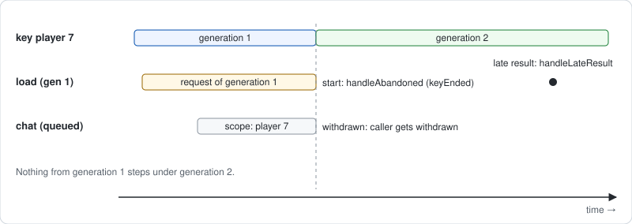
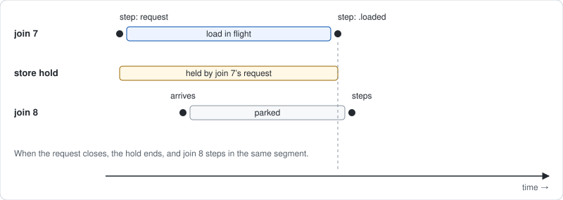

[English](README.md) | [中文版](README.zh-TW.md)

# The turn core (SwiftStateTurns)

`SwiftStateTurns` is a small library target in this package. It is a way to write an actor whose state changes only in synchronous steps. Land authors don't use it directly. It is the base that the transport layer's own actors move onto, one at a time. Its API reference and articles are the DocC catalog in `Sources/SwiftStateTurns/SwiftStateTurns.docc`; this page summarizes them.

## What a turn is

An actor's methods run one at a time. But every `await` inside a method lets other calls run first. State that a method checked before an `await` may be stale after it. A method that changes state after an `await` acts on a world that has moved on.

A *turn* is the actor's unit of work: one job, run to completion, with no suspension in it. This is the actor-model sense of the word, not a turn in a game. The turn core makes every change to an actor's state happen inside one turn, as a synchronous *step* of a value-type machine. A step is one call of the machine's handler with one input.

## How the pieces fit

## How the pieces fit

- **`TurnMachine`**: The pure state machine. A step takes the state and one input. It returns the new state, plus outputs, replies and effects. A step is synchronous, stores only plain data, and can't `await`.
- **`TurnCore`**: The mechanics. It keeps the *parked queue* (inputs waiting behind work in flight), *keys* and their *generations* (which work is still wanted), *holds* and their deadlines (what makes later inputs wait), and timers.
- **`TurnActor`**: The shell. `send` and `call` bring inputs in. `perform` runs effects off the actor. `flush` sends outputs out.

An effect's result, a deadline or a timer comes back as a new input. Each entry into the actor (a `send`, a `call`, a result coming back) runs one *segment*: the steps that entry causes. The segment budget caps how many queued inputs a hold's release lets step in one segment. There is no run loop waiting between entries. The pattern is known as "functional core, imperative shell". Elm's `Cmd`/`Msg` and Erlang's `gen_server` have the same shape.

## The rule

- **State changes only in steps.** A machine's handlers aren't `async`, so a step can't await. Only a step's `Turn` reaches the core.
- **Effects come back as inputs.** When a step needs work done, it makes a request. `perform` does the work off the actor. Its result is a new input to a later step, and that step decides what the result means on the state as it is then. A result whose request has closed goes to `handleStale`, not to `handle`. A request closes when its key ends or is superseded, its deadline passes, or it is cancelled.
- **What a step can't own, the core owns:** keys and generations, holds with their deadlines, and end tokens. A handler holds no tickets.
- **A supersede ends the old generation's parked inputs too.** Calling `issue` on a key that is still live *supersedes* it. That closes the old generation's requests, drops its timer, and withdraws the inputs parked under that key's scope, as `end` does. A parked input carries no generation, so without this, an input sent under the old binding would step under the new one. Its caller gets `withdrawn` and can retry. Limit: inputs parked before the key's first `issue` stay.
- **Only plain data.** `@PlainData` checks at compile time that a machine stores only plain values. Only a `PlainData` machine can be run.

## A worked example

A lobby that loads each player's profile before seating them, one load at a time. The full code is in `Tests/SwiftStateTurnsTests/WorkedExampleTests.swift`. That test compiles and runs it, and checks that every excerpt on this page and in the DocC matches it. The load's result comes back as an input, and reaches `handle` only while its request is open:

```swift
case .loaded(let player, let name):
    // The load's result, back as an input. It reaches `handle` only while its request
    // is open, so the player is still joining: the state changes here, in a step.
    loading = loading.filter { $0.value != player }
    seats[player] = name
```

The effect runs off the actor:

```swift
@concurrent nonisolated func perform(_ effect: Lobby.Effect) async -> Lobby.Input? {
    switch effect {
    case .loadProfile(let player):
        return .loaded(player: player, name: await profiles.load(player))
```

### Why `perform` is both `nonisolated` and `@concurrent`

`nonisolated` keeps `perform` away from the actor's state. It can't read `core`, so an effect can't look at or change the machine behind a step's back. A must-not-compile check holds this.

`nonisolated` alone doesn't say where `perform` runs. With the `NonisolatedNonsendingByDefault` feature on, a `nonisolated async` function runs on its caller's actor (Swift 6.2's approachable-concurrency settings turn the feature on). The core calls `perform` from the actor, so a slow load would occupy the actor, and every input would wait behind it. `@concurrent` makes `perform` always run off the actor, whatever the module's settings.

Limit: `@concurrent` can't be used alone here. Without `nonisolated`, the method would be isolated to the actor, which `@concurrent` doesn't allow, and the compiler refuses the pair.

## Without the framework

The same lobby written three ways, tested with one scenario. A player joins. While the profile load is in flight, the player leaves. Then the load returns. `Tests/SwiftStateTurnsTests/ComparisonTests.swift` forces this order with a hold inside the profile store's `load`, never with timing.

**A plain actor** checks the state, awaits the load, and writes the result:

```swift
guard seats[player] == nil else { return seats.count }
let name = await profiles.load(player)
// Other calls ran during the await: the player may have left. This write doesn't know.
seats[player] = name
```

The `await` lets `leave` run in the middle of `join`, so `join` seats a player who has already left: a ghost seat. The test asserts that the ghost seat appears; it documents the hazard instead of failing on it. There is no data race here, so neither the compiler nor a thread sanitizer flags it.

**Fixed by hand**, as the repository does today: a `GenerationTable` ticket, captured before the `await` and checked with `ifCurrent` after it.

```swift
let ticket = joins.issue(player)
let name = await profiles.load(player)
// Still this join's generation? `ifCurrent`'s closure can't await, so the check and the
// write are one synchronous segment.
guard joins.ifCurrent(ticket, { _ in seats[player] = name }) != nil else {
    throw LobbyError.left
```

Limit: every method with an `await` has to remember this fix. Each one needs its own ticket, its own check, and a test that forces the interleaving.

**On the turn core**, `leave` ends the player's key:

```swift
case .leave(let player):
    // Ends the binding: a load in flight is abandoned, and its late result is stale.
    turn.end(.player(player))
    seats[player] = nil
```

The load's request belongs to that key, so the request closes, and the joiner is answered in the same segment. The returning result goes to `handleStale` and seats nobody. The same scenario passes, and the hazard can't be written. A handler can't `await`, and it can't start a task that reaches the machine. The `await-in-handle` and `task-in-handle` snippets under `scripts/must-not-compile/turns/` don't compile.

## Core concepts

The core uses a dozen ideas. Each one below builds on the ones before it, and each answers a question a game server runs into. The examples come from the lobby of the worked example above and from a room that adds the rest of the tools; both are compiled and run as tests.

### Input and step

An *input* is a message to the machine, such as "player 7 wants to join". A *step* is the machine handling one input. Steps run one at a time and can't `await`, so nothing changes the state while a step reads it.

An input arrives in one of three ways. `send` submits it and returns once it has stepped (or parked, see Admission). `call` also waits for the step's reply, which the step gives with `reply`. `ask` puts a synchronous question to the machine, answered in a step, and returns the answer.

```swift
let connection = EndToken()
let seated = try await room.call(.join(player: 7, connection: connection), cancellation: .honoured)
let count = await room.ask(.seatCount)
```

API: `send`, `call`, `reply`, `ask`, `answer`.

### Effect and perform

An *effect* is work the machine needs done outside a step, written as data: "load player 7's profile". A step can't wait for the database, so it asks for the work, and the actor's `perform` does it off the actor. Its result comes back as a new input.

There are two ways to ask. A *request* is work that a key owns and that the core tracks (the next sections explain both). `run` is untracked work: no key owns it, and nothing waits for it, such as a log line.

```swift
// Untracked work: no key owns it, and nothing waits for it.
turn.run(.log("joined \(player)"))
```

API: `perform`, `request`, `run`.

### Key

A *key* names something whose work can stop being wanted, such as a player's place in the lobby. `issue` starts it, and `end` stops it. When a player leaves mid-join, ending their key is how the machine says "the profile load for this player is no longer wanted".

```swift
case .leave(let player):
    // Ends the binding: a load in flight is abandoned, and its late result is stale.
    turn.end(.player(player))
    seats[player] = nil
```

API: `issue`, `end`, `isLive`.

### Generation

A *generation* is one lifetime of a key, from one `issue` to the next. Calling `issue` on a live key *supersedes* it: the old generation ends, and a new one starts. This answers the reconnect case. A player who drops and joins again gets a new generation, so a profile load started for the old connection can't seat the new one.



When the key is superseded, three things happen to the old generation. Its requests close (`handleAbandoned` runs, with `keyEnded`). A result that comes back later goes to `handleStale`. Inputs parked under the key's scope are withdrawn, and their callers get `withdrawn`. Limit: inputs parked before the key's first `issue` stay.

API: `issue` (true when it superseded), `generation(of:)`, `Generation`.

### Request

A *request* is an effect that a key's current generation owns. It has an ID, and it finishes in one of two ways. Its result arrives while it is open: the result steps in `handle`. Or it closes first, and it is *abandoned*: `handleAbandoned` runs with the reason (the deadline passed, the key ended, or it was cancelled). A result that arrives after that goes to `handleStale`, so a hung database load that finally returns changes nothing.

```swift
let hold = Hold.untilRequestCloses(Key.store, deadline: .seconds(2))
guard let id = turn.request(.loadProfile(player: player), for: .player(player), holding: hold) else { return }
loading[id] = player
```

API: `RequestID`, `cancel`, `Abandonment`, `handleAbandoned`, `handleStale`.

### Hold

A *hold* makes later inputs wait behind work in flight. The profile store serves one load at a time; without a hold, a second join would start a second load while the first is still running. A request takes a hold on a key, and inputs that name that key wait until the hold ends.



A hold has two kinds. `untilRequestCloses` ends when the request closes, for any reason. `untilWorkerRetires` ends only when the work returns, even if the request was abandoned first. Use it for work that changes something else while it runs, such as a database write:

```swift
// The write changes the database while it runs: the hold lasts until the worker
// returns, even if the request is abandoned first.
let hold = Hold.untilWorkerRetires(Key.database, deadline: .seconds(5))
if let id = turn.request(.writeStats(player: player), for: .player(player), holding: hold) {
    saving[id] = player
```

Every hold has a deadline, and the compiler requires it. Without one, a load that hangs would keep every later join waiting for as long as it hangs.

API: `Hold`, `request(_:for:holding:)`.

### Admission

*Admission* is the machine's rule for each kind of input: whether it waits behind a hold, and which key it belongs to (its *scope*). An input that has to wait is *parked*. If the player its scope names leaves while it waits, it is withdrawn and never steps.

```swift
// Waits while a save holds the database; withdrawn if the player leaves meanwhile.
case .chat(let player, _): .external(hold: .database, scope: .player(player))
case .saveStats: .external(hold: .database, scope: nil)
```

The parked queue has a limit, set when the core is made. An input over the limit is refused with `overloaded`, so a flood of inputs can't grow memory without bound. A `control` input is never gated: a disconnect or a stop always steps. A step's own follow-up can keep its place behind a hold with `queue`. Such a *pinned* input isn't withdrawn by a scope or refused by the limit.

API: `Admission`, `queue(_:behind:)`, `TurnError`.

### End token

An *end token* lets the sender give up an input before it steps. A key can't do this, because the input hasn't started anything yet. A join from a connection that closed while the join was parked shouldn't seat anyone:

```swift
let late = EndToken()
late.markEnded()
await #expect(throws: TurnError.withdrawn) {
    try await room.call(.join(player: 8, connection: late), cancellation: .honoured)
```

The core reads the token when the input arrives and again when it leaves the parked queue. A machine never stores a token.

API: `EndToken`, `revoke`.

### Timers and the clock

A *timer* is an input that a key schedules for later, such as "kick this player if they say nothing for a minute". Each key has at most one timer, and a new one replaces it. Ending or superseding the key drops it.

```swift
// Kicked after a minute without a word; each chat line re-arms it.
turn.timer(at: turn.now + .seconds(60), for: .player(player), .idleKick(player: player))
```

`turn.now` reads the core's clock, once per segment. The clock is injected, with no default. A test passes a clock it moves by hand, so a one-minute timer fires when the test says so, not after a minute.

API: `timer(at:for:_:)`, `now`, `TurnClock`, `TurnInstant`.

### Segment and segment budget

A *segment* is the steps one entry into the actor causes: a `send`, a `call`, or a result coming back. When a load's result releases a hold, the parked joins behind it step in the same segment. There is no run loop between entries. The *segment budget* caps how many queued inputs a release lets step in one segment; the rest continue in a later one, so a long queue behind one hold can't keep other callers out.

```swift
parkedLimit: 64,
segmentBudget: 16,
clock: ContinuousTurnClock()
```

API: `TurnCore.init`.

### Incarnation

An *incarnation* is a random number each core gets when it is made. Every task the core starts carries it. A result whose incarnation doesn't match the actor's core is dropped and counted, never stepped. It guards the case where a result reaches a core other than the one that asked for it, whose request IDs could otherwise match. There is nothing to write: the core checks it.

API: `TurnStats` (`foreignCompletions`).

### Caller cancellation

A `call` waits, and the task that waits can be cancelled, for example when the client's connection task ends. Each `call` says what that means; there is no default. `.ignored`: the caller keeps waiting and gets the real result. Pick it when the caller must know the outcome, such as a shutdown waiting for a save. `.honoured`: the caller gets `CancellationError` at once, and an input still parked is withdrawn and never steps. An input that already stepped goes on. Pick it when a gone caller means the input is no longer wanted, such as a join from a client that left.

API: `CallerCancellation`.

### Summary

| Concept | The question it answers | API |
|---|---|---|
| Input and step | How does work reach the state, one change at a time? | `send`, `call`, `reply`, `ask` |
| Effect and perform | How does a step get async work done without awaiting? | `perform`, `request`, `run` |
| Key | Is this work still wanted? | `issue`, `end` |
| Generation | Is this result from the current binding, after a reconnect? | `issue`, `Generation` |
| Request | Did the work finish, or was it given up? | `RequestID`, `handleAbandoned`, `handleStale` |
| Hold | What must wait behind work in flight? | `Hold` |
| Admission | Does this input wait, and whose is it? | `Admission`, `queue` |
| End token | Can the sender give up an input before it steps? | `EndToken`, `revoke` |
| Timer and clock | How does a step act later, and how does a test control time? | `timer`, `now`, `TurnClock` |
| Segment | How much runs per entry? | `segmentBudget` |
| Incarnation | Does this result belong to this core? | `foreignCompletions` |
| Caller cancellation | What happens when the caller's task is cancelled? | `CallerCancellation` |

## How it's tested

The tests are also examples. Each one below shows a way to check a turn-based actor.

- **Generated orders** ([`Tests/SwiftStateTurnsTests/GeneratedOrderTests.swift`](../../Tests/SwiftStateTurnsTests/GeneratedOrderTests.swift)). A seeded generator mixes sends, calls, completions, cancellations and clock moves. After every operation, the test checks the core's invariants: no step runs inside another, inputs parked behind one hold step in arrival order, each call is answered once, and only outputs emitted under a live key reach the sink. The generator is deterministic, so a seed replays the same order on every platform. A failing seed is printed, and the `replays` test keeps it as a fixed case. CI runs a fixed seed set; `TURNS_SEEDS=<count>` runs more.
- **Code that must not compile** ([`scripts/must-not-compile/turns/`](../../scripts/must-not-compile/turns/), run by [`scripts/check-must-not-compile.sh`](../../scripts/check-must-not-compile.sh)). Each file must fail to compile with a named error. Together they show what can't be written: a handler that awaits, a handler that starts a task, an effect that reads `core`, a machine that stores a class or a closure (also inside `#if`), and a machine without `@PlainData` given to a core.
- **The worked example** ([`Tests/SwiftStateTurnsTests/WorkedExampleTests.swift`](../../Tests/SwiftStateTurnsTests/WorkedExampleTests.swift)). It runs the lobby from these pages. Its last test is the rot check: every Swift block in the DocC and in `docs/turns/` must appear in a tested file, so an example can't drift from the code.
- **The three-version comparison** ([`Tests/SwiftStateTurnsTests/ComparisonTests.swift`](../../Tests/SwiftStateTurnsTests/ComparisonTests.swift)). A hold inside the profile store's `load` stops a join in the middle of its `await`. The test then sends the leave and releases the load. The order is the same on every run, with no sleeps, so the plain actor's bug happens every time.
- **Runtime stops** ([`Tests/SwiftStateTurnsTests/RuntimeStopTests.swift`](../../Tests/SwiftStateTurnsTests/RuntimeStopTests.swift)). A few mistakes can only be caught while running, such as reading the machine from inside its own step. Each one runs in a child process (an exit test), which must stop with the core's message.

## Related

- The design and its rules: `Notes/plans/2026-11-18-swift-state-turns-core.md`
- The reentrancy rule for code outside turns: "Actor Reentrancy" in `AGENTS.md`
