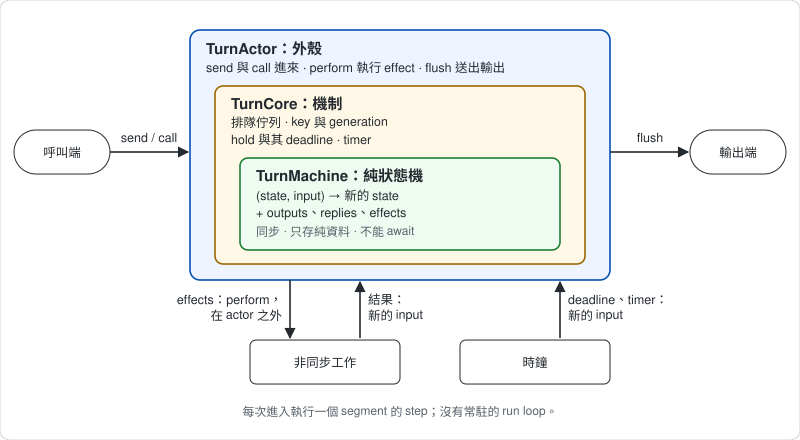
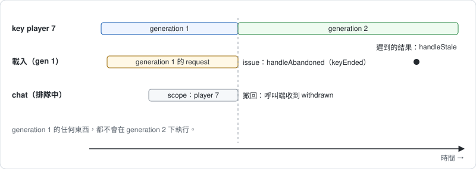
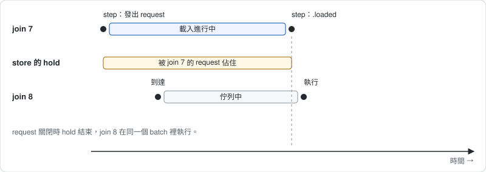

[English](README.md) | [中文版](README.zh-TW.md)

# Turn core（SwiftStateTurns）

`SwiftStateTurns` 是本套件裡的一個小型函式庫 target。它用來撰寫「狀態只在同步 step 中改變」的 actor。Land 作者不會直接使用它。傳輸層自己的 actor 會逐一遷移到它上面。API 參考與文章在 DocC 目錄 `Sources/SwiftStateTurns/SwiftStateTurns.docc`，本頁是它們的摘要。

## 什麼是 turn

actor 的方法一次只跑一個。但方法裡的每個 `await`，都會讓其他呼叫先執行。方法在 `await` 之前檢查過的狀態，在 `await` 之後可能已經過期。在 `await` 之後才改狀態的方法，面對的是一個已經變了的世界。

*turn* 是 actor 的工作單位：一個 job 從頭跑到尾，中間沒有任何暫停。這是 actor 模型裡的意思，不是遊戲的「回合」。turn core 讓 actor 狀態的每一次改變，都發生在一個 turn 裡，也就是一個值型別狀態機的同步 *step*。一個 step 就是用一個 input 呼叫一次狀態機的 handler。

## 各部分如何組合



- **`TurnMachine`**（純狀態機）：一個 step 接收狀態與一個 input，回傳新的狀態，以及 outputs、replies 和 effects。step 是同步的，只存純資料，不能 `await`。
- **`TurnCore`**（機制）：它保管*佇列*（queue，排在進行中工作後面的 input）、*key* 與其 *generation*（哪些工作仍然需要）、*hold* 與其 deadline（讓後來的 input 等待的東西），以及 timer。
- **`TurnActor`**（外殼）：`send` 與 `sendAndWait` 把 input 帶進來。`perform` 在 actor 之外執行 effect。`flush` 把 output 送出去。

effect 的結果、deadline 或 timer，都會以新的 input 回來。每一次進入 actor（一次 `send`、一次 `sendAndWait`、一個回來的結果）執行一個 *batch*：這次進入引起的 step。`maxReleasesPerBatch` 限制一次 hold 釋放在一個 batch 裡能讓多少個佇列的 input 執行。兩次進入之間，沒有等待中的 run loop。這個模式稱為「functional core, imperative shell」（函式式核心、命令式外殼）。Elm 的 `Cmd`/`Msg` 與 Erlang 的 `gen_server` 也是同樣的形狀。

## 規則

- **狀態只在 step 裡改變。** 狀態機的 handler 不是 `async`，所以 step 不能 await。只有 step 拿到的 `Turn` 能接觸 core。
- **Effect 以 input 的形式回來。** step 需要完成某項工作時，會發出一個 request。`perform` 在 actor 之外執行這項工作。結果成為之後某個 step 的新 input，由那個 step 依當下的狀態決定它的意義。request 已經關閉的結果，會交給 `handleLateResult`，而不是 `handle`。request 在這些情況下關閉：它的 key 結束或被取代、deadline 已過、或被取消。
- **step 管不到的，由 core 管：** key 與 generation、帶 deadline 的 hold、withdraw token。handler 不持有任何 ticket。
- **取代（supersede）也會結束舊 generation 在佇列中的 input。** 對一個仍有效的 key 再次呼叫 `start`，就是*取代*它。這會關閉舊 generation 的 request、取消它的 timer，並撤回（withdraw）以該 key 為 scope、在佇列中的 input，和 `end` 一樣。佇列中的 input 不帶 generation；少了這一步，在舊綁定下送出的 input 會在新綁定下執行。它的呼叫端會收到 `withdrawn`，可以重試。batch 執行期間送出、在取代之後才被接受的 input 也一樣。限制：在 key 無效時（第一次 `start` 之前，或 `end` 之後）到達的 input，會在下一個 generation 下執行；若這會造成問題，請每次綁定都用新的 key，例如連線或 session id。
- **只存純資料。** `@PlainData` 在編譯時檢查狀態機只存純值。只有 `PlainData` 的狀態機能被執行。見[純資料與工具](#純資料與工具)。

## 純資料與工具

### 什麼算純資料

`PlainData`（`Sources/SwiftStateTurns/PlainData.swift`）標示的值，不會呼叫到別的東西，也不會在持有者背後改變：任何深度都沒有 class、closure、actor、existential、lock 或 token。`@PlainData` 型別的欄位可以是 `any P`，其中 protocol `P` refine `PlainData`（也可以是 optional、array 的元素或 dictionary 的 value）：所有遵循 `P` 的型別都是經過檢查的純資料，macro 會逐一檢查這類欄位。`any P` 本身不符合 `PlainData`，所以 `Internal<any P>`、`PlainPair<any P, Int>` 和 `where T: PlainData` 的泛型都會拒絕它。

- **已符合的內建型別：** `Bool`、各種整數型別、`Double`、`Float`、`String`、`Character`、`Duration`、Foundation 的 `Data`（用 `Data(bytesNoCopy:count:deallocator:)` 搭配自訂 deallocator 建立的 `Data` 帶著 closure，實質上不是純資料；型別檢查看不出來，所以不要儲存這種值），以及 turn core 自己的值（`InputID`、`RequestID`、`Generation`、`TurnInstant`、`Abandonment`、`TurnError`）。
- **容器在內容符合時符合：** `Optional`、`Array`、`ContiguousArray`、`Set`、`Dictionary`（key 與 value），以及 `Result`（成功與失敗）。
- **tuple 無法符合。** 請改存 `PlainPair`。

| 儲存的型別 | 是純資料嗎？ |
|---|---|
| `[PlayerID: Seat]`，兩者都是 `@PlainData` | 是 |
| `Set<Int>`、`String?`、`Result<Int, TurnError>` | 是 |
| `any Payload`、`[any Payload]`、`(any Payload)?`，其中 `protocol Payload: PlainData` | 是（作為 `@PlainData` 型別的欄位） |
| `[String: Any]`、`Result<Int, any Error>` | 否：existential |
| `Date`、`UUID`、`URL`、`Decimal` | 否：分別改存毫秒的 `Int64`（或讀 turn 的 `now`）、`String` 或專案自己的 ID 型別、`String`，以及最小單位的整數或 `String` |
| `[() -> Void]` | 否：函式型別 |
| `[PlayerID: Connection]`，`Connection` 是 class | 否：class |

這些拒絕都是編譯錯誤，由 `scripts/must-not-compile/turns/` 裡的 must-not-compile 案例固定（`plaindata-class-in-dictionary.swift`、`plaindata-closure.swift`、`plaindata-any-error.swift` 及同目錄的其他案例）。

### 自己的型別

在 struct 或 enum 定義處加上 `@PlainData`。macro 會寫出 conformance，並為每個儲存屬性或 associated value 加一項檢查：檢查讀取儲存的值，值的型別不是純資料就無法編譯。因為讀的是值而不是寫出來的型別名稱，欄位型別的解析與宣告處相同，包括同一個外層型別裡巢狀的兄弟型別。
- 每個儲存屬性都要有型別標註，macro 才能檢查。
- 泛型型別的 conformance，以被儲存值寫到的每個泛型參數是 `PlainData` 為條件：`struct Box<T> { var value: T }` 在 `T` 是 `PlainData` 時才是 `PlainData`。沒有任何 stored property 或 associated value 寫到的參數不加條件，因為值裡沒有存那個型別的東西。所以泛型於某個它不儲存的 services 型別的型別，例如 `struct ProductInfo<D> { let productID: Int }`，即使 `D` 持有 class，也是 `PlainData`。
  - 參數名稱只要出現在欄位型別的任何位置就算寫到：`D`、`[D]`、`Box<D>` 和 `D.Element` 都寫到了 `D`。
  - 宣告的 `where` 子句裡的同型別條件會把名稱帶到另一邊：`struct First<C: Collection, T> where C.Element == T { let first: C.Element? }` 的欄位寫到 `C`，所以 `T` 也成為條件，由 `T: PlainData` 證明 `C.Element` 是純資料。
  - 欄位型別若是在型別本體內宣告的型別或 typealias，型別自己的每個參數都會成為條件，因為 macro 看不出那個型別用到哪些參數。
  - **限制。** 在 extension 裡宣告的 typealias（`extension Box { typealias Item = T }` 搭配 `let value: Item`）不在型別本體內，macro 看不出 `Item` 代表 `T`，所以 `T` 不會成為條件。這時欄位的檢查會編譯失敗，錯誤會指出該欄位。請在欄位直接寫出參數（`let value: T`），或把 typealias 宣告在型別本體內。
  - 參數的成員型別需要自己的條件：`let first: C.Element?` 要在宣告上寫 `where C.Element: PlainData`。macro 寫的是 `C: PlainData`，推不出前者，所以不寫的話宣告會編譯失敗。
- `@PlainData` 加在 class 或 actor 上會被拒絕；型別是 class、actor、closure，或未 refine `PlainData` 的 protocol 的 existential 的欄位，也會被拒絕。
- `any P` 欄位單獨出現時會被檢查，作為 `Optional`、`Array`、`ContiguousArray` 的元素或 `Dictionary` 的 value 時也會。放在其他泛型型別裡（`Set<any P>`、`Result<Int, any P>`）時，macro 看不出該型別怎麼使用它，所以會拒絕。
- protocol 可以 refine `PlainData`。遵循它的型別仍需加上 `@PlainData`：`PlainData` 要求 macro 寫出的檢查，所以沒有 macro 的 class 或 struct 無法編譯，除非手寫 `_plainDataCheck`，而 lint 會拒絕這種寫法。
- 在 `SwiftStateTurns` 之外手寫 `: PlainData` 或 `_plainDataCheck`（包括 `@retroactive`）會被 plain-data lint（`Tests/SwiftStateTurnsMacrosTests/PlainDataLintTests.swift`，隨 `swift test` 執行）拒絕：那樣會不經任何檢查就符合。程式碼中任何對 `PlainDataCheck` 的使用（它的 alias 或 extension 可以加入 overload），以及名為 `SwiftStateTurns`、`Swift`、`Optional`、`Array`、`ContiguousArray` 或 `Dictionary` 的宣告也會被拒絕，因為它們可能改變 macro 的檢查解析到的對象。
- `@PlainData` 型別不能掛其他 attached macro，型別本身或可能加入宣告的成員（method、initializer、subscript、computed 或 `static` property、enum case、typealias 或巢狀型別）都不行，因為這種 macro 可能加入檢查看不到的 stored member。不加入成員的內建 attribute（例如 `@available` 與 `@inlinable`）沒有問題，巢狀型別也可以掛 `@PlainData`。
- 標準函式庫或 Foundation 的型別無法加上 macro。請改存 turn core 的值型別，例如用 `TurnInstant` 取代 `ContinuousClock.Instant`。
- 本 repository 其他模組的型別，在它自己的模組、它的定義處加上 `@PlainData`，絕不在別處用 extension 加。land 的狀態與 transport 保存的 ID 和值都已這樣標註：`SessionID`、`PlayerID`、`ClientID`、`EventTarget`、`StateSnapshot`、`SnapshotValue` 和 `MessagePackValue`。machine 可以直接儲存它們。
- **限制。** macro 與 lint 是用來抓錯誤的，不是安全邊界。Swift 沒有 sealed protocol，所以刻意寫來繞過它們的程式碼（手寫 witness、alias 或 extension 的技巧、被 lint 當成核心讀取的 symlink 原始碼目錄）可以讓非純資料的型別符合 `PlainData`，代價是 replay 的保真度。這類繞過是已知限制，不是檢查承諾要堵住的漏洞。有兩種正當的寫法會被拒絕而不是被檢查：欄位型別用到只有外層 extension 宣告的泛型參數（`extension Outer { @PlainData struct Inner { var value: T } }`，macro 讀不到 `Outer` 的參數；請把 `Inner` 宣告在 `struct Outer<T>` 裡，或在那裡加上 `T: PlainData`），以及基本名稱相同的 enum case（`case item(count: Int)` 與 `case item(label: String)` 並存；請給每個 case 不同的名稱，互斥的 `#if` 分支除外）。欄位用到外層型別自己的泛型參數時，conformance 會以該參數是 `PlainData` 為條件（#782）；欄位必須直接寫出該參數，用外層型別替它取的別名當欄位型別，仍會被拒絕。只有方法或計算屬性用到的參數不會加上條件。
- 在 `Optional`、`Array`、`ContiguousArray` 或 `Dictionary` 的 value 裡，請在欄位宣告處直接寫出 `any P`，不要經過 alias：macro 是靠讀到的 `any` 找出 existential，所以 `typealias PayloadValue = any Payload` 用在型別為 `PayloadValue` 的欄位可以，用在 `PayloadValue?` 或 `[PayloadValue]` 則無法編譯。

下面的例子中，替第一個 `Room` 加上 `@PlainData` 會被拒絕：macro 會指出其中不是純資料的欄位。第二個可以編譯。

之前，狀態裡有 class 和時鐘的 instant：

```swift
struct Room {
    var players: [PlayerID: Connection]       // Connection 是 class
    var lastChat: ContinuousClock.Instant
}
```

之後，狀態只存純值；連線留在 actor 上，以 `PlayerID` 為鍵：

```swift
@PlainData
struct Room {
    var players: Set<PlayerID>                // PlayerID 是 @PlainData
    var lastChat: TurnInstant
}
```

### 為什麼：它讓各階段名副其實

- **狀態是一個值。** turn 之外的程式碼可以持有它的副本，但無法透過副本改變狀態機的狀態。
- **step 是改變狀態的唯一途徑。** 其他 task 碰不到它；狀態裡也沒有 closure，所以它不帶任何可能在 turn 之外執行的程式碼。
- **值可以比較、複製和記錄。** 測試可以餵給狀態機一串 input，再拿它的狀態和輸出與預期比較；這些都不需要 lock。

### reference type 放哪裡：工具

狀態機用到的某些東西本質上是物件：連線、encoder、版面配置表。它們留在執行狀態機的 actor 上，絕不放進狀態機的狀態。
- **狀態存的是 ID。** actor 保有從 ID 到物件的對照表。
- **需要物件的 step 發出工作請求。** 它回傳一個指名該 ID 的 output 或 effect，由 actor（或在 actor 之外執行的 `perform`）使用那個物件。回來的結果以純資料的形式，透過之後的 input 進入狀態。

### 固定的函式與設定：behavior

狀態機的 *behavior*（行為）是它「做什麼」，有別於它「持有什麼」：每個 step 都會讀的函式和固定設定，例如一個 land 的 action handler、resolver 清單和人數上限。它們不能放進狀態，因為函式不是純資料；也不需要放進狀態，因為它們從不改變。

- **一開始就固定。** 狀態機把它的型別宣告為 `Behavior`（預設是 `Void`，也就是沒有）。adopter 把值傳給 `TurnCore(machine:behavior:…)`，只傳一次。有 behavior 的狀態機，不給 behavior 就建不出來。
- **每個 step 都讀得到。** `turn.behavior` 在 `handle`、`handleAbandoned`、`handleLateResult` 和 `answer` 裡都讀得到；follow-up 和 timer 的 step 經由 `handle`，也一樣。在 `handleMail` 裡，`MailTurn` 有同樣的 `behavior`。
- **從不寫入。** behavior 在狀態機的整個生命期內固定不變；所有改變都進 model（沒有 `become`）。對 `turn.behavior` 賦值無法編譯，但它持有的參照仍可能改變（見下方的限制）。
- **它的函式能做什麼。** 它們在 step 裡執行，所以是同步的、不碰 model 以外的任何東西，而且是確定性的：不自己讀時鐘、不用沒有種子的亂數、不做 I/O。需要等待或做 I/O 的事以 effect 送出，結果再以 input 回來。
- **不會被記錄。** replay 用同一份定義和設定建出同一個 behavior；換了 behavior，replay 的就是另一個狀態機，而紀錄裡看不出來。

限制：編譯器只檢查函式是同步的。另外兩條規則由 adopter 負責。編譯器也不會阻止 behavior 持有帶可變狀態的參照（`Sendable` class，例如持有 `Mutex` 的 class，或捕獲這類參照的 closure）：`turn.behavior.limit = 3` 會被拒絕，但 `turn.behavior.box.bump()` 可以編譯。所以 behavior 只放值和作用在這些值上的函式；step 會改變的東西都放進 model。

API：`TurnMachine.Behavior`、`Turn.behavior`、`MailTurn.behavior`、`TurnCore.init(machine:behavior:queueLimit:maxReleasesPerBatch:clock:mailboxCapacity:)`。

## 範例

一個大廳：每位玩家入座前，先載入其個人資料，一次只載入一份。完整程式碼在 `Tests/SwiftStateTurnsTests/WorkedExampleTests.swift`。這個測試會編譯並執行範例，並檢查本頁與 DocC 的每段節錄都與它一致。載入結果以 input 的形式回來，而且只在它的 request 仍開著時才會到 `handle`：

```swift
case .loaded(let player, let name):
    // The load's result, back as an input. It reaches `handle` only while its request
    // is open, so the player is still joining: the state changes here, in a step.
    loading = loading.filter { $0.value != player }
    seats[player] = name
```

effect 在 actor 之外執行：

```swift
@concurrent nonisolated func perform(_ effect: Lobby.Effect) async -> Lobby.Input? {
    switch effect {
    case .loadProfile(let player):
        return .loaded(player: player, name: await profiles.load(player))
```

### 為什麼 `perform` 同時是 `nonisolated` 和 `@concurrent`

`nonisolated` 讓 `perform` 碰不到 actor 的狀態。它不能讀 `core`，所以 effect 無法在 step 背後查看或改動狀態機。有一個必須編譯失敗的檢查守住這一點。

光有 `nonisolated`，並沒有決定 `perform` 在哪裡執行。啟用 `NonisolatedNonsendingByDefault` 功能時，`nonisolated async` 函式會在呼叫端的 actor 上執行（Swift 6.2 的 approachable-concurrency 設定會啟用這個功能）。core 是從 actor 呼叫 `perform` 的，於是一次緩慢的載入會佔住 actor，所有 input 都得排在它後面。`@concurrent` 讓 `perform` 一律在 actor 之外執行，不論模組的設定為何。

限制：這裡不能只寫 `@concurrent`。少了 `nonisolated`，這個方法會隔離在 actor 上，而 `@concurrent` 不允許這樣，編譯器會拒絕這個組合。

## 不用框架的話

同一個大廳的三種寫法，用同一個情境測試。玩家加入。個人資料還在載入時，玩家離開。接著載入完成。`Tests/SwiftStateTurnsTests/ComparisonTests.swift` 用個人資料存取端 `load` 裡的 hold 強制這個順序，從不依賴時間。

**一般的 actor**：檢查狀態、await 載入、寫入結果：

```swift
guard seats[player] == nil else { return seats.count }
let name = await profiles.load(player)
// Other calls ran during the await: the player may have left. This write doesn't know.
seats[player] = name
```

這個 `await` 讓 `leave` 在 `join` 的中途執行，於是 `join` 讓一位已經離開的玩家入座：幽靈座位。測試斷言幽靈座位確實出現；它記錄這個危險，而不是因它失敗。這裡沒有資料競爭，所以編譯器和 thread sanitizer 都不會標出它。

**手動修正**，也就是本專案目前的做法：在 `await` 之前取得 `GenerationTable` 的 ticket，`await` 之後用 `ifCurrent` 檢查：

```swift
let ticket = joins.issue(player)
let name = await profiles.load(player)
// Still this join's generation? `ifCurrent`'s closure can't await, so the check and the
// write are one synchronous segment.
guard joins.ifCurrent(ticket, { _ in seats[player] = name }) != nil else {
    throw LobbyError.left
```

限制：每個含 `await` 的方法都得記得這個修正。每一個都需要自己的 ticket、自己的檢查，以及一個強制交錯順序的測試。

**用 turn core**，`leave` 會結束該玩家的 key：

```swift
case .leave(let player):
    // Ends the binding: a load in flight is abandoned, and its late result is stale.
    turn.end(.player(player))
    seats[player] = nil
```

載入的 request 屬於這個 key，所以它會關閉，加入的呼叫端在同一個 batch 就得到回覆。回來的結果交給 `handleLateResult`，不會讓任何人入座。同一個情境會通過，而且這種危險寫不出來。handler 不能 `await`，也不能啟動碰得到狀態機的 task。`scripts/must-not-compile/turns/` 下的 `await-in-handle` 與 `task-in-handle` snippet 無法編譯。

## 核心概念

core 用到十幾個概念。下面每一個都建立在前面幾個之上，也各自回答遊戲伺服器會遇到的一個問題。範例來自上方範例的大廳，以及一個加上其餘工具的房間（room）；兩者都以測試編譯並執行。

### Input 與 step

*input* 是送給狀態機的一則訊息，例如「player 7 想加入」。*step* 是狀態機處理一個 input。step 一次只跑一個，而且不能 `await`，所以 step 讀狀態時，沒有任何東西會改變它。

step 拿到兩樣東西：狀態機的狀態（`self`）和一個 `Turn`。turn 是 step 對外行動的唯一途徑，例如提出 request、執行工作、設定 timer、送出輸出、回覆，或開始與結束一個 key。其中有些立刻生效：`start`、`end` 與 `request` 會更新 core 的記錄，同一個 step 就看得到變化（`isLive`、request 的 ID）。發布與啟動則等 step 結束：這時 actor 送出（flush）輸出、發布回覆並啟動 effect，每個 effect 的結果在之後的 step 才到。step 可以把 turn 以 `inout` 參數借給同步的 helper。它不能建立、複製、保存或移走 turn，`Task` 或 escaping closure 也不能捕捉它，所以 turn 只存在於收到它的那個 step。`Turn<M>` 對狀態機泛型，讓它的方法使用狀態機自己的型別：`request` 接受 `M.Effect`、`emit` 接受 `M.Output`、`reply` 接受 `M.Reply`、`start` 接受 `M.Key`。這個詞來自 actor model。在 E 裡，turn 是把一則訊息處理完；在 Orleans 裡，turn 跑到 handler 的下一個 `await` 為止。step 沒有 `await`，所以每個 step 就是一整個 turn。

狀態機只在 input 到達時才行動。它沒有 run loop，也沒有自己的 task。input 來自三個地方：
- I/O 端（例如連線的讀取端）呼叫 `send`、`sendAndWait` 或 `query`。
- core 送回 effect 的結果與 timer 的觸發，並在 request 的期限過了時執行 `handleAbandoned`。
- step 為狀態機排定之後的 input：用 `timer`、用 `request`（它的結果）、用 `queue(_:behind:)`，以及用 request 的期限。

input 有三種送達方式。`send` 送出 input，不等回覆就返回；它在 input 執行完、排入佇列或被延後，或被拒絕（見「send 在等什麼」）後返回。`sendAndWait` 送出 input，並等待狀態機的回覆，step 用 `reply` 給出回覆。`query` 向狀態機提出一個同步的問題，在一個 step 裡回答，並傳回答案。

```swift
let connection = WithdrawToken()
let seated = try await room.sendAndWait(.join(player: 7, connection: connection), cancellation: .cancelsCall)
let count = await room.query(.seatCount)
```

API：`send`、`sendAndWait`、`reply`、`query`、`answer`。

### Effect 與 perform

*effect* 是狀態機需要在 step 之外完成的工作，以資料表示：「載入 player 7 的個人資料」。step 不能等資料庫，所以它提出這項工作，由 actor 的 `perform` 在 actor 之外完成。結果以新的 input 回來。

提出的方式有兩種。*request* 是由某個 key 擁有、由 core 追蹤的工作（接下來幾節會說明兩者）。`run` 是不追蹤的工作：沒有 key 擁有它，也沒有人等它，例如一行日誌。

```swift
// Untracked work: no key owns it, and nothing waits for it.
turn.run(.log("joined \(player)"))
```

`perform` 與 `flush` 是 actor 對外的兩條路，兩者不同。`perform` 是命令：它非同步地在 actor 之外執行，結果以 input 回來。`flush` 是事件：actor 在兩個 step 之間同步呼叫它，它不傳回任何東西，並依 step 送出的順序拿到輸出。資料庫載入是 effect；伺服器送給客戶端的訊息寫在 `flush` 裡。

effect 以資料表示，是為了讓 step 的工作可以被檢查、被替換。測試的假 `perform` 可以記錄 step 提出的每個 effect，並傳回編造的結果，不需要資料庫；`effectsByInput` 依 input 的 case 計算 effect 數量，只在 debug build 有效。不論 `perform` 做真正的工作、假的、模擬，或重播錄下的結果，狀態機都不變。

API：`perform`、`flush`、`request`、`run`、`effectsByInput`。

### Key

*key* 為某件「工作可能不再需要」的事物命名，例如玩家在大廳裡的位置。`start` 開始它，`end` 結束它。玩家在加入途中離開時，結束他的 key，就是狀態機表達「這位玩家的資料載入不再需要」的方式。

```swift
case .leave(let player):
    // Ends the binding: a load in flight is abandoned, and its late result is stale.
    turn.end(.player(player))
    seats[player] = nil
```

API：`start`、`end`、`isLive`。

### Generation

*generation* 是 key 的一段生命週期，從一次 `start` 到下一次。對仍有效的 key 呼叫 `start`，就是*取代*（supersede）它：舊的 generation 結束，新的開始。這回答了重新連線的情況。玩家斷線後再加入，會得到新的 generation，所以為舊連線開始的資料載入，不會讓新的連線入座。



key 被取代時，舊的 generation 會發生三件事。它的 request 關閉（`handleAbandoned` 執行，原因是 `keyEnded`）。之後才回來的結果交給 `handleLateResult`。以該 key 為 scope、在佇列中的 input 被撤回，呼叫端收到 `withdrawn`。batch 執行期間送出、在取代之後才被接受的 input 也一樣。限制：在 key 無效時（第一次 `start` 之前，或 `end` 之後）到達的 input，會在下一個 generation 下執行；若這會造成問題，請每次綁定都用新的 key，例如連線或 session id。這樣的 input 屬於該 `start` 開始的 generation，所以之後取代這個 generation 時，它同樣會被撤回。多個呼叫端同時被撤回時，它們收到回覆的順序沒有保證。

API：`start`（取代時回傳 true）、`generation(of:)`、`Generation`。

### Request

*request* 是由某個 key 目前的 generation 擁有的 effect。它有一個 ID，並以兩種方式之一結束。結果在它仍開著時回來：結果在 `handle` 裡執行。或者它先關閉，也就是被*放棄*（abandoned）：`handleAbandoned` 帶著原因執行（deadline 已過、key 結束、或被取消）。在那之後才到的結果交給 `handleLateResult`，所以一個卡住的資料庫載入最後才回來，也不會改變任何東西。被放棄的同時，request 的工作也會被取消，就像 task group 取消它的子 task。取消只是請工作停下，並不會直接停掉它。`perform` 只在可以安全停下的地方檢查 `Task.isCancelled`（或使用可取消的 await）；會改動外部狀態的工作，要在返回前把那個改動處理完：`untilWorkerReturns` 的 hold 在工作返回時就結束。必須做完的工作用 `run`，它不受追蹤，永遠不會被取消。不理會取消的工作，會讓 actor 一直存活到它結束。有 mailbox 時，replay 的 completion 來自同一個 `perform`，所以被取消的 `perform` 回傳 nil：不論取消在什麼時候送到，completion 都一樣。

```swift
let hold = Hold.untilRequestCloses(Key.store, deadline: loadDeadline)
guard let id = turn.request(.loadProfile(player: player), for: .player(player), holding: hold) else { return }
loading[id] = player
```

API：`RequestID`、`cancel`、`Abandonment`、`handleAbandoned`、`handleLateResult`。

### Hold

*hold* 讓之後的 input 排在進行中的工作後面。個人資料存取端一次只服務一個載入；少了 hold，第二次加入會在第一次的載入還在跑時，開始第二個載入。request 對一個 key 取得 hold，指定該 key 的 input 會等到 hold 結束。



hold 有兩種。`untilRequestCloses` 在 request 關閉時結束，不論原因。`untilWorkerReturns` 只在工作回來時結束，即使 request 先被放棄也一樣。執行期間會改動其他東西的工作，例如資料庫寫入，就用這一種：

```swift
// The write changes the database while it runs: the hold lasts until the worker
// returns, even if the request is abandoned first.
let hold = Hold.untilWorkerReturns(Key.database, deadline: .seconds(5))
if let id = turn.request(.writeStats(player: player), for: .player(player), holding: hold) {
    saving[id] = player
```

每個 hold 都有 deadline，而且編譯器要求一定要有。少了它，一個卡住的載入會讓之後每一次加入都跟著一直等。

API：`Hold`、`request(_:for:holding:)`。

### Input policy（輸入規則）

*input policy*（輸入規則）是狀態機對每種 input 的規則：它是否排在某個 hold 後面，以及它屬於哪個 key（它的 *scope*）。必須等待的 input 會*排入佇列*（queued）。如果它的 scope 所指的玩家在等待期間離開，它會被撤回，永遠不會執行。

```swift
// Waits while a save holds the database; withdrawn if the player leaves meanwhile.
case .chat(let player, _): .normal(waitsFor: .database, belongsTo: .player(player))
case .saveStats: .normal(waitsFor: .database, belongsTo: nil)
```

只有排在 hold 後面等待的 input，或 step 用 `queue(_:behind:)` 排入的 input（即使 key 沒被佔用也會排入），才會排入佇列。其他被接受的 input 都在它到達的那個 batch 裡執行；batch 執行期間送來而被延後的 input，在該 batch 稍後執行（見「send 在等什麼」）。

佇列有上限，在建立 core 時設定。超過上限的 input 會以 `queueFull` 被拒絕，所以大量湧入的 input 不會讓記憶體無限成長。`control` input 從不受限：斷線或停止一定會執行。step 自己的後續工作可以用 `queue` 在 hold 後面保留位置。這種*釘住*（pinned）的 input 不會因 scope 被撤回，也不會因上限被拒絕。

API：`InputPolicy`、`queue(_:behind:)`、`TurnError`。

### Withdraw token

*withdraw token* 讓送出者在 input 執行前放棄它。key 做不到這件事，因為 input 還沒開始任何東西。從一個在加入執行前就關閉的連線送來的加入，不應該讓任何人入座：

```swift
let late = WithdrawToken()
late.withdraw()
await #expect(throws: TurnError.withdrawn) {
    try await room.sendAndWait(.join(player: 8, connection: late), cancellation: .cancelsCall)
```

core 在 input 到達時讀取 token，離開佇列時再讀一次。狀態機從不保存 token。

API：`WithdrawToken`、`revoke`。

### Timer 與時鐘

*timer* 是 key 排定在之後送出的 input，例如「這位玩家一分鐘都沒說話就踢掉」。每個 key 最多一個 timer，新的會取代舊的。結束或取代該 key 會取消它。

```swift
// Kicked after a minute without a word; each chat line re-arms it.
turn.timer(at: turn.now + .seconds(60), for: .player(player), .idleKick(player: player))
```

`turn.now` 讀取 core 的時鐘，每個 batch 一次。時鐘是注入的，沒有預設值。測試傳入一個由它手動推進的時鐘，所以一分鐘的 timer 在測試指定的時候觸發，而不是真的等一分鐘。

週期性的遊戲 tick 是一個會自己重新設定的 timer，不是 `while` 迴圈。tick 的 input 帶著它原本排定的時刻，它的 step 做 tick 的工作並設定下一個 tick。延遲觸發後下一個 tick 排在何時，由狀態機決定。core 的測試把它排在 `turn.now` 之後、週期格點上的第一個時刻：週期 2 秒、原定在 2 秒的 tick 若在 7 秒才觸發，就重新設定在 8 秒，錯過的 tick 被跳過，而不是一次補跑。每個 tick 都是一般的 input，測試推進時鐘就能觸發它，結束該 key 就會停止 tick。

每個 core 用一個計時器處理所有 request 的 deadline、所有 follow-up 的 gate deadline 與所有 timer。core 保留一個睡眠中的 task，它睡到已設定的最早時刻為止。醒來時，它取出到那時為止到期的項目，依時刻先後觸發。同一時刻的項目依 core 排入的先後觸發。core 在 step 結束時排入這個 step 設定的東西：先是 timer，再來是 gate deadline，最後是 request deadline。所以在同一個 step 裡，這個順序不是呼叫的順序。一次喚醒正在觸發時排入的項目，要等之後的喚醒，即使它的時刻比這次喚醒還沒觸發的項目更早。待處理的 mail 是例外：有 mailbox 的 core，喚醒遇到的第一個仍有效的項目，會在喚醒取出其餘項目之前先取出待處理的 mail，所以這些 mail 排入、時刻不晚於這次喚醒的項目，可能在這次喚醒觸發，但仍受每次喚醒的上限限制。到期項目全都失效的喚醒不取 mail。限制：mail replay 依 ordinal，也就是每封 mail 被取出時所在的項目，來放置 mail，不記錄喚醒。一次喚醒觸發哪些項目，可能取決於 mail 是在喚醒之前處理，還是在它第一次取出時處理。所以當 mail 連鎖排入時刻不晚於這次喚醒的項目、超過每次喚醒的任一上限（觸發 64 個項目、移除 256 個失效項目），或在多次取出中排入時，replay 可能把這次喚醒的項目分組得不一樣，而且不會回報（#756）。每一個都作為自己的 input，在自己的 batch 中觸發。一次喚醒最多觸發 64 個，其餘的在之後的喚醒觸發，actor 上已排隊的其他工作可能先執行。睡眠中的 task 以 medium 優先權執行，不論最先排入項目的是哪個 task。取消 request 或取代 timer 不會喚醒任何東西：舊的項目留到它的時刻，或留到 core 把它丟掉，到時什麼都不做。

時鐘的 sleep 不可在它的時刻之前返回，除非它的 task 被取消。core 觸發的是它睡到的那個時刻已到期的項目，不再讀一次時鐘，所以提早醒來的時鐘會讓它們提早觸發。`SystemTurnClock` 是符合這個要求的正式環境時鐘：它的時刻從行程的起點起算，而且每次醒來後都會重新讀取時鐘。

`TurnInstant` 是從行程起點起算的有號奈秒。它的加減運算到範圍兩端就停住，不會繞回：`turn.now + .seconds(.max)` 是最晚的時刻，也就是永遠不會觸發的 timer，而不是一個已經過去的時刻；兩個時刻相減的結果，正負號也不會跟先後順序相反（#791）。

API：`timer(at:for:_:)`、`now`、`TurnClock`、`SystemTurnClock`、`TurnInstant`。

### Follow-up

*follow-up* 是 key 替自己排定、之後只 step 一次的 input，例如「這一回合結束後公布分數」，不論這回合改了多少分數。它以 key 和 *slot*（machine 的 `FollowUpSlot` 型別）命名，每個 key 和 slot 最多一個待執行。已有一個待執行時再 arm 會 *join* 它，什麼都不改：第一次 arm 的 input 和 trigger 保留。arm 回傳的 id 只在 `handleAbandoned` 裡指認這個 follow-up。它不是 request id：`cancel(id)` 對它不起作用，`reply(after: id)` 會立刻發布。

```swift
case .round(let points):
    for (player, gained) in points.enumerated() {
        add(gained, to: player)
        // One publish per round, however many scores changed: later arms join the first.
        turn.followUp(.publish, .publish, of: .board, .afterBatch)
    }
case .publish:
    turn.emit(scores, for: .board)
```

`.afterBatch` 在新的 batch 裡 step 它，作為目前這個之後 actor 自己的 job。這個 job 是 core 唯一的 continuation：它也會釋出前一個 batch 超過 release 上限而留下的 parked input，並 step 它開始時已到期的 follow-up，排在迴圈先找到的 release 之後。actor 上已排隊的其他 entry 可能先於它執行。`.afterWork(effect, deadline:)` 在 `perform(effect)` 回來時 step 它，例如「writer 清空後再 sync 一次」；deadline 先到則關閉它，並 step `handleAbandoned(id, .deadline)`。兩者都以 control input step，且 slot 在 step 之前就釋出，所以它的 step 可以 arm 下一個。

follow-up 屬於它 key 的 generation。結束或取代該 key 會讓它不執行就關閉，並呼叫 `handleAbandoned(id, .keyEnded)`，所以舊 binding 下 arm 的 follow-up 不會在新 binding 下執行。自己就把工作做掉的 step 會把待執行的那個收回：

```swift
// Publishing now does the pending follow-up's work: retire it, so it doesn't run too.
turn.consumeFollowUp(.publish, of: .board)
turn.emit(scores, for: .board)
```

測試等到每個 follow-up 都 step 或關閉，而不是 sleep：

```swift
await board.send(.round(points: [3, 1, 4]))
await board.waitForQuiescence()
```

API：`followUp`、`consumeFollowUp`、`followUpPending`、`FollowUpTrigger`、`FollowUpArming`、`FollowUpSlot`、`waitForQuiescence`、`pendingWork`、`TurnWork`。

### Mailbox

mailbox 是一條旁路通道，就像 Akka 在 actor 主 queue 旁的 system queue：post 完就走，由 core 在它的 checkpoint 取出。

另一條 thread 上的協作者有時必須在 machine 下一個 step 之前告訴它某件事，例如 transport 因失敗而關閉了 output gate。await 的 `send` 做不到這個保證：hop 抵達之前，actor 可能先跑了一個 step。core 的 *mailbox* 做得到。machine 以 `Mail` 型別和 `handleMail` 加入，後者把 mail 當作 control input step（hold、`close` 和 queue 上限都不適用）：

```swift
mutating func handleMail(_ mail: Failure, _ turn: inout MailTurn<Keeper>) {
    failed = failed ?? mail
}
```

它的 actor 保存 core 的 mailbox，所以 `post` 不需要 actor 的隔離就能碰到它：

```swift
let core: TurnCore<Keeper>
nonisolated let mailbox: TurnMailbox<Keeper.Mail>?

init() {
    let core = TurnCore(Keeper(), queueLimit: 64, maxReleasesPerBatch: 16, clock: SystemTurnClock())
    self.core = core
    // The core's own mailbox: a lint checks it's assigned from `core.mailbox`.
    self.mailbox = core.mailbox
}
```

`post` 不 await，從任何 thread 都能呼叫：

```swift
// From any thread, with no await: the core's next step takes the mail first.
_ = keeper.post(.transportFailed)
```

每個 step 之前，driver 會依 post 的順序 step 在那之前 post 的 mail。mail 的 step 造成的事（它的 output 送出的 input、它放行的 parked input）會在該 entry 自己的 input 之前 step，就像那個 mail 在自己的 batch 裡 step 一樣。一個 entry 最多 step `mailboxCapacity` 個 mail（`TurnCore.init`，預設 8），其餘在之後的 batch 裡 step，所以 handler 會再 post 一個的 mail 不會餓死其他工作。mailbox 滿了就拒絕 post：`post` 回傳 false，`refusedMail` 計數，第一個待處理的 mail 勝出。必須看到自己執行期間 post 的 mail 的 step，會自己取 mailbox：

```swift
// A failure posted while this step ran stops its output.
if let failure = turn.takeMail().first { failed = failed ?? failure }
if failed == nil { turn.emit(.sync, for: .land) }
```

取 mailbox 是環境讀取，和 `now` 一樣：replay 時提供錄下的那次取用。`Mail` 是 `Never`（預設）的 machine 沒有 mailbox，也不為它付出任何成本。

API：`Mail`、`handleMail`、`TurnMailbox`、`TurnActor.mailbox`（由 `TurnCore.mailbox` 指定）、`post`、`Turn.takeMail`、`TurnCore.init`（`mailboxCapacity:`）、`TurnStats`（`emptyMailboxWakes`、`refusedMail`）。

### Batch 與 `maxReleasesPerBatch`

*batch* 是一次進入 actor 所引起的 step：一次 `send`、一次 `sendAndWait`、或一個回來的結果。載入結果釋放 hold 時，排在後面的加入會在同一個 batch 裡執行。兩次進入之間沒有 run loop。`maxReleasesPerBatch` 限制一次釋放在一個 batch 裡能讓多少個佇列的 input 執行；其餘的在之後的 batch 繼續，所以排在同一個 hold 後面的一長串 input，不會把其他呼叫端擋在外面。限制：它只計算 hold 釋放後讓它執行的佇列中 input；batch 期間的放棄與新到的 send 不計入。

```swift
queueLimit: 64,
maxReleasesPerBatch: 16,
clock: SystemTurnClock()
```

API：`TurnCore.init`。

### send 在等什麼

`send` 本身是同步的。`await room.send(...)` 裡的 `await` 是 Swift 的 actor 切換（actor hop）：呼叫端等到 actor 空出來，也就是排在它前面的 batch 都結束。進入之後，input 在 `send` 返回前會是以下四種之一：
- 立刻執行，它的 batch 在 `send` 返回前跑完。
- 排在某個 hold 後面的佇列裡。
- 被延後：`send` 在 batch 執行期間被呼叫時（例如從 `flush`）。它在該 batch 稍後依相同規則被接納。
- 被拒絕（已關閉、已撤回或超過佇列上限）：被丟棄，並計入 `droppedSends`。

`send` 不等 input 的任何結果或回覆。`sendAndWait` 等 step 的 `reply`，input 被拒絕或撤回時拋出 `TurnError`。

所以有三個佇列。actor 自己的佇列由 Swift runtime 管理，放著等待進入的呼叫端。core 的延後清單放著 batch 執行期間送來的 input，由該 batch 清空。core 的 hold 佇列放著排在 hold 後面的 input。等待發生在呼叫端、進入之前，所以 step 從不會被暫停。在 `await` 之前檢查過自己狀態的呼叫端，之後要重新檢查，任何 actor 程式碼都一樣。

Swift 不保證不同 task 的呼叫之間有任何順序：哪一個先到 actor，取決於排程與優先權。同一條連線的 input 只有在由一個 task 依序送出時才保持順序，所以每條連線用一個迴圈依序 await 每次 `send`，不要每則訊息開一個 task。

API：`send`、`sendAndWait`、`TurnStats`（`droppedSends`）。

### Incarnation

*incarnation* 是每個 core 建立時取得的一個隨機數。core 啟動的每個 task 都帶著它。incarnation 與 actor 的 core 不符的結果會被丟棄並計數，永遠不會執行。它防範的是結果送到了另一個 core 的情況：否則那個 core 的 request ID 可能剛好相符。這裡不需要寫任何東西：core 會檢查。

API：`TurnStats`（`foreignCompletions`）。

### 呼叫端取消

`sendAndWait` 會等待，而等待的 task 可能被取消，例如客戶端的連線 task 結束時。每個 `sendAndWait` 都要說明這代表什麼；沒有預設值。`.ignoresCancel`：呼叫端繼續等，並拿到真正的結果。呼叫端必須知道結果時選它，例如等待存檔的關機流程。`.cancelsCall`：actor 一處理取消，呼叫端就收到 `CancellationError`，除非回覆先到；仍在佇列的 input 被撤回，永遠不會執行。已經執行的 input 會繼續。呼叫端消失就代表不再需要這個 input 時選它，例如已離開的客戶端送來的加入。

API：`CallerCancellation`。

### 總表

| 概念 | 它回答的問題 | API |
|---|---|---|
| Input 與 step | 工作如何一次一個地改變狀態？ | `send`、`sendAndWait`、`reply`、`query` |
| Effect 與 perform | step 如何不 await 就完成非同步工作？ | `perform`、`request`、`run` |
| Key | 這項工作還需要嗎？ | `start`、`end` |
| Generation | 重新連線後，這個結果屬於目前的綁定嗎？ | `start`、`Generation` |
| Request | 工作完成了，還是被放棄了？ | `RequestID`、`handleAbandoned`、`handleLateResult` |
| Hold | 什麼必須排在進行中的工作後面？ | `Hold` |
| Input policy | 這個 input 要等嗎？它屬於誰？ | `InputPolicy`、`queue` |
| Withdraw token | 送出者能在 input 執行前放棄它嗎？ | `WithdrawToken`、`revoke` |
| Timer 與時鐘 | step 如何在之後行動？測試如何控制時間？ | `timer`、`now`、`TurnClock`、`SystemTurnClock` |
| Follow-up | key 如何要求之後 step 一次，不論要求幾次？ | `followUp`、`consumeFollowUp`、`waitForQuiescence` |
| Mailbox | 另一條 thread 如何在 machine 下一個 step 之前告訴它某件事？ | `Mail`、`post`、`takeMail` |
| Batch | 每次進入執行多少？ | `maxReleasesPerBatch` |
| send 在等什麼 | `await send` 在等什麼？順序如何？ | `send`、`sendAndWait` |
| Incarnation | 這個結果屬於這個 core 嗎？ | `foreignCompletions` |
| 呼叫端取消 | 呼叫端的 task 被取消時會怎樣？ | `CallerCancellation` |
| Behavior | 每個 step 都需要的函式和固定設定放在哪裡？ | `Behavior`、`turn.behavior` |

## 如何測試

這些測試也是範例。下面每一個，都示範一種檢查 turn 架構 actor 的方法。

- **產生的順序**（[`Tests/SwiftStateTurnsTests/GeneratedOrderTests.swift`](../../Tests/SwiftStateTurnsTests/GeneratedOrderTests.swift)）。一個帶 seed 的產生器，混合 send、call、完成、取消與時鐘推進。每次操作之後，測試都檢查 core 的不變量：沒有 step 在另一個 step 裡執行、排在同一個 hold 後面的 input 依到達順序執行、每個 call 只被回覆一次、只有在有效 key 下發出的 output 會到達輸出端。在大的 batch 上限下，同一個 seed 每次都產生同樣的順序；上限為 2 的 seed 會守住不變量，但沒有固定的排程。失敗的 seed 會被印出；手動把它加進 `replays` 測試，就留作固定案例。CI 跑一組固定的 seed；`TURNS_SEEDS=<數量>` 可以跑更多。
- **必須編譯失敗的程式碼**（[`scripts/must-not-compile/turns/`](../../scripts/must-not-compile/turns/)，由 [`scripts/check-must-not-compile.sh`](../../scripts/check-must-not-compile.sh) 執行）。每個檔案都必須以指定的錯誤編譯失敗。它們合起來說明哪些東西寫不出來：會 await 的 handler、會啟動 task 的 handler、讀取 `core` 的 effect、存放 class 或 closure 的狀態機（包括在 `#if` 裡）、以及沒有 `@PlainData` 卻交給 core 的狀態機。
- **範例**（[`Tests/SwiftStateTurnsTests/WorkedExampleTests.swift`](../../Tests/SwiftStateTurnsTests/WorkedExampleTests.swift)）。它執行這些頁面上的大廳。最後一個測試是防腐檢查：DocC 與 `docs/turns/` 裡的每段 Swift 程式碼，都必須出現在受測的檔案中，所以範例不會和程式碼脫節。
- **三種寫法的比較**（[`Tests/SwiftStateTurnsTests/ComparisonTests.swift`](../../Tests/SwiftStateTurnsTests/ComparisonTests.swift)）。個人資料存取端 `load` 裡的 hold，讓一次加入停在 `await` 的中途。測試接著送出離開，再放行載入。每次執行的順序都相同，不用 sleep，所以一般 actor 的 bug 每次都會發生。
- **執行期停止**（[`Tests/SwiftStateTurnsTests/RuntimeStopTests.swift`](../../Tests/SwiftStateTurnsTests/RuntimeStopTests.swift)）。少數錯誤只能在執行時發現，例如在狀態機自己的 step 裡讀取它。每一個都在子行程裡執行（exit test），而且必須帶著 core 的訊息停止。

## Release build 的 exclusivity 檢查

Swift 會在執行時檢查：一個變數正被使用時，沒有別的地方在改它。這就是 exclusivity 檢查。在 class 的 stored 屬性上，每次使用都要付一對 runtime 呼叫。

在 release build 裡，core 對自己的 stored 狀態跳過這個檢查。core 內聯進採用它的 actor 之後，每個 input 都會多次碰到這些狀態；有這個檢查時，一次 `read` 的成本大約是手寫同樣查詢的兩倍。

actor 一次只執行一個呼叫。在同一個呼叫裡，core 在每種 build 都守住自己的規則。step 會改狀態機，`read` 只是讀它。core 會記下目前開著幾個 read，以及有沒有 step 正在執行：

| 已經開著 | 開始一個 `read` | 開始一個 step（`send`、`sendAndWait`、`query`） |
|---|---|---|
| 沒有 | 執行 | 執行 |
| 一個以上的 `read` | 執行 | 停止行程 |
| 一個 step | 停止行程 | `query` 停止行程；`send` 在這裡不算開始一個 step：它會等著，在這個 step 結束後才執行 |

所以 read 可以巢狀，而在 `read` 的 closure 裡，一個會立刻執行的 `send`，或一個 `query`，即使裡面另一個 `read` 已經執行完並返回，也會停止行程。不會立刻執行的 `send`（在 batch 執行中送出的、它的 hold 正生效的、在 admission 被拒的）不會停止。

**採用者必須守住的事。** core 在改自己的狀態時，也會執行採用者的一些程式碼，這時它擋不住重疊：
- key 型別的 `==` 和 `hash(into:)`，在 core 更新它的表時執行；
- core 丟掉的 input 或 key 的 deinit（被撤回的 input、清空的佇列、結束的 key）。

這些程式碼不可以回頭呼叫 actor：不能在裡面 `send`、`sendAndWait`、`query`、`read` 或 `stats`。在沒有檢查的 release build 裡，這樣的呼叫會在另一次修改的途中改掉 core 的狀態，而且不會有任何錯誤。用下面有檢查的 build 來測試它。

Debug build 保留這個檢查。用 `TURNS_EXCLUSIVITY_CHECKED` 旗標建置的 release build 也會保留：

```sh
swift build -c release -Xswiftc -DTURNS_EXCLUSIVITY_CHECKED
```

懷疑 release build 裡有兩次存取 core 狀態互相重疊時，或要在 release 路徑上開著檢查跑採用者的測試時，用它建置。預設的 release build 沒有這個檢查。


- 設計與規則：`Notes/plans/2026-11-18-swift-state-turns-core.md`
- turn 之外程式碼的 reentrancy 規則：`AGENTS.md` 的「Actor Reentrancy」一節
